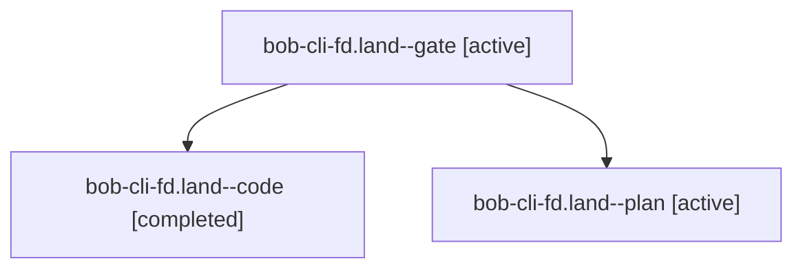

# Session: bob-cli-fd.land

[Agent Hoods](../README.md) / [bbugyi200](../users/bbugyi200/README.md) / [apollo](../users/bbugyi200/machines/apollo/README.md) / [bob-cli-fd](../users/bbugyi200/machines/apollo/hoods/bob-cli-fd/README.md) / bob-cli-fd.land

Owner: `bbugyi200.apollo` · Hood: `bob-cli-fd` · Members: 3 · Bead: [bob-cli-fd](https://github.com/bobs-org/bob-cli--beads/blob/main/pages/bob-cli-fd/README.md)

## Lineage



The diagram is an optional enhancement; the ordered table below contains the same lineage in accessible text.

| Role | Agent | State | Model / provider | Timing | Commits | Prompt | Chat |
|---|---|---|---|---|---:|---|---|
| <a id="member-gate"></a>gate | bob-cli-fd.land--gate | active | gpt-6-astra / codex | 2026-11-01T23:00:00.863083+00:00 | 0 | — | [Chat](../agents/bbugyi200.apollo.bob-cli-fd.land--gate/chat.md) |
| <a id="member-code"></a>code | bob-cli-fd.land--code | completed | muse-spark-1.3-contributor / muse | 2026-11-01T23:01:36.602037+00:00 → 2026-11-01T23:46:56.741817+00:00 | 0 | — | [Chat](../agents/bbugyi200.apollo.bob-cli-fd.land--code/chat.md) |
| <a id="member-plan"></a>plan | bob-cli-fd.land--plan | active | gpt-6-astra / codex | 2026-11-01T22:43:42.688901+00:00 | 0 | [Prompt](../agents/bbugyi200.apollo.bob-cli-fd.land--plan/prompt.md) | [Chat](../agents/bbugyi200.apollo.bob-cli-fd.land--plan/chat.md) |

## Variables

| Role | Variable | Value |
|---|---|---|
| plan | `artifacts` | \[{bead: bob-cli-fd, kind: file, label: bob-cli-fd landing: five pre-existing plugin test failures, path: /home/bryan/.sase/artifacts/agents/gh\_bobs-org\_\_bob-cli/20261101151348/fd-followup-check-3ab39… |

#### artifacts

**Role:** `plan`

```yaml
- bead: bob-cli-fd
  kind: file
  label: bob-cli-fd landing: five pre-existing plugin test failures
  path: /home/bryan/.sase/artifacts/agents/gh_bobs-org__bob-cli/20261101151348/fd-followup-check-3ab399cc98ba.log
  ref: file:explicit:844e735243fe4ec95a86291a
```

Values are truncated for display; see each member's agent meta.json for the full values.

## Neighbors

| Agent | Relation | State |
|---|---|---|
| [bob-cli-fd.1](../agents/bbugyi200.apollo.bob-cli-fd.1/README.md) | bob-cli-fd hood | active |
| [bob-cli-fd.2](../agents/bbugyi200.apollo.bob-cli-fd.2/README.md) | bob-cli-fd hood | active |
| [bob-cli-fd.3](../agents/bbugyi200.apollo.bob-cli-fd.3/README.md) | bob-cli-fd hood | active |
| [bob-cli-fd.4](../agents/bbugyi200.apollo.bob-cli-fd.4/README.md) | bob-cli-fd hood | active |
