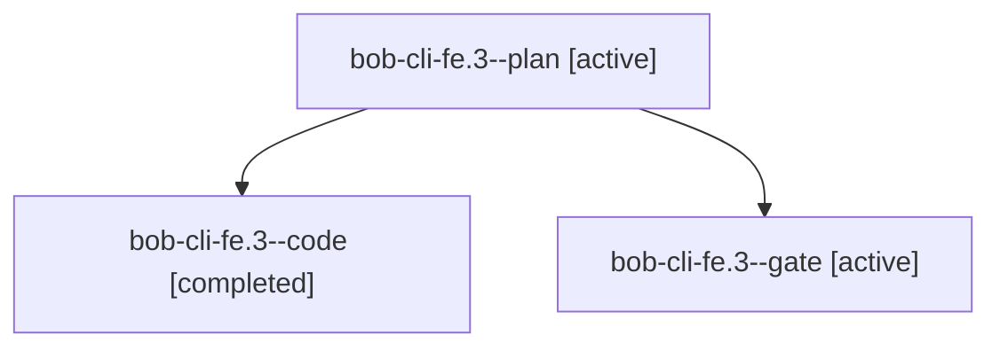

# Session: bob-cli-fe.3

[Agent Hoods](../README.md) / [bbugyi200](../users/bbugyi200/README.md) / [apollo](../users/bbugyi200/machines/apollo/README.md) / [bob-cli-fe](../users/bbugyi200/machines/apollo/hoods/bob-cli-fe/README.md) / bob-cli-fe.3

Owner: `bbugyi200.apollo` · Hood: `bob-cli-fe` · Members: 3 · Bead: [bob-cli-fe.3](https://github.com/bobs-org/bob-cli--beads/blob/main/pages/bob-cli-fe/bob-cli-fe.3.md)

## Lineage

The diagram is an optional enhancement; the ordered table below contains the same lineage in accessible text.

| Role | Agent | State | Model / provider | Timing | Commits | Prompt | Chat |
|---|---|---|---|---|---:|---|---|
| plan | bob-cli-fe.3--plan | active | gpt-6-astra / codex | 2026-11-01T23:12:46.506614+00:00 | 0 | [Prompt](../agents/bbugyi200.apollo.bob-cli-fe.3--plan/prompt.md) | [Chat](../agents/bbugyi200.apollo.bob-cli-fe.3--plan/chat.md) |
| code | bob-cli-fe.3--code | completed | muse-spark-1.3-contributor / muse | 2026-11-01T23:19:21.000181+00:00 → 2026-11-02T02:22:12.631902+00:00 | [1](../agents/bbugyi200.apollo.bob-cli-fe.3--code/README.md#commits) | — | [Chat](../agents/bbugyi200.apollo.bob-cli-fe.3--code/chat.md) |
| gate | bob-cli-fe.3--gate | active | gpt-6-astra / codex | 2026-11-01T23:18:28.768541+00:00 | 0 | — | [Chat](../agents/bbugyi200.apollo.bob-cli-fe.3--gate/chat.md) |

## Commits

| Role | Repo | Commit | Subject | Committed |
|---|---|---|---|---|
| code | bob-cli | [`971d864`](https://github.com/bobs-org/bob-cli/commit/971d864f6c8ca91ed78f01aca41c0f4d93643efa) | feat(capture): bullet drawer completion menu, docs, and memory records | 2026-11-01 20:54:25 EST |
| — | bob-cli | [`ccd1ada`](https://github.com/bobs-org/bob-cli/commit/ccd1ada109a634bf58b2261b5f3c0a2a84daa5ef) | feat(capture)!: add =/ split syntax end to end | 2026-11-01 21:20:36 EST |

## Neighbors

| Agent | Relation | State |
|---|---|---|
| [bob-cli-fe.1](../agents/bbugyi200.apollo.bob-cli-fe.1/README.md) | bob-cli-fe hood | active |
| [bob-cli-fe.10](../agents/bbugyi200.apollo.bob-cli-fe.10/README.md) | bob-cli-fe hood | active |
| [bob-cli-fe.2](../agents/bbugyi200.apollo.bob-cli-fe.2/README.md) | bob-cli-fe hood | active |
| [bob-cli-fe.4](../agents/bbugyi200.apollo.bob-cli-fe.4/README.md) | bob-cli-fe hood | active |
| [bob-cli-fe.5](../agents/bbugyi200.apollo.bob-cli-fe.5/README.md) | bob-cli-fe hood | active |
| [bob-cli-fe.6](bbugyi200.apollo.bob-cli-fe.6.md) (session · 17) | bob-cli-fe hood | active 17 |
| [bob-cli-fe.7](../agents/bbugyi200.apollo.bob-cli-fe.7/README.md) | bob-cli-fe hood | active |
| [bob-cli-fe.8](../agents/bbugyi200.apollo.bob-cli-fe.8/README.md) | bob-cli-fe hood | active |
| [bob-cli-fe.9](../agents/bbugyi200.apollo.bob-cli-fe.9/README.md) | bob-cli-fe hood | active |
| [bob-cli-fe.land](../agents/bbugyi200.apollo.bob-cli-fe.land/README.md) | bob-cli-fe hood | active |
