# Session: bob-cli-fe.6

[Agent Hoods](../README.md) / [bbugyi200](../users/bbugyi200/README.md) / [apollo](../users/bbugyi200/machines/apollo/README.md) / [bob-cli-fe](../users/bbugyi200/machines/apollo/hoods/bob-cli-fe/README.md) / bob-cli-fe.6

Owner: `bbugyi200.apollo` · Hood: `bob-cli-fe` · Members: 17 · Bead: [bob-cli-fe.6](https://github.com/bobs-org/bob-cli--beads/blob/main/pages/bob-cli-fe/bob-cli-fe.6.md)

## Lineage

```mermaid
flowchart TD
  n0["bob-cli-fe.6--7 [active]"]
  n1["bob-cli-fe.6--mon-1 [active]"]
  n0 --> n1
  n2["bob-cli-fe.6--1 [active]"]
  n0 --> n2
  n3["bob-cli-fe.6--4 [active]"]
  n0 --> n3
  n4["bob-cli-fe.6--mon-5 [active]"]
  n0 --> n4
  n5["bob-cli-fe.6--mon [active]"]
  n0 --> n5
  n6["bob-cli-fe.6--3 [active]"]
  n0 --> n6
  n7["bob-cli-fe.6--mon-0 [active]"]
  n0 --> n7
  n8["bob-cli-fe.6--6 [active]"]
  n0 --> n8
  n9["bob-cli-fe.6--mon-3 [active]"]
  n0 --> n9
  n10["bob-cli-fe.6--plan [active]"]
  n0 --> n10
  n11["bob-cli-fe.6--mon-2 [active]"]
  n0 --> n11
  n12["bob-cli-fe.6--5 [active]"]
  n0 --> n12
  n13["bob-cli-fe.6--8 [active]"]
  n0 --> n13
  n14["bob-cli-fe.6--mon-4 [active]"]
  n0 --> n14
  n15["bob-cli-fe.6--2 [active]"]
  n0 --> n15
  n16["bob-cli-fe.6--gate [active]"]
  n0 --> n16
```

The diagram is an optional enhancement; the ordered table below contains the same lineage in accessible text.

| Role | Agent | State | Model / provider | Timing | Commits | Prompt | Chat |
|---|---|---|---|---|---:|---|---|
| 7 | bob-cli-fe.6--7 | active | gpt-6-luna / codex | 2026-11-02T01:35:55.381660+00:00 | 0 | [Prompt](../agents/bbugyi200.apollo.bob-cli-fe.6--7/prompt.md) | [Chat](../agents/bbugyi200.apollo.bob-cli-fe.6--7/chat.md) |
| mon-1 | bob-cli-fe.6--mon-1 | active | gpt-6-luna / codex | 2026-11-02T00:18:46.251557+00:00 | 0 | — | — |
| 1 | bob-cli-fe.6--1 | active | gpt-6-luna / codex | 2026-11-01T23:47:54.751964+00:00 | 0 | [Prompt](../agents/bbugyi200.apollo.bob-cli-fe.6--1/prompt.md) | [Chat](../agents/bbugyi200.apollo.bob-cli-fe.6--1/chat.md) |
| 4 | bob-cli-fe.6--4 | active | gpt-6-luna / codex | 2026-11-02T00:42:42.298048+00:00 | 0 | [Prompt](../agents/bbugyi200.apollo.bob-cli-fe.6--4/prompt.md) | [Chat](../agents/bbugyi200.apollo.bob-cli-fe.6--4/chat.md) |
| mon-5 | bob-cli-fe.6--mon-5 | active | gpt-6-luna / codex | 2026-11-02T01:26:35.788017+00:00 | 0 | — | — |
| mon | bob-cli-fe.6--mon | active | gpt-6-luna / codex | 2026-11-01T23:19:05.228952+00:00 | 0 | — | — |
| 3 | bob-cli-fe.6--3 | active | gpt-6-luna / codex | 2026-11-02T00:27:37.116132+00:00 | 0 | [Prompt](../agents/bbugyi200.apollo.bob-cli-fe.6--3/prompt.md) | [Chat](../agents/bbugyi200.apollo.bob-cli-fe.6--3/chat.md) |
| mon-0 | bob-cli-fe.6--mon-0 | active | gpt-6-luna / codex | 2026-11-01T23:50:16.529356+00:00 | 0 | — | — |
| 6 | bob-cli-fe.6--6 | active | gpt-6-luna / codex | 2026-11-02T01:24:54.089459+00:00 | 0 | [Prompt](../agents/bbugyi200.apollo.bob-cli-fe.6--6/prompt.md) | [Chat](../agents/bbugyi200.apollo.bob-cli-fe.6--6/chat.md) |
| mon-3 | bob-cli-fe.6--mon-3 | active | gpt-6-luna / codex | 2026-11-02T00:48:26.766957+00:00 | 0 | — | — |
| plan | bob-cli-fe.6--plan | active | gpt-6-luna / codex | 2026-11-01T22:49:35.838759+00:00 | 0 | [Prompt](../agents/bbugyi200.apollo.bob-cli-fe.6--plan/prompt.md) | [Chat](../agents/bbugyi200.apollo.bob-cli-fe.6--plan/chat.md) |
| mon-2 | bob-cli-fe.6--mon-2 | active | gpt-6-luna / codex | 2026-11-02T00:32:13.631033+00:00 | 0 | — | — |
| 5 | bob-cli-fe.6--5 | active | gpt-6-luna / codex | 2026-11-02T00:59:05.064201+00:00 | 0 | [Prompt](../agents/bbugyi200.apollo.bob-cli-fe.6--5/prompt.md) | [Chat](../agents/bbugyi200.apollo.bob-cli-fe.6--5/chat.md) |
| 8 | bob-cli-fe.6--8 | active | gpt-6-luna / codex | 2026-11-02T10:50:31.054937+00:00 | 0 | [Prompt](../agents/bbugyi200.apollo.bob-cli-fe.6--8/prompt.md) | — |
| mon-4 | bob-cli-fe.6--mon-4 | active | gpt-6-luna / codex | 2026-11-02T01:09:02.862116+00:00 | 0 | — | — |
| 2 | bob-cli-fe.6--2 | active | gpt-6-luna / codex | 2026-11-02T00:16:47.381589+00:00 | 0 | [Prompt](../agents/bbugyi200.apollo.bob-cli-fe.6--2/prompt.md) | [Chat](../agents/bbugyi200.apollo.bob-cli-fe.6--2/chat.md) |
| gate | bob-cli-fe.6--gate | active | gpt-6-luna / codex | 2026-11-02T10:49:09.435005+00:00 | 0 | — | [Chat](../agents/bbugyi200.apollo.bob-cli-fe.6--gate/chat.md) |

## Neighbors

| Agent | Relation | State |
|---|---|---|
| [bob-cli-fe.1](../agents/bbugyi200.apollo.bob-cli-fe.1/README.md) | bob-cli-fe hood | active |
| [bob-cli-fe.10](../agents/bbugyi200.apollo.bob-cli-fe.10/README.md) | bob-cli-fe hood | active |
| [bob-cli-fe.2](../agents/bbugyi200.apollo.bob-cli-fe.2/README.md) | bob-cli-fe hood | active |
| [bob-cli-fe.3](bbugyi200.apollo.bob-cli-fe.3.md) (session · 3) | bob-cli-fe hood | active 2, completed 1 |
| [bob-cli-fe.4](../agents/bbugyi200.apollo.bob-cli-fe.4/README.md) | bob-cli-fe hood | active |
| [bob-cli-fe.5](../agents/bbugyi200.apollo.bob-cli-fe.5/README.md) | bob-cli-fe hood | active |
| [bob-cli-fe.7](../agents/bbugyi200.apollo.bob-cli-fe.7/README.md) | bob-cli-fe hood | active |
| [bob-cli-fe.8](../agents/bbugyi200.apollo.bob-cli-fe.8/README.md) | bob-cli-fe hood | active |
| [bob-cli-fe.9](../agents/bbugyi200.apollo.bob-cli-fe.9/README.md) | bob-cli-fe hood | active |
| [bob-cli-fe.land](../agents/bbugyi200.apollo.bob-cli-fe.land/README.md) | bob-cli-fe hood | active |
