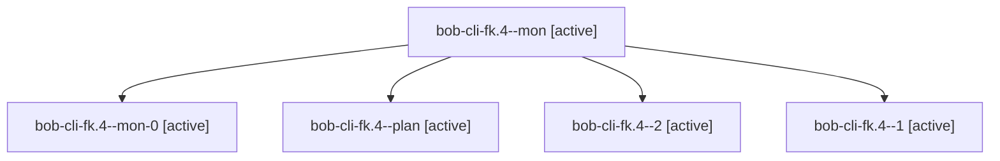

# Session: bob-cli-fk.4

[Agent Hoods](../README.md) / [bbugyi200](../users/bbugyi200/README.md) / [apollo](../users/bbugyi200/machines/apollo/README.md) / [bob-cli-fk](../users/bbugyi200/machines/apollo/hoods/bob-cli-fk/README.md) / bob-cli-fk.4

Owner: `bbugyi200.apollo` · Hood: `bob-cli-fk` · Members: 5 · Bead: [bob-cli-fk.4](https://github.com/bobs-org/bob-cli--beads/blob/main/pages/bob-cli-fk/bob-cli-fk.4.md)

## Lineage

The diagram is an optional enhancement; the ordered table below contains the same lineage in accessible text.

| Role | Agent | State | Model / provider | Timing | Commits | Prompt | Chat |
|---|---|---|---|---|---:|---|---|
| mon | bob-cli-fk.4--mon | active | gpt-6-luna / codex | 2026-11-02T03:56:31.356641+00:00 | 0 | — | — |
| mon-0 | bob-cli-fk.4--mon-0 | active | gpt-6-luna / codex | 2026-11-02T04:17:54.804681+00:00 | 0 | — | — |
| plan | bob-cli-fk.4--plan | active | gpt-6-luna / codex | 2026-11-02T03:42:13.348379+00:00 | 0 | [Prompt](../agents/bbugyi200.apollo.bob-cli-fk.4--plan/prompt.md) | [Chat](../agents/bbugyi200.apollo.bob-cli-fk.4--plan/chat.md) |
| 2 | bob-cli-fk.4--2 | active | gpt-6-luna / codex | 2026-11-02T04:35:53.114782+00:00 | [1](../agents/bbugyi200.apollo.bob-cli-fk.4--2/README.md#commits) | [Prompt](../agents/bbugyi200.apollo.bob-cli-fk.4--2/prompt.md) | — |
| 1 | bob-cli-fk.4--1 | active | gpt-6-luna / codex | 2026-11-02T04:11:11.794502+00:00 | 0 | [Prompt](../agents/bbugyi200.apollo.bob-cli-fk.4--1/prompt.md) | [Chat](../agents/bbugyi200.apollo.bob-cli-fk.4--1/chat.md) |

## Commits

| Role | Repo | Commit | Subject | Committed |
|---|---|---|---|---|
| 2 | bob-cli | [`1b796cd`](https://github.com/bobs-org/bob-cli/commit/1b796cd7af05917ee9b8dcdee1f3b10693d779ca) | feat(capture): expose buffered calendar event agenda | 2026-11-01 23:44:52 EST |

## Neighbors

| Agent | Relation | State |
|---|---|---|
| [bob-cli-fk.1](../agents/bbugyi200.apollo.bob-cli-fk.1/README.md) | bob-cli-fk hood | active |
| [bob-cli-fk.2](../agents/bbugyi200.apollo.bob-cli-fk.2/README.md) | bob-cli-fk hood | active |
| [bob-cli-fk.3](../agents/bbugyi200.apollo.bob-cli-fk.3/README.md) | bob-cli-fk hood | active |
| [bob-cli-fk.5](../agents/bbugyi200.apollo.bob-cli-fk.5/README.md) | bob-cli-fk hood | active |
| [bob-cli-fk.6](../agents/bbugyi200.apollo.bob-cli-fk.6/README.md) | bob-cli-fk hood | active |
| [bob-cli-fk.land](bbugyi200.apollo.bob-cli-fk.land.md) (session · 5) | bob-cli-fk hood | active 3, completed 2 |
