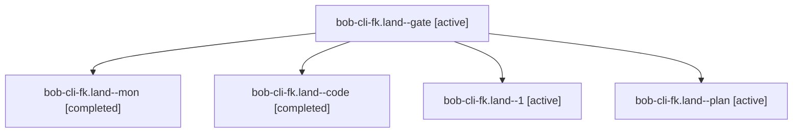

# Session: bob-cli-fk.land

[Agent Hoods](../README.md) / [bbugyi200](../users/bbugyi200/README.md) / [apollo](../users/bbugyi200/machines/apollo/README.md) / [bob-cli-fk](../users/bbugyi200/machines/apollo/hoods/bob-cli-fk/README.md) / bob-cli-fk.land

Owner: `bbugyi200.apollo` · Hood: `bob-cli-fk` · Members: 5 · Bead: [bob-cli-fk](https://github.com/bobs-org/bob-cli--beads/blob/main/pages/bob-cli-fk/README.md)

## Lineage

The diagram is an optional enhancement; the ordered table below contains the same lineage in accessible text.

| Role | Agent | State | Model / provider | Timing | Commits | Prompt | Chat |
|---|---|---|---|---|---:|---|---|
| gate | bob-cli-fk.land--gate | active | opus / claude | 2026-11-02T05:50:35.276882+00:00 | 0 | — | [Chat](../agents/bbugyi200.apollo.bob-cli-fk.land--gate/chat.md) |
| mon | bob-cli-fk.land--mon | completed | gpt-6-luna / codex | 2026-11-02T05:53:41.354975+00:00 → 2026-11-02T06:05:42.447560+00:00 | 0 | — | [Chat](../agents/bbugyi200.apollo.bob-cli-fk.land--mon/chat.md) |
| code | bob-cli-fk.land--code | completed | gpt-6-luna / codex | 2026-11-02T05:51:11.780710+00:00 → 2026-11-02T05:53:57.221248+00:00 | 0 | — | [Chat](../agents/bbugyi200.apollo.bob-cli-fk.land--code/chat.md) |
| 1 | bob-cli-fk.land--1 | active | gpt-6-luna / codex | 2026-11-02T06:06:00.671837+00:00 | [1](../agents/bbugyi200.apollo.bob-cli-fk.land--1/README.md#commits) | [Prompt](../agents/bbugyi200.apollo.bob-cli-fk.land--1/prompt.md) | — |
| plan | bob-cli-fk.land--plan | active | opus / claude | 2026-11-02T05:16:07.282054+00:00 | 0 | [Prompt](../agents/bbugyi200.apollo.bob-cli-fk.land--plan/prompt.md) | [Chat](../agents/bbugyi200.apollo.bob-cli-fk.land--plan/chat.md) |

## Commits

| Role | Repo | Commit | Subject | Committed |
|---|---|---|---|---|
| 1 | bob-cli | [`2d5ebfc`](https://github.com/bobs-org/bob-cli/commit/2d5ebfc9ba31f28acaba2ed4b8d1422908b14252) | fix(gcal): finish event buffer epic closeout | 2026-11-02 01:32:24 EST |

## Neighbors

| Agent | Relation | State |
|---|---|---|
| [bob-cli-fk.1](../agents/bbugyi200.apollo.bob-cli-fk.1/README.md) | bob-cli-fk hood | active |
| [bob-cli-fk.2](../agents/bbugyi200.apollo.bob-cli-fk.2/README.md) | bob-cli-fk hood | active |
| [bob-cli-fk.3](../agents/bbugyi200.apollo.bob-cli-fk.3/README.md) | bob-cli-fk hood | active |
| [bob-cli-fk.4](bbugyi200.apollo.bob-cli-fk.4.md) (session · 5) | bob-cli-fk hood | active 5 |
| [bob-cli-fk.5](../agents/bbugyi200.apollo.bob-cli-fk.5/README.md) | bob-cli-fk hood | active |
| [bob-cli-fk.6](../agents/bbugyi200.apollo.bob-cli-fk.6/README.md) | bob-cli-fk hood | active |
