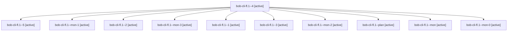

# Session: bob-cli-fl.1

[Agent Hoods](../README.md) / [bbugyi200](../users/bbugyi200/README.md) / [apollo](../users/bbugyi200/machines/apollo/README.md) / [bob-cli-fl](../users/bbugyi200/machines/apollo/hoods/bob-cli-fl/README.md) / bob-cli-fl.1

Owner: `bbugyi200.apollo` · Hood: `bob-cli-fl` · Members: 11 · Bead: [bob-cli-fl.1](https://github.com/bobs-org/bob-cli--beads/blob/main/pages/bob-cli-fl/bob-cli-fl.1.md)

## Lineage

The diagram is an optional enhancement; the ordered table below contains the same lineage in accessible text.

| Role | Agent | State | Model / provider | Timing | Commits | Prompt | Chat |
|---|---|---|---|---|---:|---|---|
| 4 | bob-cli-fl.1--4 | active | gpt-6-luna / codex | 2026-11-02T04:38:24.961493+00:00 | 0 | [Prompt](../agents/bbugyi200.apollo.bob-cli-fl.1--4/prompt.md) | [Chat](../agents/bbugyi200.apollo.bob-cli-fl.1--4/chat.md) |
| 5 | bob-cli-fl.1--5 | active | gpt-6-luna / codex | 2026-11-02T04:54:53.222440+00:00 | [1](../agents/bbugyi200.apollo.bob-cli-fl.1--5/README.md#commits) | [Prompt](../agents/bbugyi200.apollo.bob-cli-fl.1--5/prompt.md) | — |
| mon-1 | bob-cli-fl.1--mon-1 | active | gpt-6-luna / codex | 2026-11-02T04:09:24.633458+00:00 | 0 | — | — |
| 2 | bob-cli-fl.1--2 | active | gpt-6-luna / codex | 2026-11-02T04:04:13.202717+00:00 | 0 | [Prompt](../agents/bbugyi200.apollo.bob-cli-fl.1--2/prompt.md) | [Chat](../agents/bbugyi200.apollo.bob-cli-fl.1--2/chat.md) |
| mon-3 | bob-cli-fl.1--mon-3 | active | gpt-6-luna / codex | 2026-11-02T04:41:25.380771+00:00 | 0 | — | — |
| 1 | bob-cli-fl.1--1 | active | gpt-6-luna / codex | 2026-11-02T03:35:20.983895+00:00 | 0 | [Prompt](../agents/bbugyi200.apollo.bob-cli-fl.1--1/prompt.md) | [Chat](../agents/bbugyi200.apollo.bob-cli-fl.1--1/chat.md) |
| 3 | bob-cli-fl.1--3 | active | gpt-6-luna / codex | 2026-11-02T04:28:36.109682+00:00 | 0 | [Prompt](../agents/bbugyi200.apollo.bob-cli-fl.1--3/prompt.md) | [Chat](../agents/bbugyi200.apollo.bob-cli-fl.1--3/chat.md) |
| mon-2 | bob-cli-fl.1--mon-2 | active | gpt-6-luna / codex | 2026-11-02T04:30:22.935715+00:00 | 0 | — | — |
| plan | bob-cli-fl.1--plan | active | gpt-6-luna / codex | 2026-11-02T02:47:51.022566+00:00 | 0 | [Prompt](../agents/bbugyi200.apollo.bob-cli-fl.1--plan/prompt.md) | [Chat](../agents/bbugyi200.apollo.bob-cli-fl.1--plan/chat.md) |
| mon | bob-cli-fl.1--mon | active | gpt-6-luna / codex | 2026-11-02T03:31:09.498963+00:00 | 0 | — | — |
| mon-0 | bob-cli-fl.1--mon-0 | active | gpt-6-luna / codex | 2026-11-02T03:40:02.346794+00:00 | 0 | — | — |

## Commits

| Role | Repo | Commit | Subject | Committed |
|---|---|---|---|---|
| 5 | bob-cli | [`8a9ec68`](https://github.com/bobs-org/bob-cli/commit/8a9ec685ed9c727a0d7338c9c7072b7e285c975e) | feat(off-clock): add off-clock Pomodoro ledger support | 2026-11-02 01:10:48 EST |

## Neighbors

| Agent | Relation | State |
|---|---|---|
| [bob-cli-fl.2](bbugyi200.apollo.bob-cli-fl.2.md) (session · 5) | bob-cli-fl hood | active 5 |
| [bob-cli-fl.3](bbugyi200.apollo.bob-cli-fl.3.md) (session · 3) | bob-cli-fl hood | active 3 |
| [bob-cli-fl.3.1.1](../agents/bbugyi200.apollo.bob-cli-fl.3.1.1/README.md) | bob-cli-fl hood | active |
| [bob-cli-fl.3.1.2](../agents/bbugyi200.apollo.bob-cli-fl.3.1.2/README.md) | bob-cli-fl hood | active |
| [bob-cli-fl.3.1.3](../agents/bbugyi200.apollo.bob-cli-fl.3.1.3/README.md) | bob-cli-fl hood | active |
| [bob-cli-fl.3.1.land](bbugyi200.apollo.bob-cli-fl.3.1.land.md) (session · 3) | bob-cli-fl hood | active 2, completed 1 |
| [bob-cli-fl.4](../agents/bbugyi200.apollo.bob-cli-fl.4/README.md) | bob-cli-fl hood | active |
| [bob-cli-fl.5](../agents/bbugyi200.apollo.bob-cli-fl.5/README.md) | bob-cli-fl hood | active |
| [bob-cli-fl.6](bbugyi200.apollo.bob-cli-fl.6.md) (session · 3) | bob-cli-fl hood | active 3 |
| [bob-cli-fl.6.1.1](../agents/bbugyi200.apollo.bob-cli-fl.6.1.1/README.md) | bob-cli-fl hood | active |
| [bob-cli-fl.6.1.2](../agents/bbugyi200.apollo.bob-cli-fl.6.1.2/README.md) | bob-cli-fl hood | active |
| [bob-cli-fl.6.1.3](../agents/bbugyi200.apollo.bob-cli-fl.6.1.3/README.md) | bob-cli-fl hood | active |
| [bob-cli-fl.6.1.4](../agents/bbugyi200.apollo.bob-cli-fl.6.1.4/README.md) | bob-cli-fl hood | active |
| [bob-cli-fl.6.1.5](bbugyi200.apollo.bob-cli-fl.6.1.5.md) (session · 3) | bob-cli-fl hood | active 3 |
| [bob-cli-fl.6.1.land](bbugyi200.apollo.bob-cli-fl.6.1.land.md) (session · 3) | bob-cli-fl hood | active 2, completed 1 |
| [bob-cli-fl.7](bbugyi200.apollo.bob-cli-fl.7.md) (session · 7) | bob-cli-fl hood | active 7 |
| [bob-cli-fl.land](bbugyi200.apollo.bob-cli-fl.land.md) (session · 39) | bob-cli-fl hood | active 19, completed 15, failed 5 |
