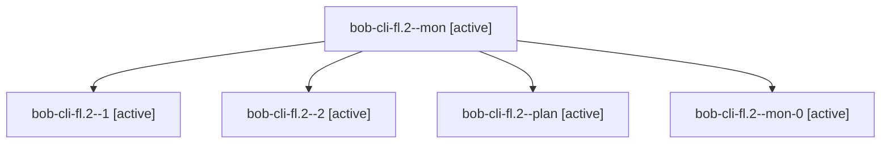

# Session: bob-cli-fl.2

[Agent Hoods](../README.md) / [bbugyi200](../users/bbugyi200/README.md) / [apollo](../users/bbugyi200/machines/apollo/README.md) / [bob-cli-fl](../users/bbugyi200/machines/apollo/hoods/bob-cli-fl/README.md) / bob-cli-fl.2

Owner: `bbugyi200.apollo` · Hood: `bob-cli-fl` · Members: 5 · Bead: [bob-cli-fl.2](https://github.com/bobs-org/bob-cli--beads/blob/main/pages/bob-cli-fl/bob-cli-fl.2.md)

## Lineage

The diagram is an optional enhancement; the ordered table below contains the same lineage in accessible text.

| Role | Agent | State | Model / provider | Timing | Commits | Prompt | Chat |
|---|---|---|---|---|---:|---|---|
| mon | bob-cli-fl.2--mon | active | grok-4.6 / grok | 2026-11-02T06:58:47.729559+00:00 | 0 | — | — |
| 1 | bob-cli-fl.2--1 | active | grok-4.6 / grok | 2026-11-02T07:09:33.577826+00:00 | 0 | [Prompt](../agents/bbugyi200.apollo.bob-cli-fl.2--1/prompt.md) | [Chat](../agents/bbugyi200.apollo.bob-cli-fl.2--1/chat.md) |
| 2 | bob-cli-fl.2--2 | active | grok-4.6 / grok | 2026-11-02T07:31:55.226989+00:00 | [1](../agents/bbugyi200.apollo.bob-cli-fl.2--2/README.md#commits) | [Prompt](../agents/bbugyi200.apollo.bob-cli-fl.2--2/prompt.md) | — |
| plan | bob-cli-fl.2--plan | active | grok-4.6 / grok | 2026-11-02T06:14:28.492540+00:00 | 0 | [Prompt](../agents/bbugyi200.apollo.bob-cli-fl.2--plan/prompt.md) | [Chat](../agents/bbugyi200.apollo.bob-cli-fl.2--plan/chat.md) |
| mon-0 | bob-cli-fl.2--mon-0 | active | grok-4.6 / grok | 2026-11-02T07:20:55.341232+00:00 | 0 | — | — |

## Commits

| Role | Repo | Commit | Subject | Committed |
|---|---|---|---|---|
| 2 | bob-cli | [`71a65da`](https://github.com/bobs-org/bob-cli/commit/71a65dad49413ba3662098834f01fbecda70fdd9) | feat(capture): stamp session clock from counted Task Links | 2026-11-02 02:51:13 EST |

## Neighbors

| Agent | Relation | State |
|---|---|---|
| [bob-cli-fl.1](bbugyi200.apollo.bob-cli-fl.1.md) (session · 11) | bob-cli-fl hood | active 11 |
| [bob-cli-fl.3](bbugyi200.apollo.bob-cli-fl.3.md) (session · 3) | bob-cli-fl hood | active 3 |
| [bob-cli-fl.3.1.1](../agents/bbugyi200.apollo.bob-cli-fl.3.1.1/README.md) | bob-cli-fl hood | active |
| [bob-cli-fl.3.1.2](../agents/bbugyi200.apollo.bob-cli-fl.3.1.2/README.md) | bob-cli-fl hood | active |
| [bob-cli-fl.3.1.3](../agents/bbugyi200.apollo.bob-cli-fl.3.1.3/README.md) | bob-cli-fl hood | active |
| [bob-cli-fl.3.1.land](bbugyi200.apollo.bob-cli-fl.3.1.land.md) (session · 3) | bob-cli-fl hood | active 2, completed 1 |
| [bob-cli-fl.4](../agents/bbugyi200.apollo.bob-cli-fl.4/README.md) | bob-cli-fl hood | active |
| [bob-cli-fl.5](../agents/bbugyi200.apollo.bob-cli-fl.5/README.md) | bob-cli-fl hood | active |
| [bob-cli-fl.6](bbugyi200.apollo.bob-cli-fl.6.md) (session · 3) | bob-cli-fl hood | active 3 |
| [bob-cli-fl.6.1.1](../agents/bbugyi200.apollo.bob-cli-fl.6.1.1/README.md) | bob-cli-fl hood | active |
| [bob-cli-fl.6.1.2](../agents/bbugyi200.apollo.bob-cli-fl.6.1.2/README.md) | bob-cli-fl hood | active |
| [bob-cli-fl.6.1.3](../agents/bbugyi200.apollo.bob-cli-fl.6.1.3/README.md) | bob-cli-fl hood | active |
| [bob-cli-fl.6.1.4](../agents/bbugyi200.apollo.bob-cli-fl.6.1.4/README.md) | bob-cli-fl hood | active |
| [bob-cli-fl.6.1.5](bbugyi200.apollo.bob-cli-fl.6.1.5.md) (session · 3) | bob-cli-fl hood | active 3 |
| [bob-cli-fl.6.1.land](bbugyi200.apollo.bob-cli-fl.6.1.land.md) (session · 3) | bob-cli-fl hood | active 2, completed 1 |
| [bob-cli-fl.7](bbugyi200.apollo.bob-cli-fl.7.md) (session · 7) | bob-cli-fl hood | active 7 |
| [bob-cli-fl.land](bbugyi200.apollo.bob-cli-fl.land.md) (session · 39) | bob-cli-fl hood | active 19, completed 15, failed 5 |
