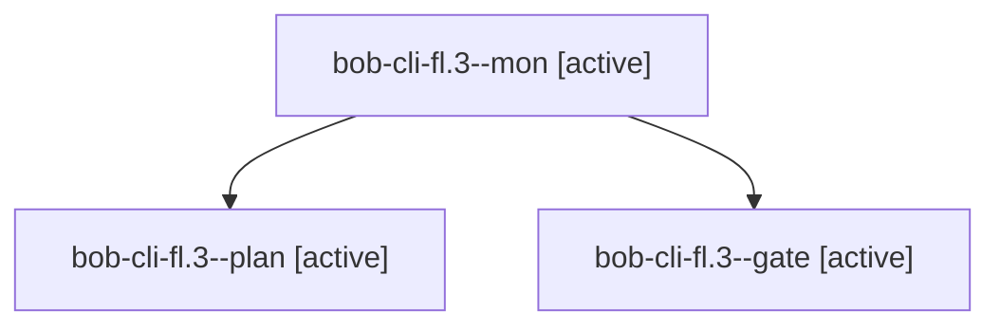

# Session: bob-cli-fl.3

[Agent Hoods](../README.md) / [bbugyi200](../users/bbugyi200/README.md) / [apollo](../users/bbugyi200/machines/apollo/README.md) / [bob-cli-fl](../users/bbugyi200/machines/apollo/hoods/bob-cli-fl/README.md) / bob-cli-fl.3

Owner: `bbugyi200.apollo` · Hood: `bob-cli-fl` · Members: 3 · Bead: [bob-cli-fl.3](https://github.com/bobs-org/bob-cli--beads/blob/main/pages/bob-cli-fl/bob-cli-fl.3.md)

## Lineage

The diagram is an optional enhancement; the ordered table below contains the same lineage in accessible text.

| Role | Agent | State | Model / provider | Timing | Commits | Prompt | Chat |
|---|---|---|---|---|---:|---|---|
| mon | bob-cli-fl.3--mon | active | gpt-6-astra / codex | 2026-11-02T06:23:46.400298+00:00 | 0 | — | — |
| plan | bob-cli-fl.3--plan | active | gpt-6-astra / codex | 2026-11-02T06:14:31.737114+00:00 | 0 | [Prompt](../agents/bbugyi200.apollo.bob-cli-fl.3--plan/prompt.md) | [Chat](../agents/bbugyi200.apollo.bob-cli-fl.3--plan/chat.md) |
| gate | bob-cli-fl.3--gate | active | gpt-6-astra / codex | 2026-11-02T06:23:28.924616+00:00 | 0 | — | [Chat](../agents/bbugyi200.apollo.bob-cli-fl.3--gate/chat.md) |

## Neighbors

| Agent | Relation | State |
|---|---|---|
| [bob-cli-fl.3.1.1](../agents/bbugyi200.apollo.bob-cli-fl.3.1.1/README.md) | descendant | active |
| [bob-cli-fl.3.1.2](../agents/bbugyi200.apollo.bob-cli-fl.3.1.2/README.md) | descendant | active |
| [bob-cli-fl.3.1.3](../agents/bbugyi200.apollo.bob-cli-fl.3.1.3/README.md) | descendant | active |
| [bob-cli-fl.3.1.land](bbugyi200.apollo.bob-cli-fl.3.1.land.md) (session · 3) | descendant | active 2, completed 1 |
| [bob-cli-fl.1](bbugyi200.apollo.bob-cli-fl.1.md) (session · 11) | bob-cli-fl hood | active 11 |
| [bob-cli-fl.2](bbugyi200.apollo.bob-cli-fl.2.md) (session · 5) | bob-cli-fl hood | active 5 |
| [bob-cli-fl.4](../agents/bbugyi200.apollo.bob-cli-fl.4/README.md) | bob-cli-fl hood | active |
| [bob-cli-fl.5](../agents/bbugyi200.apollo.bob-cli-fl.5/README.md) | bob-cli-fl hood | active |
| [bob-cli-fl.6](bbugyi200.apollo.bob-cli-fl.6.md) (session · 3) | bob-cli-fl hood | active 3 |
| [bob-cli-fl.6.1.1](../agents/bbugyi200.apollo.bob-cli-fl.6.1.1/README.md) | bob-cli-fl hood | active |
| [bob-cli-fl.6.1.2](../agents/bbugyi200.apollo.bob-cli-fl.6.1.2/README.md) | bob-cli-fl hood | active |
| [bob-cli-fl.6.1.3](../agents/bbugyi200.apollo.bob-cli-fl.6.1.3/README.md) | bob-cli-fl hood | active |
| [bob-cli-fl.6.1.4](../agents/bbugyi200.apollo.bob-cli-fl.6.1.4/README.md) | bob-cli-fl hood | active |
| [bob-cli-fl.6.1.5](bbugyi200.apollo.bob-cli-fl.6.1.5.md) (session · 3) | bob-cli-fl hood | active 3 |
| [bob-cli-fl.6.1.land](bbugyi200.apollo.bob-cli-fl.6.1.land.md) (session · 3) | bob-cli-fl hood | active 2, completed 1 |
| [bob-cli-fl.7](bbugyi200.apollo.bob-cli-fl.7.md) (session · 7) | bob-cli-fl hood | active 7 |
| [bob-cli-fl.land](bbugyi200.apollo.bob-cli-fl.land.md) (session · 39) | bob-cli-fl hood | active 19, completed 15, failed 5 |
