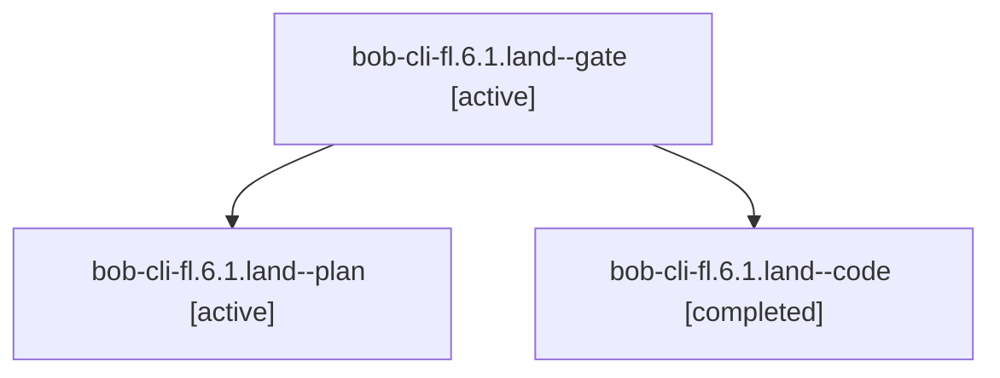

# Session: bob-cli-fl.6.1.land

[Agent Hoods](../README.md) / [bbugyi200](../users/bbugyi200/README.md) / [apollo](../users/bbugyi200/machines/apollo/README.md) / [bob-cli-fl](../users/bbugyi200/machines/apollo/hoods/bob-cli-fl/README.md) / bob-cli-fl.6.1.land

Owner: `bbugyi200.apollo` · Hood: `bob-cli-fl` · Members: 3 · Bead: [bob-cli-fl.6.1](https://github.com/bobs-org/bob-cli--beads/blob/main/pages/bob-cli-fl/bob-cli-fl.6.1.md)

## Lineage

The diagram is an optional enhancement; the ordered table below contains the same lineage in accessible text.

| Role | Agent | State | Model / provider | Timing | Commits | Prompt | Chat |
|---|---|---|---|---|---:|---|---|
| gate | bob-cli-fl.6.1.land--gate | active | opus / claude | 2026-11-02T17:12:21.662164+00:00 | 0 | — | [Chat](../agents/bbugyi200.apollo.bob-cli-fl.6.1.land--gate/chat.md) |
| plan | bob-cli-fl.6.1.land--plan | active | opus / claude | 2026-11-02T15:53:28.425946+00:00 | 0 | [Prompt](../agents/bbugyi200.apollo.bob-cli-fl.6.1.land--plan/prompt.md) | [Chat](../agents/bbugyi200.apollo.bob-cli-fl.6.1.land--plan/chat.md) |
| code | bob-cli-fl.6.1.land--code | completed | muse-spark-1.3-contributor / muse | 2026-11-02T17:12:49.913969+00:00 → 2026-11-02T17:50:07.415384+00:00 | [1](../agents/bbugyi200.apollo.bob-cli-fl.6.1.land--code/README.md#commits) | — | [Chat](../agents/bbugyi200.apollo.bob-cli-fl.6.1.land--code/chat.md) |

## Commits

| Role | Repo | Commit | Subject | Committed |
|---|---|---|---|---|
| code | bob-cli | [`99fe1ce`](https://github.com/bobs-org/bob-cli/commit/99fe1ce49a73154a49ffb904e4856a99ce708c79) | docs(stats): finish clock user docs for Obsidian Stats block and window bars | 2026-11-02 12:47:44 EST |

## Neighbors

| Agent | Relation | State |
|---|---|---|
| [bob-cli-fl.6](bbugyi200.apollo.bob-cli-fl.6.md) (session · 3) | ancestor | active 3 |
| [bob-cli-fl.6.1.1](../agents/bbugyi200.apollo.bob-cli-fl.6.1.1/README.md) | bob-cli-fl.6.1 hood | active |
| [bob-cli-fl.6.1.2](../agents/bbugyi200.apollo.bob-cli-fl.6.1.2/README.md) | bob-cli-fl.6.1 hood | active |
| [bob-cli-fl.6.1.3](../agents/bbugyi200.apollo.bob-cli-fl.6.1.3/README.md) | bob-cli-fl.6.1 hood | active |
| [bob-cli-fl.6.1.4](../agents/bbugyi200.apollo.bob-cli-fl.6.1.4/README.md) | bob-cli-fl.6.1 hood | active |
| [bob-cli-fl.6.1.5](bbugyi200.apollo.bob-cli-fl.6.1.5.md) (session · 3) | bob-cli-fl.6.1 hood | active 3 |
| [bob-cli-fl.1](bbugyi200.apollo.bob-cli-fl.1.md) (session · 11) | bob-cli-fl hood | active 11 |
| [bob-cli-fl.2](bbugyi200.apollo.bob-cli-fl.2.md) (session · 5) | bob-cli-fl hood | active 5 |
| [bob-cli-fl.3](bbugyi200.apollo.bob-cli-fl.3.md) (session · 3) | bob-cli-fl hood | active 3 |
| [bob-cli-fl.3.1.1](../agents/bbugyi200.apollo.bob-cli-fl.3.1.1/README.md) | bob-cli-fl hood | active |
| [bob-cli-fl.3.1.2](../agents/bbugyi200.apollo.bob-cli-fl.3.1.2/README.md) | bob-cli-fl hood | active |
| [bob-cli-fl.3.1.3](../agents/bbugyi200.apollo.bob-cli-fl.3.1.3/README.md) | bob-cli-fl hood | active |
| [bob-cli-fl.3.1.land](bbugyi200.apollo.bob-cli-fl.3.1.land.md) (session · 3) | bob-cli-fl hood | active 2, completed 1 |
| [bob-cli-fl.4](../agents/bbugyi200.apollo.bob-cli-fl.4/README.md) | bob-cli-fl hood | active |
| [bob-cli-fl.5](../agents/bbugyi200.apollo.bob-cli-fl.5/README.md) | bob-cli-fl hood | active |
| [bob-cli-fl.7](bbugyi200.apollo.bob-cli-fl.7.md) (session · 7) | bob-cli-fl hood | active 7 |
| [bob-cli-fl.land](bbugyi200.apollo.bob-cli-fl.land.md) (session · 39) | bob-cli-fl hood | active 19, completed 15, failed 5 |
