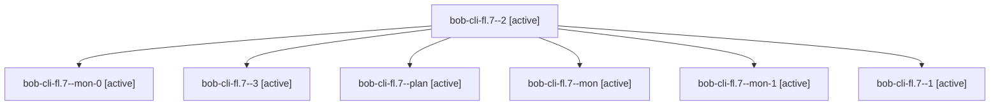

# Session: bob-cli-fl.7

[Agent Hoods](../README.md) / [bbugyi200](../users/bbugyi200/README.md) / [apollo](../users/bbugyi200/machines/apollo/README.md) / [bob-cli-fl](../users/bbugyi200/machines/apollo/hoods/bob-cli-fl/README.md) / bob-cli-fl.7

Owner: `bbugyi200.apollo` · Hood: `bob-cli-fl` · Members: 7 · Bead: [bob-cli-fl.7](https://github.com/bobs-org/bob-cli--beads/blob/main/pages/bob-cli-fl/bob-cli-fl.7.md)

## Lineage

The diagram is an optional enhancement; the ordered table below contains the same lineage in accessible text.

| Role | Agent | State | Model / provider | Timing | Commits | Prompt | Chat |
|---|---|---|---|---|---:|---|---|
| 2 | bob-cli-fl.7--2 | active | gpt-6-luna / codex | 2026-11-02T08:15:27.763529+00:00 | 0 | [Prompt](../agents/bbugyi200.apollo.bob-cli-fl.7--2/prompt.md) | [Chat](../agents/bbugyi200.apollo.bob-cli-fl.7--2/chat.md) |
| mon-0 | bob-cli-fl.7--mon-0 | active | gpt-6-luna / codex | 2026-11-02T08:13:56.497150+00:00 | 0 | — | — |
| 3 | bob-cli-fl.7--3 | active | gpt-6-luna / codex | 2026-11-02T08:21:30.948908+00:00 | 0 | [Prompt](../agents/bbugyi200.apollo.bob-cli-fl.7--3/prompt.md) | — |
| plan | bob-cli-fl.7--plan | active | gpt-6-luna / codex | 2026-11-02T07:51:57.958946+00:00 | 0 | [Prompt](../agents/bbugyi200.apollo.bob-cli-fl.7--plan/prompt.md) | [Chat](../agents/bbugyi200.apollo.bob-cli-fl.7--plan/chat.md) |
| mon | bob-cli-fl.7--mon | active | gpt-6-luna / codex | 2026-11-02T08:09:29.617437+00:00 | 0 | — | — |
| mon-1 | bob-cli-fl.7--mon-1 | active | gpt-6-luna / codex | 2026-11-02T08:17:57.788617+00:00 | 0 | — | — |
| 1 | bob-cli-fl.7--1 | active | gpt-6-luna / codex | 2026-11-02T08:11:29.978214+00:00 | 0 | [Prompt](../agents/bbugyi200.apollo.bob-cli-fl.7--1/prompt.md) | [Chat](../agents/bbugyi200.apollo.bob-cli-fl.7--1/chat.md) |

## Neighbors

| Agent | Relation | State |
|---|---|---|
| [bob-cli-fl.1](bbugyi200.apollo.bob-cli-fl.1.md) (session · 11) | bob-cli-fl hood | active 11 |
| [bob-cli-fl.2](bbugyi200.apollo.bob-cli-fl.2.md) (session · 5) | bob-cli-fl hood | active 5 |
| [bob-cli-fl.3](bbugyi200.apollo.bob-cli-fl.3.md) (session · 3) | bob-cli-fl hood | active 3 |
| [bob-cli-fl.3.1.1](../agents/bbugyi200.apollo.bob-cli-fl.3.1.1/README.md) | bob-cli-fl hood | active |
| [bob-cli-fl.3.1.2](../agents/bbugyi200.apollo.bob-cli-fl.3.1.2/README.md) | bob-cli-fl hood | active |
| [bob-cli-fl.3.1.3](../agents/bbugyi200.apollo.bob-cli-fl.3.1.3/README.md) | bob-cli-fl hood | active |
| [bob-cli-fl.3.1.land](bbugyi200.apollo.bob-cli-fl.3.1.land.md) (session · 3) | bob-cli-fl hood | active 2, completed 1 |
| [bob-cli-fl.4](../agents/bbugyi200.apollo.bob-cli-fl.4/README.md) | bob-cli-fl hood | active |
| [bob-cli-fl.5](../agents/bbugyi200.apollo.bob-cli-fl.5/README.md) | bob-cli-fl hood | active |
| [bob-cli-fl.6](bbugyi200.apollo.bob-cli-fl.6.md) (session · 3) | bob-cli-fl hood | active 3 |
| [bob-cli-fl.6.1.1](../agents/bbugyi200.apollo.bob-cli-fl.6.1.1/README.md) | bob-cli-fl hood | active |
| [bob-cli-fl.6.1.2](../agents/bbugyi200.apollo.bob-cli-fl.6.1.2/README.md) | bob-cli-fl hood | active |
| [bob-cli-fl.6.1.3](../agents/bbugyi200.apollo.bob-cli-fl.6.1.3/README.md) | bob-cli-fl hood | active |
| [bob-cli-fl.6.1.4](../agents/bbugyi200.apollo.bob-cli-fl.6.1.4/README.md) | bob-cli-fl hood | active |
| [bob-cli-fl.6.1.5](bbugyi200.apollo.bob-cli-fl.6.1.5.md) (session · 3) | bob-cli-fl hood | active 3 |
| [bob-cli-fl.6.1.land](bbugyi200.apollo.bob-cli-fl.6.1.land.md) (session · 3) | bob-cli-fl hood | active 2, completed 1 |
| [bob-cli-fl.land](bbugyi200.apollo.bob-cli-fl.land.md) (session · 39) | bob-cli-fl hood | active 19, completed 15, failed 5 |
