# Session: bob-cli-fl.land

[Agent Hoods](../README.md) / [bbugyi200](../users/bbugyi200/README.md) / [apollo](../users/bbugyi200/machines/apollo/README.md) / [bob-cli-fl](../users/bbugyi200/machines/apollo/hoods/bob-cli-fl/README.md) / bob-cli-fl.land

Owner: `bbugyi200.apollo` · Hood: `bob-cli-fl` · Members: 39 · Bead: [bob-cli-fl](https://github.com/bobs-org/bob-cli--beads/blob/main/pages/bob-cli-fl/README.md)

## Lineage

```mermaid
flowchart TD
  n0["bob-cli-fl.land--f [completed]"]
  n1["bob-cli-fl.land--9 [active]"]
  n0 --> n1
  n2["bob-cli-fl.land--5 [active]"]
  n0 --> n2
  n3["bob-cli-fl.land--mon-6 [active]"]
  n0 --> n3
  n4["bob-cli-fl.land--1 [active]"]
  n0 --> n4
  n5["bob-cli-fl.land--mon-0 [active]"]
  n0 --> n5
  n6["bob-cli-fl.land--mon-4 [active]"]
  n0 --> n6
  n7["bob-cli-fl.land--mon-g [completed]"]
  n0 --> n7
  n8["bob-cli-fl.land--mon-8 [completed]"]
  n0 --> n8
  n9["bob-cli-fl.land--g [completed]"]
  n0 --> n9
  n10["bob-cli-fl.land--mon-3 [active]"]
  n0 --> n10
  n11["bob-cli-fl.land--mon-5 [active]"]
  n0 --> n11
  n12["bob-cli-fl.land--8 [active]"]
  n0 --> n12
  n13["bob-cli-fl.land--b [completed]"]
  n0 --> n13
  n14["bob-cli-fl.land--mon-e [completed]"]
  n0 --> n14
  n15["bob-cli-fl.land--mon-2 [active]"]
  n0 --> n15
  n16["bob-cli-fl.land--6 [active]"]
  n0 --> n16
  n17["bob-cli-fl.land--d [completed]"]
  n0 --> n17
  n18["bob-cli-fl.land--plan [active]"]
  n0 --> n18
  n19["bob-cli-fl.land--c [completed]"]
  n0 --> n19
  n20["bob-cli-fl.land--gate [active]"]
  n0 --> n20
  n21["bob-cli-fl.land--mon-c [failed]"]
  n0 --> n21
  n22["bob-cli-fl.land--4 [active]"]
  n0 --> n22
  n23["bob-cli-fl.land--mon-d [completed]"]
  n0 --> n23
  n24["bob-cli-fl.land--mon-9 [failed]"]
  n0 --> n24
  n25["bob-cli-fl.land--mon-a [failed]"]
  n0 --> n25
  n26["bob-cli-fl.land--mon-b [failed]"]
  n0 --> n26
  n27["bob-cli-fl.land--h [completed]"]
  n0 --> n27
  n28["bob-cli-fl.land--mon [failed]"]
  n0 --> n28
  n29["bob-cli-fl.land--mon-1 [active]"]
  n0 --> n29
  n30["bob-cli-fl.land--2 [active]"]
  n0 --> n30
  n31["bob-cli-fl.land--3 [active]"]
  n0 --> n31
  n32["bob-cli-fl.land--7 [active]"]
  n0 --> n32
  n33["bob-cli-fl.land--i [completed]"]
  n0 --> n33
  n34["bob-cli-fl.land--code [completed]"]
  n0 --> n34
  n35["bob-cli-fl.land--mon-7 [active]"]
  n0 --> n35
  n36["bob-cli-fl.land--mon-f [completed]"]
  n0 --> n36
  n37["bob-cli-fl.land--e [completed]"]
  n0 --> n37
  n38["bob-cli-fl.land--a [completed]"]
  n0 --> n38
```



The diagram is an optional enhancement; the ordered table below contains the same lineage in accessible text.

| Role | Agent | State | Model / provider | Timing | Commits | Prompt | Chat |
|---|---|---|---|---|---:|---|---|
| <a id="member-f"></a>f | bob-cli-fl.land--f | completed | gpt-6-luna / codex | 2026-11-02T21:26:44.140444+00:00 → 2026-11-02T21:28:30.893930+00:00 | 0 | [Prompt](../agents/bbugyi200.apollo.bob-cli-fl.land--f/prompt.md) | [Chat](../agents/bbugyi200.apollo.bob-cli-fl.land--f/chat.md) |
| <a id="member-9"></a>9 | bob-cli-fl.land--9 | active | gpt-6-luna / codex | 2026-11-02T20:13:26.149653+00:00 | 0 | [Prompt](../agents/bbugyi200.apollo.bob-cli-fl.land--9/prompt.md) | [Chat](../agents/bbugyi200.apollo.bob-cli-fl.land--9/chat.md) |
| <a id="member-5"></a>5 | bob-cli-fl.land--5 | active | gpt-6-luna / codex | 2026-11-02T19:15:30.072438+00:00 | 0 | [Prompt](../agents/bbugyi200.apollo.bob-cli-fl.land--5/prompt.md) | [Chat](../agents/bbugyi200.apollo.bob-cli-fl.land--5/chat.md) |
| <a id="member-mon-6"></a>mon-6 | bob-cli-fl.land--mon-6 | active | gpt-6-luna / codex | 2026-11-02T19:39:24.174584+00:00 | 0 | — | — |
| <a id="member-1"></a>1 | bob-cli-fl.land--1 | active | gpt-6-luna / codex | 2026-11-02T18:47:07.813146+00:00 | 0 | [Prompt](../agents/bbugyi200.apollo.bob-cli-fl.land--1/prompt.md) | [Chat](../agents/bbugyi200.apollo.bob-cli-fl.land--1/chat.md) |
| <a id="member-mon-0"></a>mon-0 | bob-cli-fl.land--mon-0 | active | gpt-6-luna / codex | 2026-11-02T18:49:32.666317+00:00 | 0 | — | — |
| <a id="member-mon-4"></a>mon-4 | bob-cli-fl.land--mon-4 | active | gpt-6-luna / codex | 2026-11-02T19:19:42.521146+00:00 | 0 | — | — |
| <a id="member-mon-g"></a>mon-g | bob-cli-fl.land--mon-g | completed | gpt-6-luna / codex | 2026-11-02T21:41:18.496899+00:00 → 2026-11-02T21:54:07.100556+00:00 | 0 | — | [Chat](../agents/bbugyi200.apollo.bob-cli-fl.land--mon-g/chat.md) |
| <a id="member-mon-8"></a>mon-8 | bob-cli-fl.land--mon-8 | completed | gpt-6-luna / codex | 2026-11-02T20:36:47.142291+00:00 → 2026-11-02T20:42:03.253659+00:00 | 0 | — | [Chat](../agents/bbugyi200.apollo.bob-cli-fl.land--mon-8/chat.md) |
| <a id="member-g"></a>g | bob-cli-fl.land--g | completed | gpt-6-luna / codex | 2026-11-02T21:33:21.508370+00:00 → 2026-11-02T21:35:37.894146+00:00 | 0 | [Prompt](../agents/bbugyi200.apollo.bob-cli-fl.land--g/prompt.md) | [Chat](../agents/bbugyi200.apollo.bob-cli-fl.land--g/chat.md) |
| <a id="member-mon-3"></a>mon-3 | bob-cli-fl.land--mon-3 | active | gpt-6-luna / codex | 2026-11-02T19:10:54.404984+00:00 | 0 | — | — |
| <a id="member-mon-5"></a>mon-5 | bob-cli-fl.land--mon-5 | active | gpt-6-luna / codex | 2026-11-02T19:30:34.867704+00:00 | 0 | — | — |
| <a id="member-8"></a>8 | bob-cli-fl.land--8 | active | gpt-6-luna / codex | 2026-11-02T19:51:26.681620+00:00 | 0 | [Prompt](../agents/bbugyi200.apollo.bob-cli-fl.land--8/prompt.md) | [Chat](../agents/bbugyi200.apollo.bob-cli-fl.land--8/chat.md) |
| <a id="member-b"></a>b | bob-cli-fl.land--b | completed | gpt-6-luna / codex | 2026-11-02T20:56:40.147242+00:00 → 2026-11-02T20:59:48.797312+00:00 | 0 | [Prompt](../agents/bbugyi200.apollo.bob-cli-fl.land--b/prompt.md) | [Chat](../agents/bbugyi200.apollo.bob-cli-fl.land--b/chat.md) |
| <a id="member-mon-e"></a>mon-e | bob-cli-fl.land--mon-e | completed | gpt-6-luna / codex | 2026-11-02T21:28:02.423867+00:00 → 2026-11-02T21:33:21.749500+00:00 | 0 | — | [Chat](../agents/bbugyi200.apollo.bob-cli-fl.land--mon-e/chat.md) |
| <a id="member-mon-2"></a>mon-2 | bob-cli-fl.land--mon-2 | active | gpt-6-luna / codex | 2026-11-02T19:03:44.775581+00:00 | 0 | — | — |
| <a id="member-6"></a>6 | bob-cli-fl.land--6 | active | gpt-6-luna / codex | 2026-11-02T19:27:51.534451+00:00 | 0 | [Prompt](../agents/bbugyi200.apollo.bob-cli-fl.land--6/prompt.md) | [Chat](../agents/bbugyi200.apollo.bob-cli-fl.land--6/chat.md) |
| <a id="member-d"></a>d | bob-cli-fl.land--d | completed | gpt-6-luna / codex | 2026-11-02T21:12:25.023343+00:00 → 2026-11-02T21:15:59.612136+00:00 | 0 | [Prompt](../agents/bbugyi200.apollo.bob-cli-fl.land--d/prompt.md) | [Chat](../agents/bbugyi200.apollo.bob-cli-fl.land--d/chat.md) |
| <a id="member-plan"></a>plan | bob-cli-fl.land--plan | active | opus / claude | 2026-11-02T17:47:04.554294+00:00 | 0 | [Prompt](../agents/bbugyi200.apollo.bob-cli-fl.land--plan/prompt.md) | [Chat](../agents/bbugyi200.apollo.bob-cli-fl.land--plan/chat.md) |
| <a id="member-c"></a>c | bob-cli-fl.land--c | completed | gpt-6-luna / codex | 2026-11-02T21:03:56.814063+00:00 → 2026-11-02T21:07:43.094235+00:00 | 0 | [Prompt](../agents/bbugyi200.apollo.bob-cli-fl.land--c/prompt.md) | [Chat](../agents/bbugyi200.apollo.bob-cli-fl.land--c/chat.md) |
| <a id="member-gate"></a>gate | bob-cli-fl.land--gate | active | opus / claude | 2026-11-02T18:22:33.028676+00:00 | 0 | — | [Chat](../agents/bbugyi200.apollo.bob-cli-fl.land--gate/chat.md) |
| <a id="member-mon-c"></a>mon-c | bob-cli-fl.land--mon-c | failed | gpt-6-luna / codex | 2026-11-02T21:15:24.969669+00:00 → 2026-11-02T21:20:09.795364+00:00 | 0 | — | [Chat](../agents/bbugyi200.apollo.bob-cli-fl.land--mon-c/chat.md) |
| <a id="member-4"></a>4 | bob-cli-fl.land--4 | active | gpt-6-luna / codex | 2026-11-02T19:09:31.529283+00:00 | 0 | [Prompt](../agents/bbugyi200.apollo.bob-cli-fl.land--4/prompt.md) | [Chat](../agents/bbugyi200.apollo.bob-cli-fl.land--4/chat.md) |
| <a id="member-mon-d"></a>mon-d | bob-cli-fl.land--mon-d | completed | gpt-6-luna / codex | 2026-11-02T21:22:10.566845+00:00 → 2026-11-02T21:26:44.416326+00:00 | 0 | — | [Chat](../agents/bbugyi200.apollo.bob-cli-fl.land--mon-d/chat.md) |
| <a id="member-mon-9"></a>mon-9 | bob-cli-fl.land--mon-9 | failed | gpt-6-luna / codex | 2026-11-02T20:44:04.418420+00:00 → 2026-11-02T20:56:32.361759+00:00 | 0 | — | [Chat](../agents/bbugyi200.apollo.bob-cli-fl.land--mon-9/chat.md) |
| <a id="member-mon-a"></a>mon-a | bob-cli-fl.land--mon-a | failed | gpt-6-luna / codex | 2026-11-02T20:59:10.320761+00:00 → 2026-11-02T21:03:56.949004+00:00 | 0 | — | [Chat](../agents/bbugyi200.apollo.bob-cli-fl.land--mon-a/chat.md) |
| <a id="member-mon-b"></a>mon-b | bob-cli-fl.land--mon-b | failed | gpt-6-luna / codex | 2026-11-02T21:07:10.780027+00:00 → 2026-11-02T21:12:14.719368+00:00 | 0 | — | [Chat](../agents/bbugyi200.apollo.bob-cli-fl.land--mon-b/chat.md) |
| <a id="member-h"></a>h | bob-cli-fl.land--h | completed | gpt-6-luna / codex | 2026-11-02T21:40:55.155619+00:00 → 2026-11-02T21:41:40.816283+00:00 | 0 | [Prompt](../agents/bbugyi200.apollo.bob-cli-fl.land--h/prompt.md) | [Chat](../agents/bbugyi200.apollo.bob-cli-fl.land--h/chat.md) |
| <a id="member-mon"></a>mon | bob-cli-fl.land--mon | failed | gpt-6-luna / codex | 2026-11-02T18:42:30.438857+00:00 → 2026-11-02T18:47:06.745344+00:00 | 0 | — | [Chat](../agents/bbugyi200.apollo.bob-cli-fl.land--mon/chat.md) |
| <a id="member-mon-1"></a>mon-1 | bob-cli-fl.land--mon-1 | active | gpt-6-luna / codex | 2026-11-02T18:57:51.159754+00:00 | 0 | — | — |
| <a id="member-2"></a>2 | bob-cli-fl.land--2 | active | gpt-6-luna / codex | 2026-11-02T18:54:14.015053+00:00 | 0 | [Prompt](../agents/bbugyi200.apollo.bob-cli-fl.land--2/prompt.md) | [Chat](../agents/bbugyi200.apollo.bob-cli-fl.land--2/chat.md) |
| <a id="member-3"></a>3 | bob-cli-fl.land--3 | active | gpt-6-luna / codex | 2026-11-02T19:02:24.720840+00:00 | 0 | [Prompt](../agents/bbugyi200.apollo.bob-cli-fl.land--3/prompt.md) | [Chat](../agents/bbugyi200.apollo.bob-cli-fl.land--3/chat.md) |
| <a id="member-7"></a>7 | bob-cli-fl.land--7 | active | gpt-6-luna / codex | 2026-11-02T19:36:16.451472+00:00 | 0 | [Prompt](../agents/bbugyi200.apollo.bob-cli-fl.land--7/prompt.md) | [Chat](../agents/bbugyi200.apollo.bob-cli-fl.land--7/chat.md) |
| <a id="member-i"></a>i | bob-cli-fl.land--i | completed | gpt-6-luna / codex | 2026-11-02T21:54:06.664486+00:00 → 2026-11-02T21:58:52.031726+00:00 | [1](../agents/bbugyi200.apollo.bob-cli-fl.land--i/README.md#commits) | [Prompt](../agents/bbugyi200.apollo.bob-cli-fl.land--i/prompt.md) | [Chat](../agents/bbugyi200.apollo.bob-cli-fl.land--i/chat.md) |
| <a id="member-code"></a>code | bob-cli-fl.land--code | completed | gpt-6-luna / codex | 2026-11-02T18:23:03.393722+00:00 → 2026-11-02T18:42:58.598309+00:00 | 0 | — | [Chat](../agents/bbugyi200.apollo.bob-cli-fl.land--code/chat.md) |
| <a id="member-mon-7"></a>mon-7 | bob-cli-fl.land--mon-7 | active | gpt-6-luna / codex | 2026-11-02T20:00:11.525431+00:00 | 0 | — | — |
| <a id="member-mon-f"></a>mon-f | bob-cli-fl.land--mon-f | completed | gpt-6-luna / codex | 2026-11-02T21:35:17.746980+00:00 → 2026-11-02T21:40:55.668614+00:00 | 0 | — | [Chat](../agents/bbugyi200.apollo.bob-cli-fl.land--mon-f/chat.md) |
| <a id="member-e"></a>e | bob-cli-fl.land--e | completed | gpt-6-luna / codex | 2026-11-02T21:20:09.556370+00:00 → 2026-11-02T21:22:45.023147+00:00 | 0 | [Prompt](../agents/bbugyi200.apollo.bob-cli-fl.land--e/prompt.md) | [Chat](../agents/bbugyi200.apollo.bob-cli-fl.land--e/chat.md) |
| <a id="member-a"></a>a | bob-cli-fl.land--a | completed | gpt-6-luna / codex | 2026-11-02T20:42:02.792250+00:00 → 2026-11-02T20:44:22.500239+00:00 | 0 | [Prompt](../agents/bbugyi200.apollo.bob-cli-fl.land--a/prompt.md) | [Chat](../agents/bbugyi200.apollo.bob-cli-fl.land--a/chat.md) |

## Commits

| Role | Repo | Commit | Subject | Committed |
|---|---|---|---|---|
| i | bob-cli | [`37b2de6`](https://github.com/bobs-org/bob-cli/commit/37b2de64717c575b1b0a6251eb38aa441a90b21e) | fix(capture): restamp edited pomodoro lineups | 2026-11-02 16:57:19 EST |

## Variables

| Role | Variable | Value |
|---|---|---|
| 8 | `artifacts` | \[{kind: markdown, label: complete\_themes full-suite flake corroboration, path: /home/bryan/.sase/artifacts/agents/gh\_bobs-org\_\_bob-cli/20261102145032/sase-complete-themes-flake-evidence-59909e1b286a.… |

#### artifacts

**Role:** `8`

```yaml
- kind: markdown
  label: complete_themes full-suite flake corroboration
  path: /home/bryan/.sase/artifacts/agents/gh_bobs-org__bob-cli/20261102145032/sase-complete-themes-flake-evidence-59909e1b286a.md
  ref: file:explicit:03020116cf7516de01de171b
  source_path: /home/bryan/.local/state/sase/workspaces/bobs-org/bob-cli/bob-cli_10/.sase-complete-themes-flake-evidence.md
```

Values are truncated for display; see each member's agent meta.json for the full values.

## Neighbors

| Agent | Relation | State |
|---|---|---|
| [bob-cli-fl.1](bbugyi200.apollo.bob-cli-fl.1.md) (session · 11) | bob-cli-fl hood | active 11 |
| [bob-cli-fl.2](bbugyi200.apollo.bob-cli-fl.2.md) (session · 5) | bob-cli-fl hood | active 5 |
| [bob-cli-fl.3](bbugyi200.apollo.bob-cli-fl.3.md) (session · 3) | bob-cli-fl hood | active 3 |
| [bob-cli-fl.3.1.1](../agents/bbugyi200.apollo.bob-cli-fl.3.1.1/README.md) | bob-cli-fl hood | active |
| [bob-cli-fl.3.1.2](../agents/bbugyi200.apollo.bob-cli-fl.3.1.2/README.md) | bob-cli-fl hood | active |
| [bob-cli-fl.3.1.3](../agents/bbugyi200.apollo.bob-cli-fl.3.1.3/README.md) | bob-cli-fl hood | active |
| [bob-cli-fl.3.1.land](bbugyi200.apollo.bob-cli-fl.3.1.land.md) (session · 3) | bob-cli-fl hood | active 2, completed 1 |
| [bob-cli-fl.4](../agents/bbugyi200.apollo.bob-cli-fl.4/README.md) | bob-cli-fl hood | active |
| [bob-cli-fl.5](../agents/bbugyi200.apollo.bob-cli-fl.5/README.md) | bob-cli-fl hood | active |
| [bob-cli-fl.6](bbugyi200.apollo.bob-cli-fl.6.md) (session · 3) | bob-cli-fl hood | active 3 |
| [bob-cli-fl.6.1.1](../agents/bbugyi200.apollo.bob-cli-fl.6.1.1/README.md) | bob-cli-fl hood | active |
| [bob-cli-fl.6.1.2](../agents/bbugyi200.apollo.bob-cli-fl.6.1.2/README.md) | bob-cli-fl hood | active |
| [bob-cli-fl.6.1.3](../agents/bbugyi200.apollo.bob-cli-fl.6.1.3/README.md) | bob-cli-fl hood | active |
| [bob-cli-fl.6.1.4](../agents/bbugyi200.apollo.bob-cli-fl.6.1.4/README.md) | bob-cli-fl hood | active |
| [bob-cli-fl.6.1.5](bbugyi200.apollo.bob-cli-fl.6.1.5.md) (session · 3) | bob-cli-fl hood | active 3 |
| [bob-cli-fl.6.1.land](bbugyi200.apollo.bob-cli-fl.6.1.land.md) (session · 3) | bob-cli-fl hood | active 2, completed 1 |
| [bob-cli-fl.7](bbugyi200.apollo.bob-cli-fl.7.md) (session · 7) | bob-cli-fl hood | active 7 |
