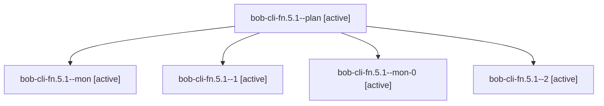

# Session: bob-cli-fn.5.1

[Agent Hoods](../README.md) / [bbugyi200](../users/bbugyi200/README.md) / [apollo](../users/bbugyi200/machines/apollo/README.md) / [bob-cli-fn](../users/bbugyi200/machines/apollo/hoods/bob-cli-fn/README.md) / bob-cli-fn.5.1

Owner: `bbugyi200.apollo` · Hood: `bob-cli-fn` · Members: 5 · Bead: [bob-cli-fn.5.1](https://github.com/bobs-org/bob-cli--beads/blob/main/pages/bob-cli-fn/bob-cli-fn.5.1.md)

## Lineage

The diagram is an optional enhancement; the ordered table below contains the same lineage in accessible text.

| Role | Agent | State | Model / provider | Timing | Commits | Prompt | Chat |
|---|---|---|---|---|---:|---|---|
| plan | bob-cli-fn.5.1--plan | active | grok-4.6 / grok | 2026-11-02T12:15:54.113947+00:00 | 0 | [Prompt](../agents/bbugyi200.apollo.bob-cli-fn.5.1--plan/prompt.md) | [Chat](../agents/bbugyi200.apollo.bob-cli-fn.5.1--plan/chat.md) |
| mon | bob-cli-fn.5.1--mon | active | grok-4.6 / grok | 2026-11-02T13:01:10.186154+00:00 | 0 | — | — |
| 1 | bob-cli-fn.5.1--1 | active | grok-4.6 / grok | 2026-11-02T13:11:09.110492+00:00 | 0 | [Prompt](../agents/bbugyi200.apollo.bob-cli-fn.5.1--1/prompt.md) | [Chat](../agents/bbugyi200.apollo.bob-cli-fn.5.1--1/chat.md) |
| mon-0 | bob-cli-fn.5.1--mon-0 | active | grok-4.6 / grok | 2026-11-02T13:22:23.843677+00:00 | 0 | — | — |
| 2 | bob-cli-fn.5.1--2 | active | grok-4.6 / grok | 2026-11-02T13:33:58.078774+00:00 | [1](../agents/bbugyi200.apollo.bob-cli-fn.5.1--2/README.md#commits) | [Prompt](../agents/bbugyi200.apollo.bob-cli-fn.5.1--2/prompt.md) | — |

## Commits

| Role | Repo | Commit | Subject | Committed |
|---|---|---|---|---|
| 2 | bob-cli | [`b483c93`](https://github.com/bobs-org/bob-cli/commit/b483c93b0ec02c5589ef0535d78de10ee31f0afb) | feat(capture): round-trip spaced section selectors | 2026-11-02 08:40:45 EST |

## Neighbors

| Agent | Relation | State |
|---|---|---|
| [bob-cli-fn.5.2](bbugyi200.apollo.bob-cli-fn.5.2.md) (session · 7) | bob-cli-fn.5 hood | active 7 |
| [bob-cli-fn.5.land](bbugyi200.apollo.bob-cli-fn.5.land.md) (session · 3) | bob-cli-fn.5 hood | active 2, completed 1 |
| [bob-cli-fn.1](../agents/bbugyi200.apollo.bob-cli-fn.1/README.md) | bob-cli-fn hood | active |
| [bob-cli-fn.2](../agents/bbugyi200.apollo.bob-cli-fn.2/README.md) | bob-cli-fn hood | active |
| [bob-cli-fn.3](bbugyi200.apollo.bob-cli-fn.3.md) (session · 5) | bob-cli-fn hood | active 5 |
| [bob-cli-fn.4](../agents/bbugyi200.apollo.bob-cli-fn.4/README.md) | bob-cli-fn hood | active |
| [bob-cli-fn.land](bbugyi200.apollo.bob-cli-fn.land.md) (session · 3) | bob-cli-fn hood | active 3 |
