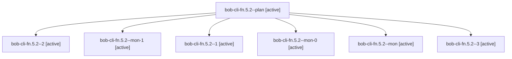

# Session: bob-cli-fn.5.2

[Agent Hoods](../README.md) / [bbugyi200](../users/bbugyi200/README.md) / [apollo](../users/bbugyi200/machines/apollo/README.md) / [bob-cli-fn](../users/bbugyi200/machines/apollo/hoods/bob-cli-fn/README.md) / bob-cli-fn.5.2

Owner: `bbugyi200.apollo` · Hood: `bob-cli-fn` · Members: 7 · Bead: [bob-cli-fn.5.2](https://github.com/bobs-org/bob-cli--beads/blob/main/pages/bob-cli-fn/bob-cli-fn.5.2.md)

## Lineage

The diagram is an optional enhancement; the ordered table below contains the same lineage in accessible text.

| Role | Agent | State | Model / provider | Timing | Commits | Prompt | Chat |
|---|---|---|---|---|---:|---|---|
| plan | bob-cli-fn.5.2--plan | active | muse-spark-1.3-contributor / muse | 2026-11-02T13:41:36.192612+00:00 | 0 | [Prompt](../agents/bbugyi200.apollo.bob-cli-fn.5.2--plan/prompt.md) | [Chat](../agents/bbugyi200.apollo.bob-cli-fn.5.2--plan/chat.md) |
| 2 | bob-cli-fn.5.2--2 | active | muse-spark-1.3-contributor / muse | 2026-11-02T14:48:05.010999+00:00 | 0 | [Prompt](../agents/bbugyi200.apollo.bob-cli-fn.5.2--2/prompt.md) | [Chat](../agents/bbugyi200.apollo.bob-cli-fn.5.2--2/chat.md) |
| mon-1 | bob-cli-fn.5.2--mon-1 | active | muse-spark-1.3-contributor / muse | 2026-11-02T14:55:23.666052+00:00 | 0 | — | — |
| 1 | bob-cli-fn.5.2--1 | active | muse-spark-1.3-contributor / muse | 2026-11-02T14:28:40.917495+00:00 | 0 | [Prompt](../agents/bbugyi200.apollo.bob-cli-fn.5.2--1/prompt.md) | [Chat](../agents/bbugyi200.apollo.bob-cli-fn.5.2--1/chat.md) |
| mon-0 | bob-cli-fn.5.2--mon-0 | active | muse-spark-1.3-contributor / muse | 2026-11-02T14:33:39.442454+00:00 | 0 | — | — |
| mon | bob-cli-fn.5.2--mon | active | muse-spark-1.3-contributor / muse | 2026-11-02T14:12:21.566226+00:00 | 0 | — | — |
| 3 | bob-cli-fn.5.2--3 | active | muse-spark-1.3-contributor / muse | 2026-11-02T15:16:33.138059+00:00 | 0 | [Prompt](../agents/bbugyi200.apollo.bob-cli-fn.5.2--3/prompt.md) | — |

## Neighbors

| Agent | Relation | State |
|---|---|---|
| [bob-cli-fn.5.1](bbugyi200.apollo.bob-cli-fn.5.1.md) (session · 5) | bob-cli-fn.5 hood | active 5 |
| [bob-cli-fn.5.land](bbugyi200.apollo.bob-cli-fn.5.land.md) (session · 3) | bob-cli-fn.5 hood | active 2, completed 1 |
| [bob-cli-fn.1](../agents/bbugyi200.apollo.bob-cli-fn.1/README.md) | bob-cli-fn hood | active |
| [bob-cli-fn.2](../agents/bbugyi200.apollo.bob-cli-fn.2/README.md) | bob-cli-fn hood | active |
| [bob-cli-fn.3](bbugyi200.apollo.bob-cli-fn.3.md) (session · 5) | bob-cli-fn hood | active 5 |
| [bob-cli-fn.4](../agents/bbugyi200.apollo.bob-cli-fn.4/README.md) | bob-cli-fn hood | active |
| [bob-cli-fn.land](bbugyi200.apollo.bob-cli-fn.land.md) (session · 3) | bob-cli-fn hood | active 3 |
