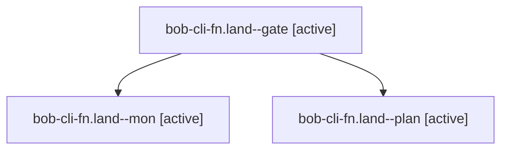

# Session: bob-cli-fn.land

[Agent Hoods](../README.md) / [bbugyi200](../users/bbugyi200/README.md) / [apollo](../users/bbugyi200/machines/apollo/README.md) / [bob-cli-fn](../users/bbugyi200/machines/apollo/hoods/bob-cli-fn/README.md) / bob-cli-fn.land

Owner: `bbugyi200.apollo` · Hood: `bob-cli-fn` · Members: 3 · Bead: [bob-cli-fn](https://github.com/bobs-org/bob-cli--beads/blob/main/pages/bob-cli-fn/README.md)

## Lineage

The diagram is an optional enhancement; the ordered table below contains the same lineage in accessible text.

| Role | Agent | State | Model / provider | Timing | Commits | Prompt | Chat |
|---|---|---|---|---|---:|---|---|
| gate | bob-cli-fn.land--gate | active | opus / claude | 2026-11-02T12:14:13.643565+00:00 | 0 | — | [Chat](../agents/bbugyi200.apollo.bob-cli-fn.land--gate/chat.md) |
| mon | bob-cli-fn.land--mon | active | opus / claude | 2026-11-02T12:14:28.366082+00:00 | 0 | — | — |
| plan | bob-cli-fn.land--plan | active | opus / claude | 2026-11-02T11:34:58.858064+00:00 | 0 | [Prompt](../agents/bbugyi200.apollo.bob-cli-fn.land--plan/prompt.md) | [Chat](../agents/bbugyi200.apollo.bob-cli-fn.land--plan/chat.md) |

## Commits

| Role | Repo | Commit | Subject | Committed |
|---|---|---|---|---|
| — | bob-cli | [`a8f6137`](https://github.com/bobs-org/bob-cli/commit/a8f6137514819f462b0182ad1081960ae566fc7c) | feat(capture)!: repair list headers, discard ranges, and ID tuning | 2026-11-02 06:23:49 EST |

## Neighbors

| Agent | Relation | State |
|---|---|---|
| [bob-cli-fn.1](../agents/bbugyi200.apollo.bob-cli-fn.1/README.md) | bob-cli-fn hood | active |
| [bob-cli-fn.2](../agents/bbugyi200.apollo.bob-cli-fn.2/README.md) | bob-cli-fn hood | active |
| [bob-cli-fn.3](bbugyi200.apollo.bob-cli-fn.3.md) (session · 5) | bob-cli-fn hood | active 5 |
| [bob-cli-fn.4](../agents/bbugyi200.apollo.bob-cli-fn.4/README.md) | bob-cli-fn hood | active |
| [bob-cli-fn.5.1](bbugyi200.apollo.bob-cli-fn.5.1.md) (session · 5) | bob-cli-fn hood | active 5 |
| [bob-cli-fn.5.2](bbugyi200.apollo.bob-cli-fn.5.2.md) (session · 7) | bob-cli-fn hood | active 7 |
| [bob-cli-fn.5.land](bbugyi200.apollo.bob-cli-fn.5.land.md) (session · 3) | bob-cli-fn hood | active 2, completed 1 |
