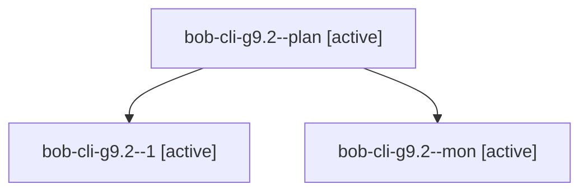

# Session: bob-cli-g9.2

[Agent Hoods](../README.md) / [bbugyi200](../users/bbugyi200/README.md) / [apollo](../users/bbugyi200/machines/apollo/README.md) / [bob-cli-g9](../users/bbugyi200/machines/apollo/hoods/bob-cli-g9/README.md) / bob-cli-g9.2

Owner: `bbugyi200.apollo` · Hood: `bob-cli-g9` · Members: 3 · Bead: [bob-cli-g9.2](https://github.com/bobs-org/bob-cli--beads/blob/main/pages/bob-cli-g9/bob-cli-g9.2.md)

## Lineage

The diagram is an optional enhancement; the ordered table below contains the same lineage in accessible text.

| Role | Agent | State | Model / provider | Timing | Commits | Prompt | Chat |
|---|---|---|---|---|---:|---|---|
| plan | bob-cli-g9.2--plan | active | grok-4.6 / grok | 2026-11-02T20:57:28.309812+00:00 | 0 | [Prompt](../agents/bbugyi200.apollo.bob-cli-g9.2--plan/prompt.md) | [Chat](../agents/bbugyi200.apollo.bob-cli-g9.2--plan/chat.md) |
| 1 | bob-cli-g9.2--1 | active | grok-4.6 / grok | 2026-11-02T21:55:54.373927+00:00 | [1](../agents/bbugyi200.apollo.bob-cli-g9.2--1/README.md#commits) | [Prompt](../agents/bbugyi200.apollo.bob-cli-g9.2--1/prompt.md) | — |
| mon | bob-cli-g9.2--mon | active | grok-4.6 / grok | 2026-11-02T21:48:20.522221+00:00 | 0 | — | — |

## Commits

| Role | Repo | Commit | Subject | Committed |
|---|---|---|---|---|
| 1 | bob-cli | [`6086791`](https://github.com/bobs-org/bob-cli/commit/6086791f76b2564e37bd282bd63ea5ef7d2a07a8) | feat(freshness)!: bump freshness JSON to schema 15 with per-rung decay limits | 2026-11-02 17:25:48 EST |

## Neighbors

| Agent | Relation | State |
|---|---|---|
| [bob-cli-g9.1](../agents/bbugyi200.apollo.bob-cli-g9.1/README.md) | bob-cli-g9 hood | active |
| [bob-cli-g9.3](../agents/bbugyi200.apollo.bob-cli-g9.3/README.md) | bob-cli-g9 hood | active |
| [bob-cli-g9.4](../agents/bbugyi200.apollo.bob-cli-g9.4/README.md) | bob-cli-g9 hood | active |
| [bob-cli-g9.5](bbugyi200.apollo.bob-cli-g9.5.md) (session · 3) | bob-cli-g9 hood | active 3 |
| [bob-cli-g9.6](../agents/bbugyi200.apollo.bob-cli-g9.6/README.md) | bob-cli-g9 hood | active |
| [bob-cli-g9.7](../agents/bbugyi200.apollo.bob-cli-g9.7/README.md) | bob-cli-g9 hood | active |
| [bob-cli-g9.land](bbugyi200.apollo.bob-cli-g9.land.md) (session · 69) | bob-cli-g9 hood | active 67, completed 1, failed 1 |
