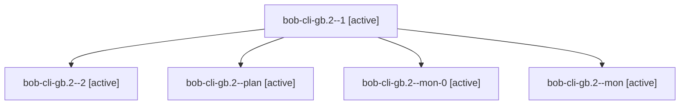

# Session: bob-cli-gb.2

[Agent Hoods](../README.md) / [bbugyi200](../users/bbugyi200/README.md) / [apollo](../users/bbugyi200/machines/apollo/README.md) / [bob-cli-gb](../users/bbugyi200/machines/apollo/hoods/bob-cli-gb/README.md) / bob-cli-gb.2

Owner: `bbugyi200.apollo` · Hood: `bob-cli-gb` · Members: 5 · Bead: [bob-cli-gb.2](https://github.com/bobs-org/bob-cli--beads/blob/main/pages/bob-cli-gb/bob-cli-gb.2.md)

## Lineage

The diagram is an optional enhancement; the ordered table below contains the same lineage in accessible text.

| Role | Agent | State | Model / provider | Timing | Commits | Prompt | Chat |
|---|---|---|---|---|---:|---|---|
| 1 | bob-cli-gb.2--1 | active | grok-4.6 / grok | 2026-11-03T01:11:46.252459+00:00 | 0 | [Prompt](../agents/bbugyi200.apollo.bob-cli-gb.2--1/prompt.md) | [Chat](../agents/bbugyi200.apollo.bob-cli-gb.2--1/chat.md) |
| 2 | bob-cli-gb.2--2 | active | grok-4.6 / grok | 2026-11-03T01:48:24.841042+00:00 | [1](../agents/bbugyi200.apollo.bob-cli-gb.2--2/README.md#commits) | [Prompt](../agents/bbugyi200.apollo.bob-cli-gb.2--2/prompt.md) | — |
| plan | bob-cli-gb.2--plan | active | grok-4.6 / grok | 2026-11-02T23:53:04.152546+00:00 | 0 | [Prompt](../agents/bbugyi200.apollo.bob-cli-gb.2--plan/prompt.md) | [Chat](../agents/bbugyi200.apollo.bob-cli-gb.2--plan/chat.md) |
| mon-0 | bob-cli-gb.2--mon-0 | active | grok-4.6 / grok | 2026-11-03T01:21:42.720847+00:00 | 0 | — | — |
| mon | bob-cli-gb.2--mon | active | grok-4.6 / grok | 2026-11-03T00:41:40.837090+00:00 | 0 | — | — |

## Commits

| Role | Repo | Commit | Subject | Committed |
|---|---|---|---|---|
| 2 | bob-cli | [`807e181`](https://github.com/bobs-org/bob-cli/commit/807e1816560696672483eeedfbe647fca9dd8898) | docs(memory): task decay ladder glossary, decision record, and regenerated pages | 2026-11-02 21:22:11 EST |
| — | bob-cli | [`beae4dc`](https://github.com/bobs-org/bob-cli/commit/beae4dc79a0593d14d7ce775d1e1702bbbe0e588) | feat(pomodoro-clock): stamp the effective clock on capture writers | 2026-11-02 21:44:22 EST |

## Neighbors

| Agent | Relation | State |
|---|---|---|
| [bob-cli-gb.1](../agents/bbugyi200.apollo.bob-cli-gb.1/README.md) | bob-cli-gb hood | active |
| [bob-cli-gb.3](bbugyi200.apollo.bob-cli-gb.3.md) (session · 3) | bob-cli-gb hood | active 3 |
| [bob-cli-gb.4](bbugyi200.apollo.bob-cli-gb.4.md) (session · 3) | bob-cli-gb hood | active 3 |
| [bob-cli-gb.4.1.1](bbugyi200.apollo.bob-cli-gb.4.1.1.md) (session · 7) | bob-cli-gb hood | active 7 |
| [bob-cli-gb.4.1.2](../agents/bbugyi200.apollo.bob-cli-gb.4.1.2/README.md) | bob-cli-gb hood | active |
| [bob-cli-gb.4.1.3](../agents/bbugyi200.apollo.bob-cli-gb.4.1.3/README.md) | bob-cli-gb hood | active |
| [bob-cli-gb.4.1.land](../agents/bbugyi200.apollo.bob-cli-gb.4.1.land/README.md) | bob-cli-gb hood | active |
| [bob-cli-gb.5](../agents/bbugyi200.apollo.bob-cli-gb.5/README.md) | bob-cli-gb hood | active |
| [bob-cli-gb.6](../agents/bbugyi200.apollo.bob-cli-gb.6/README.md) | bob-cli-gb hood | active |
| [bob-cli-gb.7](../agents/bbugyi200.apollo.bob-cli-gb.7/README.md) | bob-cli-gb hood | active |
| [bob-cli-gb.8](bbugyi200.apollo.bob-cli-gb.8.md) (session · 7) | bob-cli-gb hood | active 7 |
| [bob-cli-gb.land](../agents/bbugyi200.apollo.bob-cli-gb.land/README.md) | bob-cli-gb hood | active |
