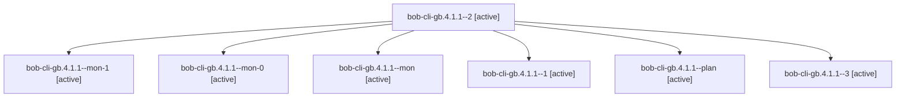

# Session: bob-cli-gb.4.1.1

[Agent Hoods](../README.md) / [bbugyi200](../users/bbugyi200/README.md) / [apollo](../users/bbugyi200/machines/apollo/README.md) / [bob-cli-gb](../users/bbugyi200/machines/apollo/hoods/bob-cli-gb/README.md) / bob-cli-gb.4.1.1

Owner: `bbugyi200.apollo` · Hood: `bob-cli-gb` · Members: 7 · Bead: [bob-cli-gb.4.1.1](https://github.com/bobs-org/bob-cli--beads/blob/main/pages/bob-cli-gb/bob-cli-gb.4.1.1.md)

## Lineage

The diagram is an optional enhancement; the ordered table below contains the same lineage in accessible text.

| Role | Agent | State | Model / provider | Timing | Commits | Prompt | Chat |
|---|---|---|---|---|---:|---|---|
| 2 | bob-cli-gb.4.1.1--2 | active | gpt-6-luna / codex | 2026-11-03T01:30:18.034556+00:00 | 0 | [Prompt](../agents/bbugyi200.apollo.bob-cli-gb.4.1.1--2/prompt.md) | [Chat](../agents/bbugyi200.apollo.bob-cli-gb.4.1.1--2/chat.md) |
| mon-1 | bob-cli-gb.4.1.1--mon-1 | active | gpt-6-luna / codex | 2026-11-03T01:31:37.237006+00:00 | 0 | — | — |
| mon-0 | bob-cli-gb.4.1.1--mon-0 | active | gpt-6-luna / codex | 2026-11-03T01:19:38.053122+00:00 | 0 | — | — |
| mon | bob-cli-gb.4.1.1--mon | active | gpt-6-luna / codex | 2026-11-03T01:05:06.173880+00:00 | 0 | — | — |
| 1 | bob-cli-gb.4.1.1--1 | active | gpt-6-luna / codex | 2026-11-03T01:17:14.000945+00:00 | 0 | [Prompt](../agents/bbugyi200.apollo.bob-cli-gb.4.1.1--1/prompt.md) | [Chat](../agents/bbugyi200.apollo.bob-cli-gb.4.1.1--1/chat.md) |
| plan | bob-cli-gb.4.1.1--plan | active | gpt-6-luna / codex | 2026-11-03T00:37:39.664088+00:00 | 0 | [Prompt](../agents/bbugyi200.apollo.bob-cli-gb.4.1.1--plan/prompt.md) | [Chat](../agents/bbugyi200.apollo.bob-cli-gb.4.1.1--plan/chat.md) |
| 3 | bob-cli-gb.4.1.1--3 | active | gpt-6-luna / codex | 2026-11-03T01:49:40.874174+00:00 | [1](../agents/bbugyi200.apollo.bob-cli-gb.4.1.1--3/README.md#commits) | [Prompt](../agents/bbugyi200.apollo.bob-cli-gb.4.1.1--3/prompt.md) | — |

## Commits

| Role | Repo | Commit | Subject | Committed |
|---|---|---|---|---|
| 3 | bob-cli | [`4d5a61d`](https://github.com/bobs-org/bob-cli/commit/4d5a61de6a5f2437a5db97a95d444f9d055fb327) | feat(gcal): parse and render explicit clock tags | 2026-11-02 21:09:07 EST |

## Neighbors

| Agent | Relation | State |
|---|---|---|
| [bob-cli-gb.4](bbugyi200.apollo.bob-cli-gb.4.md) (session · 3) | ancestor | active 3 |
| [bob-cli-gb.4.1.2](../agents/bbugyi200.apollo.bob-cli-gb.4.1.2/README.md) | bob-cli-gb.4.1 hood | active |
| [bob-cli-gb.4.1.3](../agents/bbugyi200.apollo.bob-cli-gb.4.1.3/README.md) | bob-cli-gb.4.1 hood | active |
| [bob-cli-gb.4.1.land](../agents/bbugyi200.apollo.bob-cli-gb.4.1.land/README.md) | bob-cli-gb.4.1 hood | active |
| [bob-cli-gb.1](../agents/bbugyi200.apollo.bob-cli-gb.1/README.md) | bob-cli-gb hood | active |
| [bob-cli-gb.2](bbugyi200.apollo.bob-cli-gb.2.md) (session · 5) | bob-cli-gb hood | active 5 |
| [bob-cli-gb.3](bbugyi200.apollo.bob-cli-gb.3.md) (session · 3) | bob-cli-gb hood | active 3 |
| [bob-cli-gb.5](../agents/bbugyi200.apollo.bob-cli-gb.5/README.md) | bob-cli-gb hood | active |
| [bob-cli-gb.6](../agents/bbugyi200.apollo.bob-cli-gb.6/README.md) | bob-cli-gb hood | active |
| [bob-cli-gb.7](../agents/bbugyi200.apollo.bob-cli-gb.7/README.md) | bob-cli-gb hood | active |
| [bob-cli-gb.8](bbugyi200.apollo.bob-cli-gb.8.md) (session · 7) | bob-cli-gb hood | active 7 |
| [bob-cli-gb.land](../agents/bbugyi200.apollo.bob-cli-gb.land/README.md) | bob-cli-gb hood | active |
