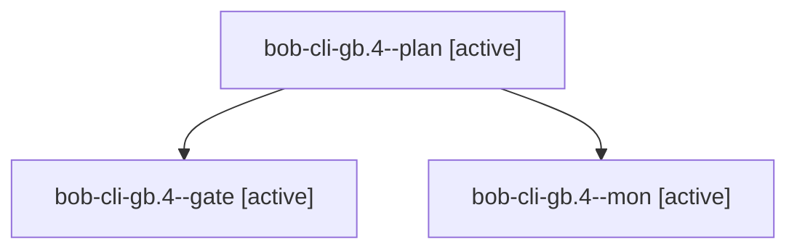

# Session: bob-cli-gb.4

[Agent Hoods](../README.md) / [bbugyi200](../users/bbugyi200/README.md) / [apollo](../users/bbugyi200/machines/apollo/README.md) / [bob-cli-gb](../users/bbugyi200/machines/apollo/hoods/bob-cli-gb/README.md) / bob-cli-gb.4

Owner: `bbugyi200.apollo` · Hood: `bob-cli-gb` · Members: 3 · Bead: [bob-cli-gb.4](https://github.com/bobs-org/bob-cli--beads/blob/main/pages/bob-cli-gb/bob-cli-gb.4.md)

## Lineage

The diagram is an optional enhancement; the ordered table below contains the same lineage in accessible text.

| Role | Agent | State | Model / provider | Timing | Commits | Prompt | Chat |
|---|---|---|---|---|---:|---|---|
| plan | bob-cli-gb.4--plan | active | gpt-6-astra / codex | 2026-11-02T23:43:32.099393+00:00 | 0 | [Prompt](../agents/bbugyi200.apollo.bob-cli-gb.4--plan/prompt.md) | [Chat](../agents/bbugyi200.apollo.bob-cli-gb.4--plan/chat.md) |
| gate | bob-cli-gb.4--gate | active | gpt-6-astra / codex | 2026-11-02T23:52:19.135588+00:00 | 0 | — | [Chat](../agents/bbugyi200.apollo.bob-cli-gb.4--gate/chat.md) |
| mon | bob-cli-gb.4--mon | active | gpt-6-astra / codex | 2026-11-02T23:52:44.176359+00:00 | 0 | — | — |

## Neighbors

| Agent | Relation | State |
|---|---|---|
| [bob-cli-gb.4.1.1](bbugyi200.apollo.bob-cli-gb.4.1.1.md) (session · 7) | descendant | active 7 |
| [bob-cli-gb.4.1.2](../agents/bbugyi200.apollo.bob-cli-gb.4.1.2/README.md) | descendant | active |
| [bob-cli-gb.4.1.3](../agents/bbugyi200.apollo.bob-cli-gb.4.1.3/README.md) | descendant | active |
| [bob-cli-gb.4.1.land](../agents/bbugyi200.apollo.bob-cli-gb.4.1.land/README.md) | descendant | active |
| [bob-cli-gb.1](../agents/bbugyi200.apollo.bob-cli-gb.1/README.md) | bob-cli-gb hood | active |
| [bob-cli-gb.2](bbugyi200.apollo.bob-cli-gb.2.md) (session · 5) | bob-cli-gb hood | active 5 |
| [bob-cli-gb.3](bbugyi200.apollo.bob-cli-gb.3.md) (session · 3) | bob-cli-gb hood | active 3 |
| [bob-cli-gb.5](../agents/bbugyi200.apollo.bob-cli-gb.5/README.md) | bob-cli-gb hood | active |
| [bob-cli-gb.6](../agents/bbugyi200.apollo.bob-cli-gb.6/README.md) | bob-cli-gb hood | active |
| [bob-cli-gb.7](../agents/bbugyi200.apollo.bob-cli-gb.7/README.md) | bob-cli-gb hood | active |
| [bob-cli-gb.8](bbugyi200.apollo.bob-cli-gb.8.md) (session · 7) | bob-cli-gb hood | active 7 |
| [bob-cli-gb.land](../agents/bbugyi200.apollo.bob-cli-gb.land/README.md) | bob-cli-gb hood | active |
