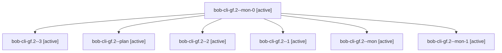

# Session: bob-cli-gf.2

[Agent Hoods](../README.md) / [bbugyi200](../users/bbugyi200/README.md) / [apollo](../users/bbugyi200/machines/apollo/README.md) / [bob-cli-gf](../users/bbugyi200/machines/apollo/hoods/bob-cli-gf/README.md) / bob-cli-gf.2

Owner: `bbugyi200.apollo` · Hood: `bob-cli-gf` · Members: 7 · Bead: [bob-cli-gf.2](https://github.com/bobs-org/bob-cli--beads/blob/main/pages/bob-cli-gf/bob-cli-gf.2.md)

## Lineage

The diagram is an optional enhancement; the ordered table below contains the same lineage in accessible text.

| Role | Agent | State | Model / provider | Timing | Commits | Prompt | Chat |
|---|---|---|---|---|---:|---|---|
| mon-0 | bob-cli-gf.2--mon-0 | active | gpt-6-luna / codex | 2026-11-03T15:29:51.146832+00:00 | 0 | — | — |
| 3 | bob-cli-gf.2--3 | active | gpt-6-luna / codex | 2026-11-03T15:44:45.945440+00:00 | 0 | [Prompt](../agents/bbugyi200.apollo.bob-cli-gf.2--3/prompt.md) | — |
| plan | bob-cli-gf.2--plan | active | gpt-6-luna / codex | 2026-11-03T15:11:19.652754+00:00 | 0 | [Prompt](../agents/bbugyi200.apollo.bob-cli-gf.2--plan/prompt.md) | [Chat](../agents/bbugyi200.apollo.bob-cli-gf.2--plan/chat.md) |
| 2 | bob-cli-gf.2--2 | active | gpt-6-luna / codex | 2026-11-03T15:39:43.336898+00:00 | 0 | [Prompt](../agents/bbugyi200.apollo.bob-cli-gf.2--2/prompt.md) | [Chat](../agents/bbugyi200.apollo.bob-cli-gf.2--2/chat.md) |
| 1 | bob-cli-gf.2--1 | active | gpt-6-luna / codex | 2026-11-03T15:29:02.816958+00:00 | 0 | [Prompt](../agents/bbugyi200.apollo.bob-cli-gf.2--1/prompt.md) | [Chat](../agents/bbugyi200.apollo.bob-cli-gf.2--1/chat.md) |
| mon | bob-cli-gf.2--mon | active | gpt-6-luna / codex | 2026-11-03T15:25:54.823203+00:00 | 0 | — | — |
| mon-1 | bob-cli-gf.2--mon-1 | active | gpt-6-luna / codex | 2026-11-03T15:41:35.038309+00:00 | 0 | — | — |

## Neighbors

| Agent | Relation | State |
|---|---|---|
| [bob-cli-gf.1](../agents/bbugyi200.apollo.bob-cli-gf.1/README.md) | bob-cli-gf hood | active |
| [bob-cli-gf.3](../agents/bbugyi200.apollo.bob-cli-gf.3/README.md) | bob-cli-gf hood | active |
| [bob-cli-gf.land](bbugyi200.apollo.bob-cli-gf.land.md) (session · 5) | bob-cli-gf hood | active 3, completed 1, failed 1 |
