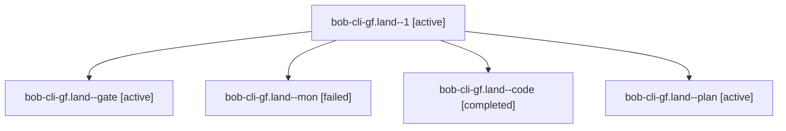

# Session: bob-cli-gf.land

[Agent Hoods](../README.md) / [bbugyi200](../users/bbugyi200/README.md) / [apollo](../users/bbugyi200/machines/apollo/README.md) / [bob-cli-gf](../users/bbugyi200/machines/apollo/hoods/bob-cli-gf/README.md) / bob-cli-gf.land

Owner: `bbugyi200.apollo` · Hood: `bob-cli-gf` · Members: 5 · Bead: [bob-cli-gf](https://github.com/bobs-org/bob-cli--beads/blob/main/pages/bob-cli-gf/README.md)

## Lineage

The diagram is an optional enhancement; the ordered table below contains the same lineage in accessible text.

| Role | Agent | State | Model / provider | Timing | Commits | Prompt | Chat |
|---|---|---|---|---|---:|---|---|
| 1 | bob-cli-gf.land--1 | active | gpt-6-luna / codex | 2026-11-03T17:11:43.105615+00:00 | 0 | [Prompt](../agents/bbugyi200.apollo.bob-cli-gf.land--1/prompt.md) | — |
| gate | bob-cli-gf.land--gate | active | gpt-6-astra / codex | 2026-11-03T17:01:01.402500+00:00 | 0 | — | [Chat](../agents/bbugyi200.apollo.bob-cli-gf.land--gate/chat.md) |
| mon | bob-cli-gf.land--mon | failed | gpt-6-luna / codex | 2026-11-03T17:07:39.862668+00:00 → 2026-11-03T17:11:12.018988+00:00 | 0 | — | [Chat](../agents/bbugyi200.apollo.bob-cli-gf.land--mon/chat.md) |
| code | bob-cli-gf.land--code | completed | gpt-6-luna / codex | 2026-11-03T17:01:47.449529+00:00 → 2026-11-03T17:08:16.861042+00:00 | 0 | — | [Chat](../agents/bbugyi200.apollo.bob-cli-gf.land--code/chat.md) |
| plan | bob-cli-gf.land--plan | active | gpt-6-astra / codex | 2026-11-03T16:39:17.370793+00:00 | 0 | [Prompt](../agents/bbugyi200.apollo.bob-cli-gf.land--plan/prompt.md) | [Chat](../agents/bbugyi200.apollo.bob-cli-gf.land--plan/chat.md) |

## Neighbors

| Agent | Relation | State |
|---|---|---|
| [bob-cli-gf.1](../agents/bbugyi200.apollo.bob-cli-gf.1/README.md) | bob-cli-gf hood | active |
| [bob-cli-gf.2](bbugyi200.apollo.bob-cli-gf.2.md) (session · 7) | bob-cli-gf hood | active 7 |
| [bob-cli-gf.3](../agents/bbugyi200.apollo.bob-cli-gf.3/README.md) | bob-cli-gf hood | active |
