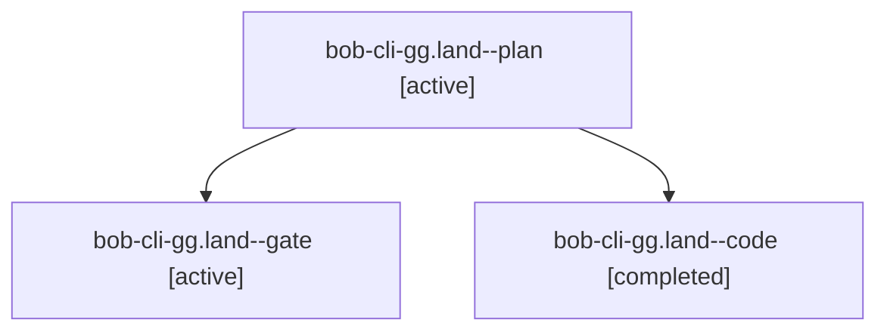

# Session: bob-cli-gg.land

[Agent Hoods](../README.md) / [bbugyi200](../users/bbugyi200/README.md) / [apollo](../users/bbugyi200/machines/apollo/README.md) / [bob-cli-gg](../users/bbugyi200/machines/apollo/hoods/bob-cli-gg/README.md) / bob-cli-gg.land

Owner: `bbugyi200.apollo` · Hood: `bob-cli-gg` · Members: 3 · Bead: [bob-cli-gg](https://github.com/bobs-org/bob-cli--beads/blob/main/pages/bob-cli-gg/README.md)

## Lineage

The diagram is an optional enhancement; the ordered table below contains the same lineage in accessible text.

| Role | Agent | State | Model / provider | Timing | Commits | Prompt | Chat |
|---|---|---|---|---|---:|---|---|
| plan | bob-cli-gg.land--plan | active | gpt-6-astra / codex | 2026-11-03T17:13:43.776720+00:00 | 0 | [Prompt](../agents/bbugyi200.apollo.bob-cli-gg.land--plan/prompt.md) | [Chat](../agents/bbugyi200.apollo.bob-cli-gg.land--plan/chat.md) |
| gate | bob-cli-gg.land--gate | active | gpt-6-astra / codex | 2026-11-03T17:25:21.218423+00:00 | 0 | — | [Chat](../agents/bbugyi200.apollo.bob-cli-gg.land--gate/chat.md) |
| code | bob-cli-gg.land--code | completed | grok-4.6 / grok | 2026-11-03T17:26:14.534460+00:00 → 2026-11-03T17:57:38.132580+00:00 | [1](../agents/bbugyi200.apollo.bob-cli-gg.land--code/README.md#commits) | — | [Chat](../agents/bbugyi200.apollo.bob-cli-gg.land--code/chat.md) |

## Commits

| Role | Repo | Commit | Subject | Committed |
|---|---|---|---|---|
| code | bob-cli | [`ee5c078`](https://github.com/bobs-org/bob-cli/commit/ee5c0781caa7c748713ab685de9a9dc7da000f78) | docs(task-link-marks): describe event pill and off chip as additive | 2026-11-03 12:55:39 EST |

## Neighbors

| Agent | Relation | State |
|---|---|---|
| [bob-cli-gg.1](../agents/bbugyi200.apollo.bob-cli-gg.1/README.md) | bob-cli-gg hood | active |
| [bob-cli-gg.2](../agents/bbugyi200.apollo.bob-cli-gg.2/README.md) | bob-cli-gg hood | active |
| [bob-cli-gg.3](../agents/bbugyi200.apollo.bob-cli-gg.3/README.md) | bob-cli-gg hood | active |
