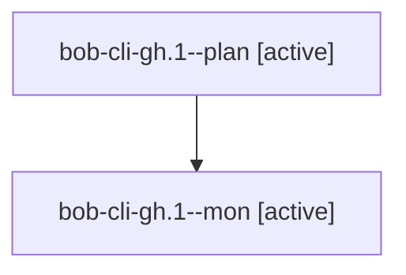

# Session: bob-cli-gh.1

[Agent Hoods](../README.md) / [bbugyi200](../users/bbugyi200/README.md) / [apollo](../users/bbugyi200/machines/apollo/README.md) / [bob-cli-gh](../users/bbugyi200/machines/apollo/hoods/bob-cli-gh/README.md) / bob-cli-gh.1

Owner: `bbugyi200.apollo` · Hood: `bob-cli-gh` · Members: 2 · Bead: [bob-cli-gh.1](https://github.com/bobs-org/bob-cli--beads/blob/main/pages/bob-cli-gh/bob-cli-gh.1.md)

## Lineage

The diagram is an optional enhancement; the ordered table below contains the same lineage in accessible text.

| Role | Agent | State | Model / provider | Timing | Commits | Prompt | Chat |
|---|---|---|---|---|---:|---|---|
| plan | bob-cli-gh.1--plan | active | grok-4.6 / grok | 2026-11-03T16:01:42.633795+00:00 | [1](../agents/bbugyi200.apollo.bob-cli-gh.1--plan/README.md#commits) | [Prompt](../agents/bbugyi200.apollo.bob-cli-gh.1--plan/prompt.md) | — |
| mon | bob-cli-gh.1--mon | active | grok-4.6 / grok | 2026-11-03T16:07:40.863832+00:00 | 0 | — | — |

## Commits

| Role | Repo | Commit | Subject | Committed |
|---|---|---|---|---|
| plan | bob-cli | [`4ce7909`](https://github.com/bobs-org/bob-cli/commit/4ce79094aaf3cf8753bb438a17cd3d9b40afa02a) | docs(memory): add Period Note and Stats Strip glossary terms | 2026-11-03 11:31:20 EST |

## Neighbors

| Agent | Relation | State |
|---|---|---|
| [bob-cli-gh.2](../agents/bbugyi200.apollo.bob-cli-gh.2/README.md) | bob-cli-gh hood | active |
| [bob-cli-gh.3](../agents/bbugyi200.apollo.bob-cli-gh.3/README.md) | bob-cli-gh hood | active |
| [bob-cli-gh.4](../agents/bbugyi200.apollo.bob-cli-gh.4/README.md) | bob-cli-gh hood | active |
| [bob-cli-gh.5](../agents/bbugyi200.apollo.bob-cli-gh.5/README.md) | bob-cli-gh hood | active |
| [bob-cli-gh.6](../agents/bbugyi200.apollo.bob-cli-gh.6/README.md) | bob-cli-gh hood | active |
| [bob-cli-gh.7](../agents/bbugyi200.apollo.bob-cli-gh.7/README.md) | bob-cli-gh hood | active |
| [bob-cli-gh.8](../agents/bbugyi200.apollo.bob-cli-gh.8/README.md) | bob-cli-gh hood | active |
| [bob-cli-gh.9](../agents/bbugyi200.apollo.bob-cli-gh.9/README.md) | bob-cli-gh hood | active |
| [bob-cli-gh.land](../agents/bbugyi200.apollo.bob-cli-gh.land/README.md) | bob-cli-gh hood | active |
