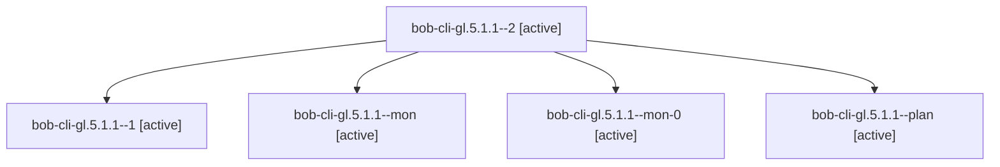

# Session: bob-cli-gl.5.1.1

[Agent Hoods](../README.md) / [bbugyi200](../users/bbugyi200/README.md) / [apollo](../users/bbugyi200/machines/apollo/README.md) / [bob-cli-gl](../users/bbugyi200/machines/apollo/hoods/bob-cli-gl/README.md) / bob-cli-gl.5.1.1

Owner: `bbugyi200.apollo` · Hood: `bob-cli-gl` · Members: 5 · Bead: [bob-cli-gl.5.1.1](https://github.com/bobs-org/bob-cli--beads/blob/main/pages/bob-cli-gl/bob-cli-gl.5.1.1.md)

## Lineage

The diagram is an optional enhancement; the ordered table below contains the same lineage in accessible text.

| Role | Agent | State | Model / provider | Timing | Commits | Prompt | Chat |
|---|---|---|---|---|---:|---|---|
| 2 | bob-cli-gl.5.1.1--2 | active | gpt-6-luna / codex | 2026-11-03T22:42:55.133372+00:00 | [1](../agents/bbugyi200.apollo.bob-cli-gl.5.1.1--2/README.md#commits) | [Prompt](../agents/bbugyi200.apollo.bob-cli-gl.5.1.1--2/prompt.md) | — |
| 1 | bob-cli-gl.5.1.1--1 | active | gpt-6-luna / codex | 2026-11-03T22:20:39.863906+00:00 | 0 | [Prompt](../agents/bbugyi200.apollo.bob-cli-gl.5.1.1--1/prompt.md) | [Chat](../agents/bbugyi200.apollo.bob-cli-gl.5.1.1--1/chat.md) |
| mon | bob-cli-gl.5.1.1--mon | active | gpt-6-luna / codex | 2026-11-03T22:09:27.332693+00:00 | 0 | — | — |
| mon-0 | bob-cli-gl.5.1.1--mon-0 | active | gpt-6-luna / codex | 2026-11-03T22:28:19.599566+00:00 | 0 | — | — |
| plan | bob-cli-gl.5.1.1--plan | active | gpt-6-luna / codex | 2026-11-03T21:20:14.207836+00:00 | 0 | [Prompt](../agents/bbugyi200.apollo.bob-cli-gl.5.1.1--plan/prompt.md) | [Chat](../agents/bbugyi200.apollo.bob-cli-gl.5.1.1--plan/chat.md) |

## Commits

| Role | Repo | Commit | Subject | Committed |
|---|---|---|---|---|
| 2 | bob-cli | [`6650faa`](https://github.com/bobs-org/bob-cli/commit/6650faa30491c8f7f39c2657bdbe8676ec97c6f6) | feat(capture): execute ordered project-note moves | 2026-11-03 17:45:01 EST |

## Neighbors

| Agent | Relation | State |
|---|---|---|
| [bob-cli-gl.5](bbugyi200.apollo.bob-cli-gl.5.md) (session · 3) | ancestor | active 3 |
| [bob-cli-gl.5.1.2](bbugyi200.apollo.bob-cli-gl.5.1.2.md) (session · 3) | bob-cli-gl.5.1 hood | active 3 |
| [bob-cli-gl.5.1.3](bbugyi200.apollo.bob-cli-gl.5.1.3.md) (session · 3) | bob-cli-gl.5.1 hood | active 3 |
| [bob-cli-gl.5.1.land](bbugyi200.apollo.bob-cli-gl.5.1.land.md) (session · 3) | bob-cli-gl.5.1 hood | active 2, completed 1 |
| [bob-cli-gl.1](../agents/bbugyi200.apollo.bob-cli-gl.1/README.md) | bob-cli-gl hood | active |
| [bob-cli-gl.2](../agents/bbugyi200.apollo.bob-cli-gl.2/README.md) | bob-cli-gl hood | active |
| [bob-cli-gl.3](../agents/bbugyi200.apollo.bob-cli-gl.3/README.md) | bob-cli-gl hood | active |
| [bob-cli-gl.4](../agents/bbugyi200.apollo.bob-cli-gl.4/README.md) | bob-cli-gl hood | active |
| [bob-cli-gl.6](../agents/bbugyi200.apollo.bob-cli-gl.6/README.md) | bob-cli-gl hood | active |
| [bob-cli-gl.7](../agents/bbugyi200.apollo.bob-cli-gl.7/README.md) | bob-cli-gl hood | active |
| [bob-cli-gl.land](../agents/bbugyi200.apollo.bob-cli-gl.land/README.md) | bob-cli-gl hood | active |
