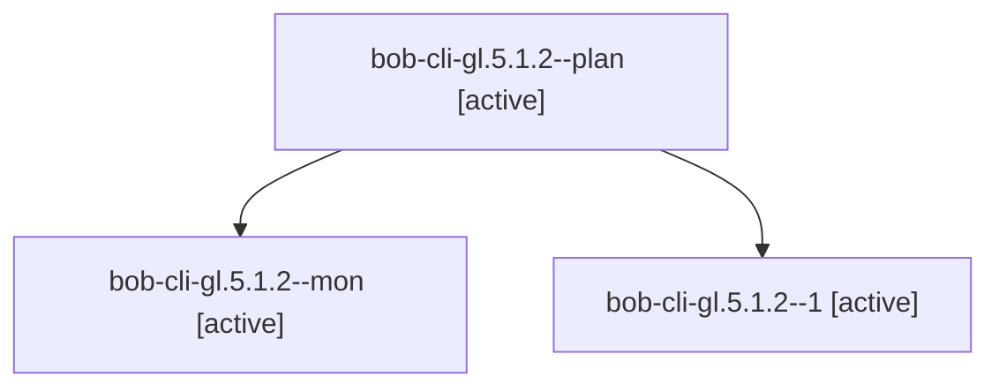

# Session: bob-cli-gl.5.1.2

[Agent Hoods](../README.md) / [bbugyi200](../users/bbugyi200/README.md) / [apollo](../users/bbugyi200/machines/apollo/README.md) / [bob-cli-gl](../users/bbugyi200/machines/apollo/hoods/bob-cli-gl/README.md) / bob-cli-gl.5.1.2

Owner: `bbugyi200.apollo` · Hood: `bob-cli-gl` · Members: 3 · Bead: [bob-cli-gl.5.1.2](https://github.com/bobs-org/bob-cli--beads/blob/main/pages/bob-cli-gl/bob-cli-gl.5.1.2.md)

## Lineage

The diagram is an optional enhancement; the ordered table below contains the same lineage in accessible text.

| Role | Agent | State | Model / provider | Timing | Commits | Prompt | Chat |
|---|---|---|---|---|---:|---|---|
| plan | bob-cli-gl.5.1.2--plan | active | muse-spark-1.3-contributor / muse | 2026-11-03T22:46:12.766406+00:00 | 0 | [Prompt](../agents/bbugyi200.apollo.bob-cli-gl.5.1.2--plan/prompt.md) | [Chat](../agents/bbugyi200.apollo.bob-cli-gl.5.1.2--plan/chat.md) |
| mon | bob-cli-gl.5.1.2--mon | active | muse-spark-1.3-contributor / muse | 2026-11-03T23:55:11.686600+00:00 | 0 | — | — |
| 1 | bob-cli-gl.5.1.2--1 | active | muse-spark-1.3-contributor / muse | 2026-11-04T00:26:41.374011+00:00 | [1](../agents/bbugyi200.apollo.bob-cli-gl.5.1.2--1/README.md#commits) | [Prompt](../agents/bbugyi200.apollo.bob-cli-gl.5.1.2--1/prompt.md) | — |

## Commits

| Role | Repo | Commit | Subject | Committed |
|---|---|---|---|---|
| 1 | bob-cli | [`14a5773`](https://github.com/bobs-org/bob-cli/commit/14a577321f81119ccb24dc41c81caa9aa9af8650) | feat(capture): link moved tasks and integrate project offers | 2026-11-03 19:29:57 EST |

## Neighbors

| Agent | Relation | State |
|---|---|---|
| [bob-cli-gl.5](bbugyi200.apollo.bob-cli-gl.5.md) (session · 3) | ancestor | active 3 |
| [bob-cli-gl.5.1.1](bbugyi200.apollo.bob-cli-gl.5.1.1.md) (session · 5) | bob-cli-gl.5.1 hood | active 5 |
| [bob-cli-gl.5.1.3](bbugyi200.apollo.bob-cli-gl.5.1.3.md) (session · 3) | bob-cli-gl.5.1 hood | active 3 |
| [bob-cli-gl.5.1.land](bbugyi200.apollo.bob-cli-gl.5.1.land.md) (session · 3) | bob-cli-gl.5.1 hood | active 2, completed 1 |
| [bob-cli-gl.1](../agents/bbugyi200.apollo.bob-cli-gl.1/README.md) | bob-cli-gl hood | active |
| [bob-cli-gl.2](../agents/bbugyi200.apollo.bob-cli-gl.2/README.md) | bob-cli-gl hood | active |
| [bob-cli-gl.3](../agents/bbugyi200.apollo.bob-cli-gl.3/README.md) | bob-cli-gl hood | active |
| [bob-cli-gl.4](../agents/bbugyi200.apollo.bob-cli-gl.4/README.md) | bob-cli-gl hood | active |
| [bob-cli-gl.6](../agents/bbugyi200.apollo.bob-cli-gl.6/README.md) | bob-cli-gl hood | active |
| [bob-cli-gl.7](../agents/bbugyi200.apollo.bob-cli-gl.7/README.md) | bob-cli-gl hood | active |
| [bob-cli-gl.land](../agents/bbugyi200.apollo.bob-cli-gl.land/README.md) | bob-cli-gl hood | active |
