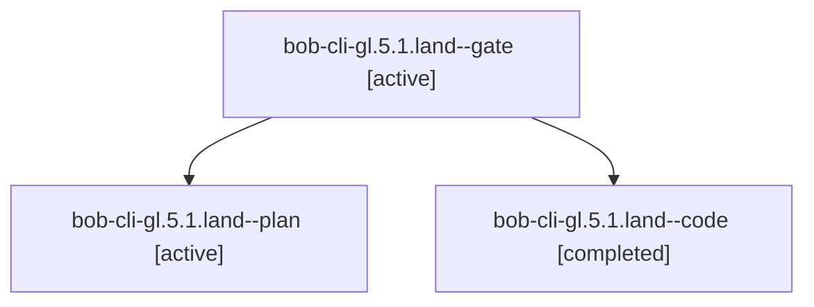

# Session: bob-cli-gl.5.1.land

[Agent Hoods](../README.md) / [bbugyi200](../users/bbugyi200/README.md) / [apollo](../users/bbugyi200/machines/apollo/README.md) / [bob-cli-gl](../users/bbugyi200/machines/apollo/hoods/bob-cli-gl/README.md) / bob-cli-gl.5.1.land

Owner: `bbugyi200.apollo` · Hood: `bob-cli-gl` · Members: 3 · Bead: [bob-cli-gl.5.1](https://github.com/bobs-org/bob-cli--beads/blob/main/pages/bob-cli-gl/bob-cli-gl.5.1.md)

## Lineage

The diagram is an optional enhancement; the ordered table below contains the same lineage in accessible text.

| Role | Agent | State | Model / provider | Timing | Commits | Prompt | Chat |
|---|---|---|---|---|---:|---|---|
| gate | bob-cli-gl.5.1.land--gate | active | gpt-6-astra / codex | 2026-11-04T01:42:53.600861+00:00 | 0 | — | [Chat](../agents/bbugyi200.apollo.bob-cli-gl.5.1.land--gate/chat.md) |
| plan | bob-cli-gl.5.1.land--plan | active | gpt-6-astra / codex | 2026-11-04T01:26:35.105726+00:00 | 0 | [Prompt](../agents/bbugyi200.apollo.bob-cli-gl.5.1.land--plan/prompt.md) | [Chat](../agents/bbugyi200.apollo.bob-cli-gl.5.1.land--plan/chat.md) |
| code | bob-cli-gl.5.1.land--code | completed | muse-spark-1.3-contributor / muse | 2026-11-04T01:43:41.309030+00:00 → 2026-11-04T02:30:52.985639+00:00 | [1](../agents/bbugyi200.apollo.bob-cli-gl.5.1.land--code/README.md#commits) | — | [Chat](../agents/bbugyi200.apollo.bob-cli-gl.5.1.land--code/chat.md) |

## Commits

| Role | Repo | Commit | Subject | Committed |
|---|---|---|---|---|
| code | bob-cli | [`b738d8f`](https://github.com/bobs-org/bob-cli/commit/b738d8f23b21ac855d83745bdd415af52dfbdc98) | feat(capture): repair project-note move landing integration | 2026-11-03 21:29:14 EST |

## Neighbors

| Agent | Relation | State |
|---|---|---|
| [bob-cli-gl.5](bbugyi200.apollo.bob-cli-gl.5.md) (session · 3) | ancestor | active 3 |
| [bob-cli-gl.5.1.1](bbugyi200.apollo.bob-cli-gl.5.1.1.md) (session · 5) | bob-cli-gl.5.1 hood | active 5 |
| [bob-cli-gl.5.1.2](bbugyi200.apollo.bob-cli-gl.5.1.2.md) (session · 3) | bob-cli-gl.5.1 hood | active 3 |
| [bob-cli-gl.5.1.3](bbugyi200.apollo.bob-cli-gl.5.1.3.md) (session · 3) | bob-cli-gl.5.1 hood | active 3 |
| [bob-cli-gl.1](../agents/bbugyi200.apollo.bob-cli-gl.1/README.md) | bob-cli-gl hood | active |
| [bob-cli-gl.2](../agents/bbugyi200.apollo.bob-cli-gl.2/README.md) | bob-cli-gl hood | active |
| [bob-cli-gl.3](../agents/bbugyi200.apollo.bob-cli-gl.3/README.md) | bob-cli-gl hood | active |
| [bob-cli-gl.4](../agents/bbugyi200.apollo.bob-cli-gl.4/README.md) | bob-cli-gl hood | active |
| [bob-cli-gl.6](../agents/bbugyi200.apollo.bob-cli-gl.6/README.md) | bob-cli-gl hood | active |
| [bob-cli-gl.7](../agents/bbugyi200.apollo.bob-cli-gl.7/README.md) | bob-cli-gl hood | active |
| [bob-cli-gl.land](../agents/bbugyi200.apollo.bob-cli-gl.land/README.md) | bob-cli-gl hood | active |
