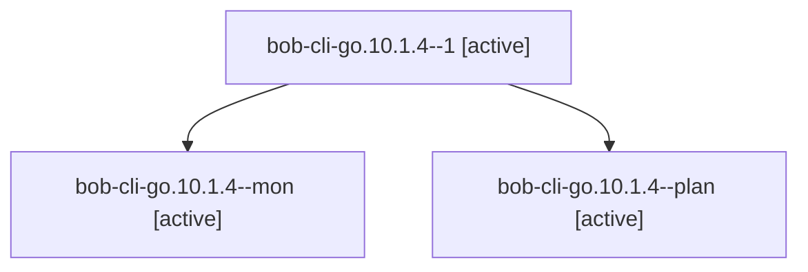

# Session: bob-cli-go.10.1.4

[Agent Hoods](../README.md) / [bbugyi200](../users/bbugyi200/README.md) / [apollo](../users/bbugyi200/machines/apollo/README.md) / [bob-cli-go](../users/bbugyi200/machines/apollo/hoods/bob-cli-go/README.md) / bob-cli-go.10.1.4

Owner: `bbugyi200.apollo` · Hood: `bob-cli-go` · Members: 3 · Bead: [bob-cli-go.10.1.4](https://github.com/bobs-org/bob-cli--beads/blob/main/pages/bob-cli-go/bob-cli-go.10.1.4.md)

## Lineage

The diagram is an optional enhancement; the ordered table below contains the same lineage in accessible text.

| Role | Agent | State | Model / provider | Timing | Commits | Prompt | Chat |
|---|---|---|---|---|---:|---|---|
| 1 | bob-cli-go.10.1.4--1 | active | gpt-6-astra / codex | 2026-11-04T12:21:00.839695+00:00 | [1](../agents/bbugyi200.apollo.bob-cli-go.10.1.4--1/README.md#commits) | [Prompt](../agents/bbugyi200.apollo.bob-cli-go.10.1.4--1/prompt.md) | — |
| mon | bob-cli-go.10.1.4--mon | active | gpt-6-astra / codex | 2026-11-04T12:06:33.244525+00:00 | 0 | — | — |
| plan | bob-cli-go.10.1.4--plan | active | gpt-6-astra / codex | 2026-11-04T11:39:59.706358+00:00 | 0 | [Prompt](../agents/bbugyi200.apollo.bob-cli-go.10.1.4--plan/prompt.md) | [Chat](../agents/bbugyi200.apollo.bob-cli-go.10.1.4--plan/chat.md) |

## Commits

| Role | Repo | Commit | Subject | Committed |
|---|---|---|---|---|
| 1 | — | `dad9e66` | feat(capture): implement staged transfer merges | 2026-11-04 07:25:51 EST |

## Neighbors

| Agent | Relation | State |
|---|---|---|
| [bob-cli-go.10](bbugyi200.apollo.bob-cli-go.10.md) (session · 3) | ancestor | active 1, dismissed 2 |
| [bob-cli-go.10.1.1](../agents/bbugyi200.apollo.bob-cli-go.10.1.1/README.md) | bob-cli-go.10.1 hood | active |
| [bob-cli-go.10.1.2](../agents/bbugyi200.apollo.bob-cli-go.10.1.2/README.md) | bob-cli-go.10.1 hood | active |
| [bob-cli-go.10.1.3](../agents/bbugyi200.apollo.bob-cli-go.10.1.3/README.md) | bob-cli-go.10.1 hood | active |
| [bob-cli-go.10.1.5](../agents/bbugyi200.apollo.bob-cli-go.10.1.5/README.md) | bob-cli-go.10.1 hood | active |
| [bob-cli-go.10.1.land](../agents/bbugyi200.apollo.bob-cli-go.10.1.land/README.md) | bob-cli-go.10.1 hood | active |
| [bob-cli-go.1](../agents/bbugyi200.apollo.bob-cli-go.1/README.md) | bob-cli-go hood | dismissed |
| [bob-cli-go.11](../agents/bbugyi200.apollo.bob-cli-go.11/README.md) | bob-cli-go hood | dismissed |
| [bob-cli-go.12](bbugyi200.apollo.bob-cli-go.12.md) (session · 5) | bob-cli-go hood | active 1, dismissed 4 |
| [bob-cli-go.13](../agents/bbugyi200.apollo.bob-cli-go.13/README.md) | bob-cli-go hood | dismissed |
| [bob-cli-go.2](bbugyi200.apollo.bob-cli-go.2.md) (session · 9) | bob-cli-go hood | active 2, dismissed 7 |
| [bob-cli-go.3](bbugyi200.apollo.bob-cli-go.3.md) (session · 15) | bob-cli-go hood | dismissed 15 |
| [bob-cli-go.4](bbugyi200.apollo.bob-cli-go.4.md) (session · 3) | bob-cli-go hood | active 1, dismissed 2 |
| [bob-cli-go.4.1.1](bbugyi200.apollo.bob-cli-go.4.1.1.md) (session · 5) | bob-cli-go hood | active 5 |
| [bob-cli-go.4.1.2](../agents/bbugyi200.apollo.bob-cli-go.4.1.2/README.md) | bob-cli-go hood | active |
| [bob-cli-go.4.1.3](bbugyi200.apollo.bob-cli-go.4.1.3.md) (session · 9) | bob-cli-go hood | active 9 |
| [bob-cli-go.4.1.land](bbugyi200.apollo.bob-cli-go.4.1.land.md) (session · 5) | bob-cli-go hood | active 3, completed 1, failed 1 |
| [bob-cli-go.5](../agents/bbugyi200.apollo.bob-cli-go.5/README.md) | bob-cli-go hood | dismissed |
| [bob-cli-go.6](../agents/bbugyi200.apollo.bob-cli-go.6/README.md) | bob-cli-go hood | dismissed |
| [bob-cli-go.7](../agents/bbugyi200.apollo.bob-cli-go.7/README.md) | bob-cli-go hood | dismissed |
| [bob-cli-go.8](../agents/bbugyi200.apollo.bob-cli-go.8/README.md) | bob-cli-go hood | dismissed |
| [bob-cli-go.9](../agents/bbugyi200.apollo.bob-cli-go.9/README.md) | bob-cli-go hood | dismissed |
| [bob-cli-go.land](bbugyi200.apollo.bob-cli-go.land.md) (session · 7) | bob-cli-go hood | active 1, completed 1, dismissed 4, failed 1 |
