# Session: bob-cli-go.3

[Agent Hoods](../README.md) / [bbugyi200](../users/bbugyi200/README.md) / [apollo](../users/bbugyi200/machines/apollo/README.md) / [bob-cli-go](../users/bbugyi200/machines/apollo/hoods/bob-cli-go/README.md) / bob-cli-go.3

Owner: `bbugyi200.apollo` · Hood: `bob-cli-go` · Members: 15 · Bead: [bob-cli-go.3](https://github.com/bobs-org/bob-cli--beads/blob/main/pages/bob-cli-go/bob-cli-go.3.md)

## Lineage

```mermaid
flowchart TD
  n0["bob-cli-go.3--mon-0 [dismissed]"]
  n1["bob-cli-go.3--mon [dismissed]"]
  n0 --> n1
  n2["bob-cli-go.3--mon-1 [dismissed]"]
  n0 --> n2
  n3["bob-cli-go.3--mon-5 [dismissed]"]
  n0 --> n3
  n4["bob-cli-go.3--6 [dismissed]"]
  n0 --> n4
  n5["bob-cli-go.3--2 [dismissed]"]
  n0 --> n5
  n6["bob-cli-go.3--mon-2 [dismissed]"]
  n0 --> n6
  n7["bob-cli-go.3--mon-3 [dismissed]"]
  n0 --> n7
  n8["bob-cli-go.3--5 [dismissed]"]
  n0 --> n8
  n9["bob-cli-go.3--plan [dismissed]"]
  n0 --> n9
  n10["bob-cli-go.3--3 [dismissed]"]
  n0 --> n10
  n11["bob-cli-go.3--4 [dismissed]"]
  n0 --> n11
  n12["bob-cli-go.3--1 [dismissed]"]
  n0 --> n12
  n13["bob-cli-go.3--7 [dismissed]"]
  n0 --> n13
  n14["bob-cli-go.3--mon-4 [dismissed]"]
  n0 --> n14
```

The diagram is an optional enhancement; the ordered table below contains the same lineage in accessible text.

| Role | Agent | State | Model / provider | Timing | Commits | Prompt | Chat |
|---|---|---|---|---|---:|---|---|
| mon-0 | bob-cli-go.3--mon-0 | dismissed | gpt-6-luna / codex | 2026-11-03T18:57:24.439002 → 2026-11-03T19:00:38.940648 | 0 | — | [Chat](../agents/bbugyi200.apollo.bob-cli-go.3--mon-0/chat.md) |
| mon | bob-cli-go.3--mon | dismissed | gpt-6-luna / codex | 2026-11-03T18:46:25.709758 → 2026-11-03T18:51:07.082779 | 0 | — | [Chat](../agents/bbugyi200.apollo.bob-cli-go.3--mon/chat.md) |
| mon-1 | bob-cli-go.3--mon-1 | dismissed | gpt-6-luna / codex | 2026-11-03T19:07:35.767691 → 2026-11-03T19:11:59.354963 | 0 | — | [Chat](../agents/bbugyi200.apollo.bob-cli-go.3--mon-1/chat.md) |
| mon-5 | bob-cli-go.3--mon-5 | dismissed | gpt-6-luna / codex | 2026-11-03T19:46:30.794214 → 2026-11-03T19:50:40.042172 | 0 | — | [Chat](../agents/bbugyi200.apollo.bob-cli-go.3--mon-5/chat.md) |
| 6 | bob-cli-go.3--6 | dismissed | gpt-6-luna / codex | 2026-11-03T19:44:15.600610 → 2026-11-03T19:47:22.955864 | 0 | [Prompt](../agents/bbugyi200.apollo.bob-cli-go.3--6/prompt.md) | [Chat](../agents/bbugyi200.apollo.bob-cli-go.3--6/chat.md) |
| 2 | bob-cli-go.3--2 | dismissed | gpt-6-luna / codex | 2026-11-03T19:02:35.469855 → 2026-11-03T19:08:26.542072 | 0 | [Prompt](../agents/bbugyi200.apollo.bob-cli-go.3--2/prompt.md) | [Chat](../agents/bbugyi200.apollo.bob-cli-go.3--2/chat.md) |
| mon-2 | bob-cli-go.3--mon-2 | dismissed | gpt-6-luna / codex | 2026-11-03T19:15:46.690852 → 2026-11-03T19:20:37.654220 | 0 | — | [Chat](../agents/bbugyi200.apollo.bob-cli-go.3--mon-2/chat.md) |
| mon-3 | bob-cli-go.3--mon-3 | dismissed | gpt-6-luna / codex | 2026-11-03T19:26:30.727372 → 2026-11-03T19:31:01.709139 | 0 | — | [Chat](../agents/bbugyi200.apollo.bob-cli-go.3--mon-3/chat.md) |
| 5 | bob-cli-go.3--5 | dismissed | gpt-6-luna / codex | 2026-11-03T19:32:44.531183 → 2026-11-03T19:37:54.668385 | 0 | [Prompt](../agents/bbugyi200.apollo.bob-cli-go.3--5/prompt.md) | [Chat](../agents/bbugyi200.apollo.bob-cli-go.3--5/chat.md) |
| plan | bob-cli-go.3--plan | dismissed | gpt-6-luna / codex | 2026-11-03T18:06:26.524890 → 2026-11-03T18:47:24.164591 | 0 | [Prompt](../agents/bbugyi200.apollo.bob-cli-go.3--plan/prompt.md) | [Chat](../agents/bbugyi200.apollo.bob-cli-go.3--plan/chat.md) |
| 3 | bob-cli-go.3--3 | dismissed | gpt-6-luna / codex | 2026-11-03T19:13:31.068275 → 2026-11-03T19:16:37.007474 | 0 | [Prompt](../agents/bbugyi200.apollo.bob-cli-go.3--3/prompt.md) | [Chat](../agents/bbugyi200.apollo.bob-cli-go.3--3/chat.md) |
| 4 | bob-cli-go.3--4 | dismissed | gpt-6-luna / codex | 2026-11-03T19:22:18.220091 → 2026-11-03T19:27:23.818258 | 0 | [Prompt](../agents/bbugyi200.apollo.bob-cli-go.3--4/prompt.md) | [Chat](../agents/bbugyi200.apollo.bob-cli-go.3--4/chat.md) |
| 1 | bob-cli-go.3--1 | dismissed | gpt-6-luna / codex | 2026-11-03T18:52:37.981546 → 2026-11-03T18:58:20.351164 | 0 | [Prompt](../agents/bbugyi200.apollo.bob-cli-go.3--1/prompt.md) | [Chat](../agents/bbugyi200.apollo.bob-cli-go.3--1/chat.md) |
| 7 | bob-cli-go.3--7 | dismissed | gpt-6-luna / codex | 2026-11-03T19:52:11.932845 → 2026-11-03T19:55:44.394903 | [1](../agents/bbugyi200.apollo.bob-cli-go.3--7/README.md#commits) | [Prompt](../agents/bbugyi200.apollo.bob-cli-go.3--7/prompt.md) | [Chat](../agents/bbugyi200.apollo.bob-cli-go.3--7/chat.md) |
| mon-4 | bob-cli-go.3--mon-4 | dismissed | gpt-6-luna / codex | 2026-11-03T19:36:41.957669 → 2026-11-03T19:41:51.565334 | 0 | — | [Chat](../agents/bbugyi200.apollo.bob-cli-go.3--mon-4/chat.md) |

## Commits

| Role | Repo | Commit | Subject | Committed |
|---|---|---|---|---|
| 7 | — | `734214e` | feat(task): add task split planner and CLI | 2026-11-03 19:54:52 EST |

## Neighbors

| Agent | Relation | State |
|---|---|---|
| [bob-cli-go.1](../agents/bbugyi200.apollo.bob-cli-go.1/README.md) | bob-cli-go hood | dismissed |
| [bob-cli-go.10](bbugyi200.apollo.bob-cli-go.10.md) (session · 3) | bob-cli-go hood | dismissed 3 |
| [bob-cli-go.10.1.1](../agents/bbugyi200.apollo.bob-cli-go.10.1.1/README.md) | bob-cli-go hood | active |
| [bob-cli-go.10.1.2](../agents/bbugyi200.apollo.bob-cli-go.10.1.2/README.md) | bob-cli-go hood | active |
| [bob-cli-go.10.1.3](../agents/bbugyi200.apollo.bob-cli-go.10.1.3/README.md) | bob-cli-go hood | active |
| [bob-cli-go.10.1.4](bbugyi200.apollo.bob-cli-go.10.1.4.md) (session · 3) | bob-cli-go hood | active 3 |
| [bob-cli-go.10.1.5](../agents/bbugyi200.apollo.bob-cli-go.10.1.5/README.md) | bob-cli-go hood | active |
| [bob-cli-go.10.1.land](../agents/bbugyi200.apollo.bob-cli-go.10.1.land/README.md) | bob-cli-go hood | active |
| [bob-cli-go.11](../agents/bbugyi200.apollo.bob-cli-go.11/README.md) | bob-cli-go hood | dismissed |
| [bob-cli-go.12](bbugyi200.apollo.bob-cli-go.12.md) (session · 5) | bob-cli-go hood | dismissed 5 |
| [bob-cli-go.13](../agents/bbugyi200.apollo.bob-cli-go.13/README.md) | bob-cli-go hood | dismissed |
| [bob-cli-go.2](bbugyi200.apollo.bob-cli-go.2.md) (session · 9) | bob-cli-go hood | dismissed 9 |
| [bob-cli-go.4](bbugyi200.apollo.bob-cli-go.4.md) (session · 3) | bob-cli-go hood | dismissed 3 |
| [bob-cli-go.4.1.1](bbugyi200.apollo.bob-cli-go.4.1.1.md) (session · 5) | bob-cli-go hood | active 5 |
| [bob-cli-go.4.1.2](../agents/bbugyi200.apollo.bob-cli-go.4.1.2/README.md) | bob-cli-go hood | active |
| [bob-cli-go.4.1.3](bbugyi200.apollo.bob-cli-go.4.1.3.md) (session · 9) | bob-cli-go hood | active 9 |
| [bob-cli-go.4.1.land](bbugyi200.apollo.bob-cli-go.4.1.land.md) (session · 5) | bob-cli-go hood | active 3, completed 1, failed 1 |
| [bob-cli-go.5](../agents/bbugyi200.apollo.bob-cli-go.5/README.md) | bob-cli-go hood | dismissed |
| [bob-cli-go.6](../agents/bbugyi200.apollo.bob-cli-go.6/README.md) | bob-cli-go hood | dismissed |
| [bob-cli-go.7](../agents/bbugyi200.apollo.bob-cli-go.7/README.md) | bob-cli-go hood | dismissed |
| [bob-cli-go.8](../agents/bbugyi200.apollo.bob-cli-go.8/README.md) | bob-cli-go hood | dismissed |
| [bob-cli-go.9](../agents/bbugyi200.apollo.bob-cli-go.9/README.md) | bob-cli-go hood | dismissed |
| [bob-cli-go.land](bbugyi200.apollo.bob-cli-go.land.md) (session · 7) | bob-cli-go hood | completed 1, dismissed 5, failed 1 |
