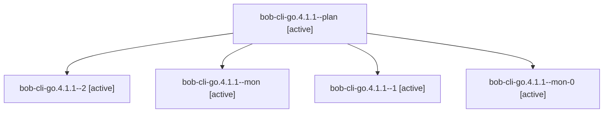

# Session: bob-cli-go.4.1.1

[Agent Hoods](../README.md) / [bbugyi200](../users/bbugyi200/README.md) / [apollo](../users/bbugyi200/machines/apollo/README.md) / [bob-cli-go](../users/bbugyi200/machines/apollo/hoods/bob-cli-go/README.md) / bob-cli-go.4.1.1

Owner: `bbugyi200.apollo` · Hood: `bob-cli-go` · Members: 5 · Bead: [bob-cli-go.4.1.1](https://github.com/bobs-org/bob-cli--beads/blob/main/pages/bob-cli-go/bob-cli-go.4.1.1.md)

## Lineage

The diagram is an optional enhancement; the ordered table below contains the same lineage in accessible text.

| Role | Agent | State | Model / provider | Timing | Commits | Prompt | Chat |
|---|---|---|---|---|---:|---|---|
| plan | bob-cli-go.4.1.1--plan | active | gpt-6-luna / codex | 2026-11-03T23:16:27.073179+00:00 | 0 | [Prompt](../agents/bbugyi200.apollo.bob-cli-go.4.1.1--plan/prompt.md) | [Chat](../agents/bbugyi200.apollo.bob-cli-go.4.1.1--plan/chat.md) |
| 2 | bob-cli-go.4.1.1--2 | active | gpt-6-luna / codex | 2026-11-04T00:13:34.797827+00:00 | [1](../agents/bbugyi200.apollo.bob-cli-go.4.1.1--2/README.md#commits) | [Prompt](../agents/bbugyi200.apollo.bob-cli-go.4.1.1--2/prompt.md) | — |
| mon | bob-cli-go.4.1.1--mon | active | gpt-6-luna / codex | 2026-11-03T23:39:10.482324+00:00 | 0 | — | — |
| 1 | bob-cli-go.4.1.1--1 | active | gpt-6-luna / codex | 2026-11-03T23:44:54.398494+00:00 | [1](../agents/bbugyi200.apollo.bob-cli-go.4.1.1--1/README.md#commits) | [Prompt](../agents/bbugyi200.apollo.bob-cli-go.4.1.1--1/prompt.md) | [Chat](../agents/bbugyi200.apollo.bob-cli-go.4.1.1--1/chat.md) |
| mon-0 | bob-cli-go.4.1.1--mon-0 | active | gpt-6-luna / codex | 2026-11-04T00:06:34.322516+00:00 | 0 | — | — |

## Commits

| Role | Repo | Commit | Subject | Committed |
|---|---|---|---|---|
| 1 | bob-cli | [`adf2082`](https://github.com/bobs-org/bob-cli/commit/adf20825f77d3adc059ae69e7809018e4b75bcbe) | fix(task-merge): resolve payload preparation failures | 2026-11-03 19:07:47 EST |
| 2 | bob-cli | [`672954d`](https://github.com/bobs-org/bob-cli/commit/672954d4bf2d740405230be9ee2e098ff33405e1) | test(task-merge): fix nested payload indentation assertion | 2026-11-03 19:48:45 EST |

## Neighbors

| Agent | Relation | State |
|---|---|---|
| [bob-cli-go.4](bbugyi200.apollo.bob-cli-go.4.md) (session · 3) | ancestor | active 3 |
| [bob-cli-go.4.1.2](../agents/bbugyi200.apollo.bob-cli-go.4.1.2/README.md) | bob-cli-go.4.1 hood | active |
| [bob-cli-go.4.1.3](bbugyi200.apollo.bob-cli-go.4.1.3.md) (session · 9) | bob-cli-go.4.1 hood | active 9 |
| [bob-cli-go.4.1.land](bbugyi200.apollo.bob-cli-go.4.1.land.md) (session · 5) | bob-cli-go.4.1 hood | active 3, completed 1, failed 1 |
| [bob-cli-go.1](../agents/bbugyi200.apollo.bob-cli-go.1/README.md) | bob-cli-go hood | active |
| [bob-cli-go.10](bbugyi200.apollo.bob-cli-go.10.md) (session · 3) | bob-cli-go hood | active 3 |
| [bob-cli-go.10.1.1](../agents/bbugyi200.apollo.bob-cli-go.10.1.1/README.md) | bob-cli-go hood | active |
| [bob-cli-go.10.1.2](../agents/bbugyi200.apollo.bob-cli-go.10.1.2/README.md) | bob-cli-go hood | active |
| [bob-cli-go.10.1.3](../agents/bbugyi200.apollo.bob-cli-go.10.1.3/README.md) | bob-cli-go hood | active |
| [bob-cli-go.10.1.4](bbugyi200.apollo.bob-cli-go.10.1.4.md) (session · 3) | bob-cli-go hood | active 3 |
| [bob-cli-go.10.1.5](../agents/bbugyi200.apollo.bob-cli-go.10.1.5/README.md) | bob-cli-go hood | active |
| [bob-cli-go.10.1.land](../agents/bbugyi200.apollo.bob-cli-go.10.1.land/README.md) | bob-cli-go hood | active |
| [bob-cli-go.11](../agents/bbugyi200.apollo.bob-cli-go.11/README.md) | bob-cli-go hood | active |
| [bob-cli-go.12](bbugyi200.apollo.bob-cli-go.12.md) (session · 5) | bob-cli-go hood | active 5 |
| [bob-cli-go.13](../agents/bbugyi200.apollo.bob-cli-go.13/README.md) | bob-cli-go hood | active |
| [bob-cli-go.2](bbugyi200.apollo.bob-cli-go.2.md) (session · 9) | bob-cli-go hood | active 9 |
| [bob-cli-go.3](bbugyi200.apollo.bob-cli-go.3.md) (session · 15) | bob-cli-go hood | active 15 |
| [bob-cli-go.5](../agents/bbugyi200.apollo.bob-cli-go.5/README.md) | bob-cli-go hood | active |
| [bob-cli-go.6](../agents/bbugyi200.apollo.bob-cli-go.6/README.md) | bob-cli-go hood | active |
| [bob-cli-go.7](../agents/bbugyi200.apollo.bob-cli-go.7/README.md) | bob-cli-go hood | active |
| [bob-cli-go.8](../agents/bbugyi200.apollo.bob-cli-go.8/README.md) | bob-cli-go hood | active |
| [bob-cli-go.9](../agents/bbugyi200.apollo.bob-cli-go.9/README.md) | bob-cli-go hood | active |
| [bob-cli-go.land](bbugyi200.apollo.bob-cli-go.land.md) (session · 7) | bob-cli-go hood | active 5, completed 1, failed 1 |
