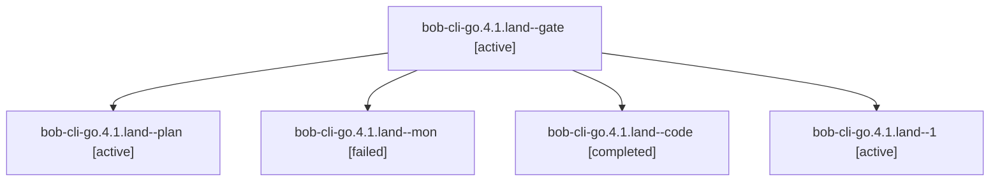

# Session: bob-cli-go.4.1.land

[Agent Hoods](../README.md) / [bbugyi200](../users/bbugyi200/README.md) / [apollo](../users/bbugyi200/machines/apollo/README.md) / [bob-cli-go](../users/bbugyi200/machines/apollo/hoods/bob-cli-go/README.md) / bob-cli-go.4.1.land

Owner: `bbugyi200.apollo` · Hood: `bob-cli-go` · Members: 5 · Bead: [bob-cli-go.4.1](https://github.com/bobs-org/bob-cli--beads/blob/main/pages/bob-cli-go/bob-cli-go.4.1.md)

## Lineage

The diagram is an optional enhancement; the ordered table below contains the same lineage in accessible text.

| Role | Agent | State | Model / provider | Timing | Commits | Prompt | Chat |
|---|---|---|---|---|---:|---|---|
| gate | bob-cli-go.4.1.land--gate | active | gpt-6-astra / codex | 2026-11-04T03:43:38.949950+00:00 | 0 | — | [Chat](../agents/bbugyi200.apollo.bob-cli-go.4.1.land--gate/chat.md) |
| plan | bob-cli-go.4.1.land--plan | active | gpt-6-astra / codex | 2026-11-04T03:22:00.378768+00:00 | [1](../agents/bbugyi200.apollo.bob-cli-go.4.1.land--plan/README.md#commits) | [Prompt](../agents/bbugyi200.apollo.bob-cli-go.4.1.land--plan/prompt.md) | [Chat](../agents/bbugyi200.apollo.bob-cli-go.4.1.land--plan/chat.md) |
| mon | bob-cli-go.4.1.land--mon | failed | gpt-6-luna / codex | 2026-11-04T04:43:28.574161+00:00 → 2026-11-04T04:49:45.271701+00:00 | 0 | — | [Chat](../agents/bbugyi200.apollo.bob-cli-go.4.1.land--mon/chat.md) |
| code | bob-cli-go.4.1.land--code | completed | gpt-6-luna / codex | 2026-11-04T03:44:27.349116+00:00 → 2026-11-04T04:44:40.325260+00:00 | 0 | — | [Chat](../agents/bbugyi200.apollo.bob-cli-go.4.1.land--code/chat.md) |
| 1 | bob-cli-go.4.1.land--1 | active | gpt-6-luna / codex | 2026-11-04T04:50:02.558928+00:00 | [1](../agents/bbugyi200.apollo.bob-cli-go.4.1.land--1/README.md#commits) | [Prompt](../agents/bbugyi200.apollo.bob-cli-go.4.1.land--1/prompt.md) | — |

## Commits

| Role | Repo | Commit | Subject | Committed |
|---|---|---|---|---|
| plan | — | `66828cf` | feat(capture): execute adjacent task target runs | 2026-11-03 22:28:47 EST |
| 1 | — | `c892b0c` | fix(task-merge): repair landing edge cases | 2026-11-04 00:21:40 EST |

## Neighbors

| Agent | Relation | State |
|---|---|---|
| [bob-cli-go.4](bbugyi200.apollo.bob-cli-go.4.md) (session · 3) | ancestor | dismissed 3 |
| [bob-cli-go.4.1.1](bbugyi200.apollo.bob-cli-go.4.1.1.md) (session · 5) | bob-cli-go.4.1 hood | active 5 |
| [bob-cli-go.4.1.2](../agents/bbugyi200.apollo.bob-cli-go.4.1.2/README.md) | bob-cli-go.4.1 hood | active |
| [bob-cli-go.4.1.3](bbugyi200.apollo.bob-cli-go.4.1.3.md) (session · 9) | bob-cli-go.4.1 hood | active 9 |
| [bob-cli-go.1](../agents/bbugyi200.apollo.bob-cli-go.1/README.md) | bob-cli-go hood | dismissed |
| [bob-cli-go.10](bbugyi200.apollo.bob-cli-go.10.md) (session · 3) | bob-cli-go hood | dismissed 3 |
| [bob-cli-go.10.1.1](../agents/bbugyi200.apollo.bob-cli-go.10.1.1/README.md) | bob-cli-go hood | active |
| [bob-cli-go.10.1.2](../agents/bbugyi200.apollo.bob-cli-go.10.1.2/README.md) | bob-cli-go hood | active |
| [bob-cli-go.10.1.3](../agents/bbugyi200.apollo.bob-cli-go.10.1.3/README.md) | bob-cli-go hood | active |
| [bob-cli-go.10.1.4](bbugyi200.apollo.bob-cli-go.10.1.4.md) (session · 3) | bob-cli-go hood | active 3 |
| [bob-cli-go.10.1.5](../agents/bbugyi200.apollo.bob-cli-go.10.1.5/README.md) | bob-cli-go hood | active |
| [bob-cli-go.10.1.land](../agents/bbugyi200.apollo.bob-cli-go.10.1.land/README.md) | bob-cli-go hood | active |
| [bob-cli-go.11](../agents/bbugyi200.apollo.bob-cli-go.11/README.md) | bob-cli-go hood | dismissed |
| [bob-cli-go.12](bbugyi200.apollo.bob-cli-go.12.md) (session · 5) | bob-cli-go hood | dismissed 5 |
| [bob-cli-go.13](../agents/bbugyi200.apollo.bob-cli-go.13/README.md) | bob-cli-go hood | dismissed |
| [bob-cli-go.2](bbugyi200.apollo.bob-cli-go.2.md) (session · 9) | bob-cli-go hood | dismissed 9 |
| [bob-cli-go.3](bbugyi200.apollo.bob-cli-go.3.md) (session · 15) | bob-cli-go hood | dismissed 15 |
| [bob-cli-go.5](../agents/bbugyi200.apollo.bob-cli-go.5/README.md) | bob-cli-go hood | dismissed |
| [bob-cli-go.6](../agents/bbugyi200.apollo.bob-cli-go.6/README.md) | bob-cli-go hood | dismissed |
| [bob-cli-go.7](../agents/bbugyi200.apollo.bob-cli-go.7/README.md) | bob-cli-go hood | dismissed |
| [bob-cli-go.8](../agents/bbugyi200.apollo.bob-cli-go.8/README.md) | bob-cli-go hood | dismissed |
| [bob-cli-go.9](../agents/bbugyi200.apollo.bob-cli-go.9/README.md) | bob-cli-go hood | dismissed |
| [bob-cli-go.land](bbugyi200.apollo.bob-cli-go.land.md) (session · 7) | bob-cli-go hood | completed 1, dismissed 5, failed 1 |
