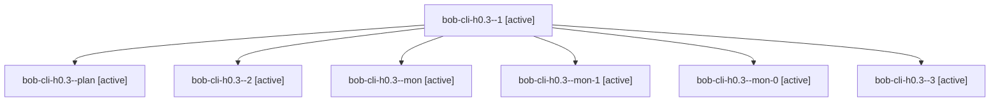

# Session: bob-cli-h0.3

[Agent Hoods](../README.md) / [bbugyi200](../users/bbugyi200/README.md) / [apollo](../users/bbugyi200/machines/apollo/README.md) / [bob-cli-h0](../users/bbugyi200/machines/apollo/hoods/bob-cli-h0/README.md) / bob-cli-h0.3

Owner: `bbugyi200.apollo` · Hood: `bob-cli-h0` · Members: 7 · Bead: [bob-cli-h0.3](https://github.com/bobs-org/bob-cli--beads/blob/main/pages/bob-cli-h0/bob-cli-h0.3.md)

## Lineage

The diagram is an optional enhancement; the ordered table below contains the same lineage in accessible text.

| Role | Agent | State | Model / provider | Timing | Commits | Prompt | Chat |
|---|---|---|---|---|---:|---|---|
| 1 | bob-cli-h0.3--1 | active | gpt-6-luna / codex | 2026-11-04T14:57:23.427083+00:00 | 0 | [Prompt](../agents/bbugyi200.apollo.bob-cli-h0.3--1/prompt.md) | [Chat](../agents/bbugyi200.apollo.bob-cli-h0.3--1/chat.md) |
| plan | bob-cli-h0.3--plan | active | gpt-6-luna / codex | 2026-11-04T14:16:34.211470+00:00 | 0 | [Prompt](../agents/bbugyi200.apollo.bob-cli-h0.3--plan/prompt.md) | [Chat](../agents/bbugyi200.apollo.bob-cli-h0.3--plan/chat.md) |
| 2 | bob-cli-h0.3--2 | active | muse-spark-1.3-contributor / muse | 2026-11-04T15:20:35.285311+00:00 | 0 | [Prompt](../agents/bbugyi200.apollo.bob-cli-h0.3--2/prompt.md) | [Chat](../agents/bbugyi200.apollo.bob-cli-h0.3--2/chat.md) |
| mon | bob-cli-h0.3--mon | active | gpt-6-luna / codex | 2026-11-04T14:42:06.543249+00:00 | 0 | — | [Chat](../agents/bbugyi200.apollo.bob-cli-h0.3--mon/chat.md) |
| mon-1 | bob-cli-h0.3--mon-1 | active | muse-spark-1.3-contributor / muse | 2026-11-04T15:26:41.069756+00:00 | 0 | — | [Chat](../agents/bbugyi200.apollo.bob-cli-h0.3--mon-1/chat.md) |
| mon-0 | bob-cli-h0.3--mon-0 | active | gpt-6-luna / codex | 2026-11-04T15:05:53.037323+00:00 | 0 | — | [Chat](../agents/bbugyi200.apollo.bob-cli-h0.3--mon-0/chat.md) |
| 3 | bob-cli-h0.3--3 | active | muse-spark-1.3-contributor / muse | 2026-11-04T15:55:47.950615+00:00 | [1](../agents/bbugyi200.apollo.bob-cli-h0.3--3/README.md#commits) | [Prompt](../agents/bbugyi200.apollo.bob-cli-h0.3--3/prompt.md) | [Chat](../agents/bbugyi200.apollo.bob-cli-h0.3--3/chat.md) |

## Commits

| Role | Repo | Commit | Subject | Committed |
|---|---|---|---|---|
| 3 | bob-cli | [`abf427c`](https://github.com/bobs-org/bob-cli/commit/abf427c211d5f8ee7c1ed7cbbc1a983418dc89bd) | feat(capture): share one planner-true move consequence builder | 2026-11-04 10:57:02 EST |

## Neighbors

| Agent | Relation | State |
|---|---|---|
| [bob-cli-h0.1](../agents/bbugyi200.apollo.bob-cli-h0.1/README.md) | bob-cli-h0 hood | active |
| [bob-cli-h0.2](../agents/bbugyi200.apollo.bob-cli-h0.2/README.md) | bob-cli-h0 hood | active |
| [bob-cli-h0.4](../agents/bbugyi200.apollo.bob-cli-h0.4/README.md) | bob-cli-h0 hood | active |
| [bob-cli-h0.5](../agents/bbugyi200.apollo.bob-cli-h0.5/README.md) | bob-cli-h0 hood | active |
| [bob-cli-h0.6](../agents/bbugyi200.apollo.bob-cli-h0.6/README.md) | bob-cli-h0 hood | active |
| [bob-cli-h0.7](bbugyi200.apollo.bob-cli-h0.7.md) (session · 3) | bob-cli-h0 hood | active 3 |
| [bob-cli-h0.8](../agents/bbugyi200.apollo.bob-cli-h0.8/README.md) | bob-cli-h0 hood | active |
| [bob-cli-h0.land](bbugyi200.apollo.bob-cli-h0.land.md) (session · 9) | bob-cli-h0 hood | active 7, completed 2 |
