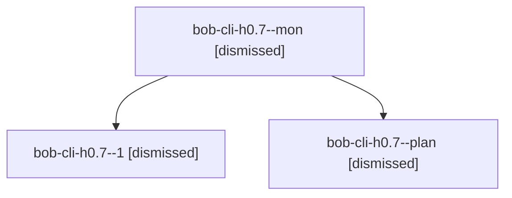

# Session: bob-cli-h0.7

[Agent Hoods](../README.md) / [bbugyi200](../users/bbugyi200/README.md) / [apollo](../users/bbugyi200/machines/apollo/README.md) / [bob-cli-h0](../users/bbugyi200/machines/apollo/hoods/bob-cli-h0/README.md) / bob-cli-h0.7

Owner: `bbugyi200.apollo` · Hood: `bob-cli-h0` · Members: 3 · Bead: [bob-cli-h0.7](https://github.com/bobs-org/bob-cli--beads/blob/main/pages/bob-cli-h0/bob-cli-h0.7.md)

## Lineage

The diagram is an optional enhancement; the ordered table below contains the same lineage in accessible text.

| Role | Agent | State | Model / provider | Timing | Commits | Prompt | Chat |
|---|---|---|---|---|---:|---|---|
| mon | bob-cli-h0.7--mon | dismissed | gpt-6-luna / codex | 2026-11-04T13:18:15.940689 → 2026-11-04T13:19:14.673962 | 0 | — | [Chat](../agents/bbugyi200.apollo.bob-cli-h0.7--mon/chat.md) |
| 1 | bob-cli-h0.7--1 | dismissed | gpt-6-luna / codex | 2026-11-04T13:21:13.102173 → 2026-11-04T13:33:26.293734 | 0 | [Prompt](../agents/bbugyi200.apollo.bob-cli-h0.7--1/prompt.md) | [Chat](../agents/bbugyi200.apollo.bob-cli-h0.7--1/chat.md) |
| plan | bob-cli-h0.7--plan | dismissed | gpt-6-luna / codex | 2026-11-04T13:01:00.564362 → 2026-11-04T13:19:14.804288 | 0 | [Prompt](../agents/bbugyi200.apollo.bob-cli-h0.7--plan/prompt.md) | [Chat](../agents/bbugyi200.apollo.bob-cli-h0.7--plan/chat.md) |

## Neighbors

| Agent | Relation | State |
|---|---|---|
| [bob-cli-h0.1](../agents/bbugyi200.apollo.bob-cli-h0.1/README.md) | bob-cli-h0 hood | dismissed |
| [bob-cli-h0.2](../agents/bbugyi200.apollo.bob-cli-h0.2/README.md) | bob-cli-h0 hood | dismissed |
| [bob-cli-h0.3](bbugyi200.apollo.bob-cli-h0.3.md) (session · 7) | bob-cli-h0 hood | dismissed 7 |
| [bob-cli-h0.4](../agents/bbugyi200.apollo.bob-cli-h0.4/README.md) | bob-cli-h0 hood | dismissed |
| [bob-cli-h0.5](../agents/bbugyi200.apollo.bob-cli-h0.5/README.md) | bob-cli-h0 hood | dismissed |
| [bob-cli-h0.6](../agents/bbugyi200.apollo.bob-cli-h0.6/README.md) | bob-cli-h0 hood | dismissed |
| [bob-cli-h0.8](../agents/bbugyi200.apollo.bob-cli-h0.8/README.md) | bob-cli-h0 hood | dismissed |
| [bob-cli-h0.land](bbugyi200.apollo.bob-cli-h0.land.md) (session · 9) | bob-cli-h0 hood | completed 2, dismissed 7 |
