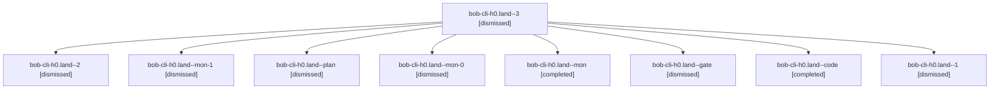

# Session: bob-cli-h0.land

[Agent Hoods](../README.md) / [bbugyi200](../users/bbugyi200/README.md) / [apollo](../users/bbugyi200/machines/apollo/README.md) / [bob-cli-h0](../users/bbugyi200/machines/apollo/hoods/bob-cli-h0/README.md) / bob-cli-h0.land

Owner: `bbugyi200.apollo` · Hood: `bob-cli-h0` · Members: 9 · Bead: [bob-cli-h0](https://github.com/bobs-org/bob-cli--beads/blob/main/pages/bob-cli-h0/README.md)

## Lineage



The diagram is an optional enhancement; the ordered table below contains the same lineage in accessible text.

| Role | Agent | State | Model / provider | Timing | Commits | Prompt | Chat |
|---|---|---|---|---|---:|---|---|
| <a id="member-3"></a>3 | bob-cli-h0.land--3 | dismissed | gpt-6-luna / codex | 2026-11-04T18:57:41.138643 → 2026-11-04T19:16:47.615846 | [1](../agents/bbugyi200.apollo.bob-cli-h0.land--3/README.md#commits) | [Prompt](../agents/bbugyi200.apollo.bob-cli-h0.land--3/prompt.md) | [Chat](../agents/bbugyi200.apollo.bob-cli-h0.land--3/chat.md) |
| <a id="member-2"></a>2 | bob-cli-h0.land--2 | dismissed | gpt-6-luna / codex | 2026-11-04T18:30:45.767005 → 2026-11-04T18:44:17.927126 | 0 | [Prompt](../agents/bbugyi200.apollo.bob-cli-h0.land--2/prompt.md) | [Chat](../agents/bbugyi200.apollo.bob-cli-h0.land--2/chat.md) |
| <a id="member-mon-1"></a>mon-1 | bob-cli-h0.land--mon-1 | dismissed | gpt-6-luna / codex | 2026-11-04T18:42:47.333019 → 2026-11-04T18:55:39.575467 | 0 | — | [Chat](../agents/bbugyi200.apollo.bob-cli-h0.land--mon-1/chat.md) |
| <a id="member-plan"></a>plan | bob-cli-h0.land--plan | dismissed | opus / claude | 2026-11-04T16:08:42.871606 → 2026-11-04T17:41:23.911202 | [1](../agents/bbugyi200.apollo.bob-cli-h0.land--plan/README.md#commits) | [Prompt](../agents/bbugyi200.apollo.bob-cli-h0.land--plan/prompt.md) | [Chat](../agents/bbugyi200.apollo.bob-cli-h0.land--plan/chat.md) |
| <a id="member-mon-0"></a>mon-0 | bob-cli-h0.land--mon-0 | dismissed | gpt-6-luna / codex | 2026-11-04T17:54:19.378370 → 2026-11-04T18:29:17.050648 | 0 | — | [Chat](../agents/bbugyi200.apollo.bob-cli-h0.land--mon-0/chat.md) |
| <a id="member-mon"></a>mon | bob-cli-h0.land--mon | completed | gpt-6-luna / codex | 2026-11-04T22:38:34.725146+00:00 → 2026-11-04T22:45:33.533870+00:00 | 0 | — | [Chat](../agents/bbugyi200.apollo.bob-cli-h0.land--mon/chat.md) |
| <a id="member-gate"></a>gate | bob-cli-h0.land--gate | dismissed | opus / claude | 2026-11-04T16:49:11.416254 → 2026-11-04T16:49:30 | 0 | — | [Chat](../agents/bbugyi200.apollo.bob-cli-h0.land--gate/chat.md) |
| <a id="member-code"></a>code | bob-cli-h0.land--code | completed | gpt-6-luna / codex | 2026-11-04T21:50:21.699218+00:00 → 2026-11-04T22:41:23.540304+00:00 | 0 | — | [Chat](../agents/bbugyi200.apollo.bob-cli-h0.land--code/chat.md) |
| <a id="member-1"></a>1 | bob-cli-h0.land--1 | dismissed | gpt-6-luna / codex | 2026-11-04T17:45:37.082826 → 2026-11-04T18:26:48.701481 | 0 | [Prompt](../agents/bbugyi200.apollo.bob-cli-h0.land--1/prompt.md) | [Chat](../agents/bbugyi200.apollo.bob-cli-h0.land--1/chat.md) |

## Commits

| Role | Repo | Commit | Subject | Committed |
|---|---|---|---|---|
| plan | — | `29f2089` | test(capture): refresh np-move note-pull fixtures for enriched move records | 2026-11-04 16:48:19 EST |
| 3 | — | `3da7ff4` | feat(capture): add project-note move choice flow | 2026-11-04 19:15:25 EST |

## Variables

| Role | Variable | Value |
|---|---|---|
| 3 | `artifacts` | \[{bead: bob-cli-bo, kind: markdown, label: Capture-related debug performance gate flake evidence, path: /home/bryan/.sase/artifacts/agents/gh\_bobs-org\_\_bob-cli/20261104185626/capture-related-flake-ev… |

#### artifacts

**Role:** `3`

```yaml
- bead: bob-cli-bo
  kind: markdown
  label: Capture-related debug performance gate flake evidence
  path: /home/bryan/.sase/artifacts/agents/gh_bobs-org__bob-cli/20261104185626/capture-related-flake-evidence-aa05f77ac503.md
  ref: file:explicit:e551fc295aa391a56842f610
```

Values are truncated for display; see each member's agent meta.json for the full values.

## Neighbors

| Agent | Relation | State |
|---|---|---|
| [bob-cli-h0.1](../agents/bbugyi200.apollo.bob-cli-h0.1/README.md) | bob-cli-h0 hood | dismissed |
| [bob-cli-h0.2](../agents/bbugyi200.apollo.bob-cli-h0.2/README.md) | bob-cli-h0 hood | dismissed |
| [bob-cli-h0.3](bbugyi200.apollo.bob-cli-h0.3.md) (session · 7) | bob-cli-h0 hood | dismissed 7 |
| [bob-cli-h0.4](../agents/bbugyi200.apollo.bob-cli-h0.4/README.md) | bob-cli-h0 hood | dismissed |
| [bob-cli-h0.5](../agents/bbugyi200.apollo.bob-cli-h0.5/README.md) | bob-cli-h0 hood | dismissed |
| [bob-cli-h0.6](../agents/bbugyi200.apollo.bob-cli-h0.6/README.md) | bob-cli-h0 hood | dismissed |
| [bob-cli-h0.7](bbugyi200.apollo.bob-cli-h0.7.md) (session · 3) | bob-cli-h0 hood | dismissed 3 |
| [bob-cli-h0.8](../agents/bbugyi200.apollo.bob-cli-h0.8/README.md) | bob-cli-h0 hood | dismissed |
