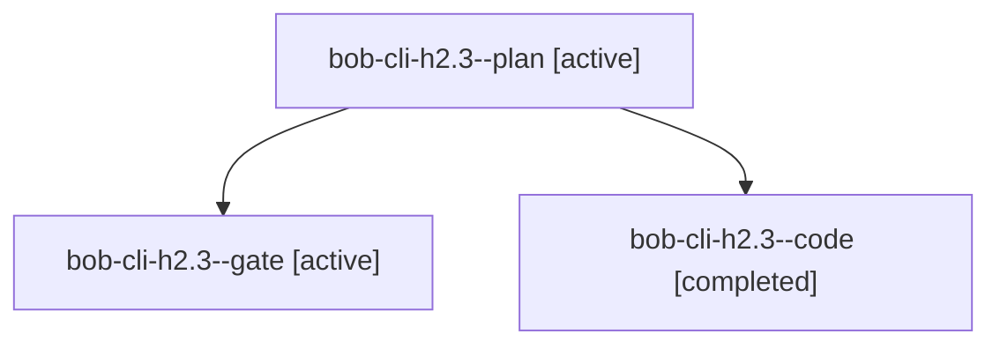

# Session: bob-cli-h2.3

[Agent Hoods](../README.md) / [bbugyi200](../users/bbugyi200/README.md) / [apollo](../users/bbugyi200/machines/apollo/README.md) / [bob-cli-h2](../users/bbugyi200/machines/apollo/hoods/bob-cli-h2/README.md) / bob-cli-h2.3

Owner: `bbugyi200.apollo` · Hood: `bob-cli-h2` · Members: 3 · Bead: [bob-cli-h2.3](https://github.com/bobs-org/bob-cli--beads/blob/main/pages/bob-cli-h2/bob-cli-h2.3.md)

## Lineage

The diagram is an optional enhancement; the ordered table below contains the same lineage in accessible text.

| Role | Agent | State | Model / provider | Timing | Commits | Prompt | Chat |
|---|---|---|---|---|---:|---|---|
| plan | bob-cli-h2.3--plan | active | gpt-6-astra / codex | 2026-11-04T17:59:30.400683+00:00 | 0 | [Prompt](../agents/bbugyi200.apollo.bob-cli-h2.3--plan/prompt.md) | [Chat](../agents/bbugyi200.apollo.bob-cli-h2.3--plan/chat.md) |
| gate | bob-cli-h2.3--gate | active | gpt-6-astra / codex | 2026-11-04T18:06:19.818057+00:00 | 0 | — | [Chat](../agents/bbugyi200.apollo.bob-cli-h2.3--gate/chat.md) |
| code | bob-cli-h2.3--code | completed | muse-spark-1.3-contributor / muse | 2026-11-04T18:07:06.039391+00:00 → 2026-11-04T19:32:58.592240+00:00 | [1](../agents/bbugyi200.apollo.bob-cli-h2.3--code/README.md#commits) | — | [Chat](../agents/bbugyi200.apollo.bob-cli-h2.3--code/chat.md) |

## Commits

| Role | Repo | Commit | Subject | Committed |
|---|---|---|---|---|
| code | bob-cli | [`ed12f3d`](https://github.com/bobs-org/bob-cli/commit/ed12f3d4f38f7fb80a560a44fd2f46e63ded36e8) | feat(capture)!: execute past Pomodoro stacks with explicit-entry record engine | 2026-11-04 14:32:05 EST |

## Neighbors

| Agent | Relation | State |
|---|---|---|
| [bob-cli-h2.1](bbugyi200.apollo.bob-cli-h2.1.md) (session · 3) | bob-cli-h2 hood | active 2, completed 1 |
| [bob-cli-h2.2](../agents/bbugyi200.apollo.bob-cli-h2.2/README.md) | bob-cli-h2 hood | active |
| [bob-cli-h2.4](../agents/bbugyi200.apollo.bob-cli-h2.4/README.md) | bob-cli-h2 hood | active |
| [bob-cli-h2.5](../agents/bbugyi200.apollo.bob-cli-h2.5/README.md) | bob-cli-h2 hood | active |
| [bob-cli-h2.6](bbugyi200.apollo.bob-cli-h2.6.md) (session · 3) | bob-cli-h2 hood | active 2, completed 1 |
| [bob-cli-h2.land](../agents/bbugyi200.apollo.bob-cli-h2.land/README.md) | bob-cli-h2 hood | active |
