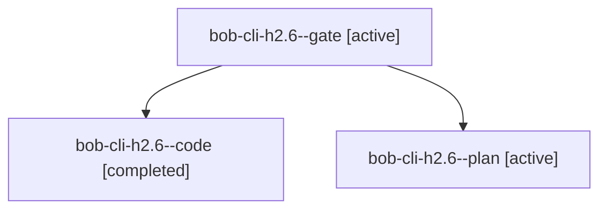

# Session: bob-cli-h2.6

[Agent Hoods](../README.md) / [bbugyi200](../users/bbugyi200/README.md) / [apollo](../users/bbugyi200/machines/apollo/README.md) / [bob-cli-h2](../users/bbugyi200/machines/apollo/hoods/bob-cli-h2/README.md) / bob-cli-h2.6

Owner: `bbugyi200.apollo` · Hood: `bob-cli-h2` · Members: 3 · Bead: [bob-cli-h2.6](https://github.com/bobs-org/bob-cli--beads/blob/main/pages/bob-cli-h2/bob-cli-h2.6.md)

## Lineage

The diagram is an optional enhancement; the ordered table below contains the same lineage in accessible text.

| Role | Agent | State | Model / provider | Timing | Commits | Prompt | Chat |
|---|---|---|---|---|---:|---|---|
| gate | bob-cli-h2.6--gate | active | gpt-6-astra / codex | 2026-11-04T21:53:17.328989+00:00 | 0 | — | [Chat](../agents/bbugyi200.apollo.bob-cli-h2.6--gate/chat.md) |
| code | bob-cli-h2.6--code | completed | muse-spark-1.3-contributor / muse | 2026-11-04T21:54:15.918547+00:00 → 2026-11-04T23:09:51.780029+00:00 | 0 | — | [Chat](../agents/bbugyi200.apollo.bob-cli-h2.6--code/chat.md) |
| plan | bob-cli-h2.6--plan | active | gpt-6-astra / codex | 2026-11-04T21:45:14.667219+00:00 | 0 | [Prompt](../agents/bbugyi200.apollo.bob-cli-h2.6--plan/prompt.md) | [Chat](../agents/bbugyi200.apollo.bob-cli-h2.6--plan/chat.md) |

## Neighbors

| Agent | Relation | State |
|---|---|---|
| [bob-cli-h2.1](bbugyi200.apollo.bob-cli-h2.1.md) (session · 3) | bob-cli-h2 hood | active 2, completed 1 |
| [bob-cli-h2.2](../agents/bbugyi200.apollo.bob-cli-h2.2/README.md) | bob-cli-h2 hood | active |
| [bob-cli-h2.3](bbugyi200.apollo.bob-cli-h2.3.md) (session · 3) | bob-cli-h2 hood | active 2, completed 1 |
| [bob-cli-h2.4](../agents/bbugyi200.apollo.bob-cli-h2.4/README.md) | bob-cli-h2 hood | active |
| [bob-cli-h2.5](../agents/bbugyi200.apollo.bob-cli-h2.5/README.md) | bob-cli-h2 hood | active |
| [bob-cli-h2.land](../agents/bbugyi200.apollo.bob-cli-h2.land/README.md) | bob-cli-h2 hood | active |
