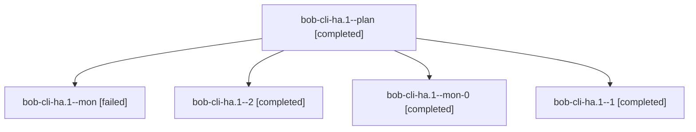

# Session: bob-cli-ha.1

[Agent Hoods](../README.md) / [bbugyi200](../users/bbugyi200/README.md) / [apollo](../users/bbugyi200/machines/apollo/README.md) / [bob-cli-ha](../users/bbugyi200/machines/apollo/hoods/bob-cli-ha/README.md) / bob-cli-ha.1

Owner: `bbugyi200.apollo` · Hood: `bob-cli-ha` · Members: 5 · Bead: [bob-cli-ha.1](https://github.com/bobs-org/bob-cli--beads/blob/main/pages/bob-cli-ha/bob-cli-ha.1.md)

## Lineage

The diagram is an optional enhancement; the ordered table below contains the same lineage in accessible text.

| Role | Agent | State | Model / provider | Timing | Commits | Prompt | Chat |
|---|---|---|---|---|---:|---|---|
| plan | bob-cli-ha.1--plan | completed | gpt-6-luna / codex | 2026-11-05T10:24:58.341164+00:00 → 2026-11-05T12:05:30.513349+00:00 | 0 | [Prompt](../agents/bbugyi200.apollo.bob-cli-ha.1--plan/prompt.md) | [Chat](../agents/bbugyi200.apollo.bob-cli-ha.1--plan/chat.md) |
| mon | bob-cli-ha.1--mon | failed | gpt-6-luna / codex | 2026-11-05T12:04:23.568739+00:00 → 2026-11-05T12:18:40.902689+00:00 | 0 | — | [Chat](../agents/bbugyi200.apollo.bob-cli-ha.1--mon/chat.md) |
| 2 | bob-cli-ha.1--2 | completed | gpt-6-luna / codex | 2026-11-05T12:55:03.349930+00:00 → 2026-11-05T13:12:00.676811+00:00 | [1](../agents/bbugyi200.apollo.bob-cli-ha.1--2/README.md#commits) | [Prompt](../agents/bbugyi200.apollo.bob-cli-ha.1--2/prompt.md) | [Chat](../agents/bbugyi200.apollo.bob-cli-ha.1--2/chat.md) |
| mon-0 | bob-cli-ha.1--mon-0 | completed | gpt-6-luna / codex | 2026-11-05T12:40:27.386025+00:00 → 2026-11-05T12:54:58.662240+00:00 | 0 | — | [Chat](../agents/bbugyi200.apollo.bob-cli-ha.1--mon-0/chat.md) |
| 1 | bob-cli-ha.1--1 | completed | gpt-6-luna / codex | 2026-11-05T12:18:46.869557+00:00 → 2026-11-05T12:41:50.653740+00:00 | 0 | [Prompt](../agents/bbugyi200.apollo.bob-cli-ha.1--1/prompt.md) | [Chat](../agents/bbugyi200.apollo.bob-cli-ha.1--1/chat.md) |

## Commits

| Role | Repo | Commit | Subject | Committed |
|---|---|---|---|---|
| 2 | bob-cli | [`01cb7b5`](https://github.com/bobs-org/bob-cli/commit/01cb7b5c3eb75d7353ef4a57014cc5ada1178bf6) | feat(capture): add glued Pomodoro start grammar | 2026-11-05 08:11:16 EST |

## Neighbors

| Agent | Relation | State |
|---|---|---|
| [bob-cli-ha.2](../agents/bbugyi200.apollo.bob-cli-ha.2/README.md) | bob-cli-ha hood | completed |
| [bob-cli-ha.3](bbugyi200.apollo.bob-cli-ha.3.md) (session · 3) | bob-cli-ha hood | completed 3 |
| [bob-cli-ha.4](bbugyi200.apollo.bob-cli-ha.4.md) (session · 5) | bob-cli-ha hood | completed 3, failed 2 |
| [bob-cli-ha.land](bbugyi200.apollo.bob-cli-ha.land.md) (session · 7) | bob-cli-ha hood | completed 5, failed 2 |
