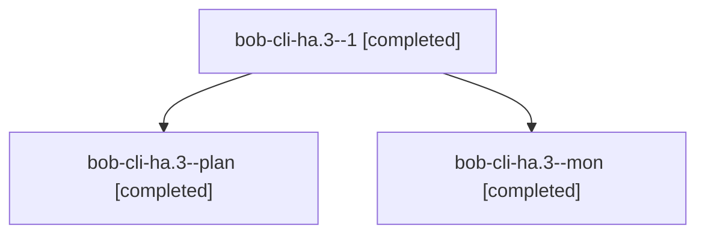

# Session: bob-cli-ha.3

[Agent Hoods](../README.md) / [bbugyi200](../users/bbugyi200/README.md) / [apollo](../users/bbugyi200/machines/apollo/README.md) / [bob-cli-ha](../users/bbugyi200/machines/apollo/hoods/bob-cli-ha/README.md) / bob-cli-ha.3

Owner: `bbugyi200.apollo` · Hood: `bob-cli-ha` · Members: 3 · Bead: [bob-cli-ha.3](https://github.com/bobs-org/bob-cli--beads/blob/main/pages/bob-cli-ha/bob-cli-ha.3.md)

## Lineage

The diagram is an optional enhancement; the ordered table below contains the same lineage in accessible text.

| Role | Agent | State | Model / provider | Timing | Commits | Prompt | Chat |
|---|---|---|---|---|---:|---|---|
| 1 | bob-cli-ha.3--1 | completed | gpt-6-luna / codex | 2026-11-05T15:28:24.641358+00:00 → 2026-11-05T16:14:01.270556+00:00 | [1](../agents/bbugyi200.apollo.bob-cli-ha.3--1/README.md#commits) | [Prompt](../agents/bbugyi200.apollo.bob-cli-ha.3--1/prompt.md) | [Chat](../agents/bbugyi200.apollo.bob-cli-ha.3--1/chat.md) |
| plan | bob-cli-ha.3--plan | completed | gpt-6-luna / codex | 2026-11-05T14:31:27.498992+00:00 → 2026-11-05T15:17:08.998568+00:00 | 0 | [Prompt](../agents/bbugyi200.apollo.bob-cli-ha.3--plan/prompt.md) | [Chat](../agents/bbugyi200.apollo.bob-cli-ha.3--plan/chat.md) |
| mon | bob-cli-ha.3--mon | completed | gpt-6-luna / codex | 2026-11-05T15:14:52.375274+00:00 → 2026-11-05T15:28:19.429229+00:00 | 0 | — | [Chat](../agents/bbugyi200.apollo.bob-cli-ha.3--mon/chat.md) |

## Commits

| Role | Repo | Commit | Subject | Committed |
|---|---|---|---|---|
| 1 | bob-cli | [`4327543`](https://github.com/bobs-org/bob-cli/commit/4327543778cfa446e765a5365abb2e558fdad5c0) | docs(capture): document glued timing spellings | 2026-11-05 11:12:44 EST |

## Neighbors

| Agent | Relation | State |
|---|---|---|
| [bob-cli-ha.1](bbugyi200.apollo.bob-cli-ha.1.md) (session · 5) | bob-cli-ha hood | completed 4, failed 1 |
| [bob-cli-ha.2](../agents/bbugyi200.apollo.bob-cli-ha.2/README.md) | bob-cli-ha hood | completed |
| [bob-cli-ha.4](bbugyi200.apollo.bob-cli-ha.4.md) (session · 5) | bob-cli-ha hood | completed 3, failed 2 |
| [bob-cli-ha.land](bbugyi200.apollo.bob-cli-ha.land.md) (session · 7) | bob-cli-ha hood | completed 5, failed 2 |
