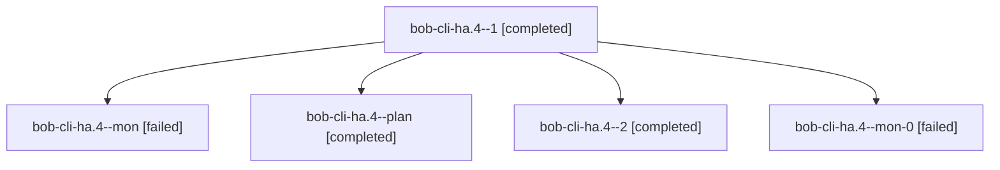

# Session: bob-cli-ha.4

[Agent Hoods](../README.md) / [bbugyi200](../users/bbugyi200/README.md) / [apollo](../users/bbugyi200/machines/apollo/README.md) / [bob-cli-ha](../users/bbugyi200/machines/apollo/hoods/bob-cli-ha/README.md) / bob-cli-ha.4

Owner: `bbugyi200.apollo` · Hood: `bob-cli-ha` · Members: 5 · Bead: [bob-cli-ha.4](https://github.com/bobs-org/bob-cli--beads/blob/main/pages/bob-cli-ha/bob-cli-ha.4.md)

## Lineage

The diagram is an optional enhancement; the ordered table below contains the same lineage in accessible text.

| Role | Agent | State | Model / provider | Timing | Commits | Prompt | Chat |
|---|---|---|---|---|---:|---|---|
| 1 | bob-cli-ha.4--1 | completed | gpt-6-luna / codex | 2026-11-05T13:56:16.688991+00:00 → 2026-11-05T13:59:05.614616+00:00 | 0 | [Prompt](../agents/bbugyi200.apollo.bob-cli-ha.4--1/prompt.md) | [Chat](../agents/bbugyi200.apollo.bob-cli-ha.4--1/chat.md) |
| mon | bob-cli-ha.4--mon | failed | gpt-6-luna / codex | 2026-11-05T13:38:49.420779+00:00 → 2026-11-05T13:55:38.629324+00:00 | 0 | — | [Chat](../agents/bbugyi200.apollo.bob-cli-ha.4--mon/chat.md) |
| plan | bob-cli-ha.4--plan | completed | gpt-6-luna / codex | 2026-11-05T13:12:38.642604+00:00 → 2026-11-05T13:40:03.248966+00:00 | 0 | [Prompt](../agents/bbugyi200.apollo.bob-cli-ha.4--plan/prompt.md) | [Chat](../agents/bbugyi200.apollo.bob-cli-ha.4--plan/chat.md) |
| 2 | bob-cli-ha.4--2 | completed | gpt-6-luna / codex | 2026-11-05T14:15:28.217640+00:00 → 2026-11-05T14:19:59.061999+00:00 | 0 | [Prompt](../agents/bbugyi200.apollo.bob-cli-ha.4--2/prompt.md) | [Chat](../agents/bbugyi200.apollo.bob-cli-ha.4--2/chat.md) |
| mon-0 | bob-cli-ha.4--mon-0 | failed | gpt-6-luna / codex | 2026-11-05T13:58:23.826538+00:00 → 2026-11-05T14:15:08.293909+00:00 | 0 | — | [Chat](../agents/bbugyi200.apollo.bob-cli-ha.4--mon-0/chat.md) |

## Neighbors

| Agent | Relation | State |
|---|---|---|
| [bob-cli-ha.1](bbugyi200.apollo.bob-cli-ha.1.md) (session · 5) | bob-cli-ha hood | completed 4, failed 1 |
| [bob-cli-ha.2](../agents/bbugyi200.apollo.bob-cli-ha.2/README.md) | bob-cli-ha hood | completed |
| [bob-cli-ha.3](bbugyi200.apollo.bob-cli-ha.3.md) (session · 3) | bob-cli-ha hood | completed 3 |
| [bob-cli-ha.land](bbugyi200.apollo.bob-cli-ha.land.md) (session · 7) | bob-cli-ha hood | completed 5, failed 2 |
