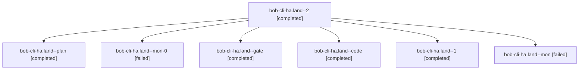

# Session: bob-cli-ha.land

[Agent Hoods](../README.md) / [bbugyi200](../users/bbugyi200/README.md) / [apollo](../users/bbugyi200/machines/apollo/README.md) / [bob-cli-ha](../users/bbugyi200/machines/apollo/hoods/bob-cli-ha/README.md) / bob-cli-ha.land

Owner: `bbugyi200.apollo` · Hood: `bob-cli-ha` · Members: 7 · Bead: [bob-cli-ha](https://github.com/bobs-org/bob-cli--beads/blob/main/pages/bob-cli-ha/README.md)

## Lineage

The diagram is an optional enhancement; the ordered table below contains the same lineage in accessible text.

| Role | Agent | State | Model / provider | Timing | Commits | Prompt | Chat |
|---|---|---|---|---|---:|---|---|
| 2 | bob-cli-ha.land--2 | completed | grok-4.6 / grok | 2026-11-06T18:02:21.284658+00:00 → 2026-11-06T18:12:06.946012+00:00 | [1](../agents/bbugyi200.apollo.bob-cli-ha.land--2/README.md#commits) | [Prompt](../agents/bbugyi200.apollo.bob-cli-ha.land--2/prompt.md) | [Chat](../agents/bbugyi200.apollo.bob-cli-ha.land--2/chat.md) |
| plan | bob-cli-ha.land--plan | completed | gpt-6-astra / codex | 2026-11-06T15:56:30.104265+00:00 → 2026-11-06T17:12:16.199733+00:00 | 0 | [Prompt](../agents/bbugyi200.apollo.bob-cli-ha.land--plan/prompt.md) | [Chat](../agents/bbugyi200.apollo.bob-cli-ha.land--plan/chat.md) |
| mon-0 | bob-cli-ha.land--mon-0 | failed | grok-4.6 / grok | 2026-11-06T17:33:55.594372+00:00 → 2026-11-06T18:01:03.412903+00:00 | 0 | — | [Chat](../agents/bbugyi200.apollo.bob-cli-ha.land--mon-0/chat.md) |
| gate | bob-cli-ha.land--gate | completed | gpt-6-astra / codex | 2026-11-06T16:07:56.466339+00:00 → 2026-11-06T16:08:12.423000+00:00 | 0 | — | [Chat](../agents/bbugyi200.apollo.bob-cli-ha.land--gate/chat.md) |
| code | bob-cli-ha.land--code | completed | grok-4.6 / grok | 2026-11-06T16:08:48.847665+00:00 → 2026-11-06T17:12:16.199733+00:00 | 0 | — | [Chat](../agents/bbugyi200.apollo.bob-cli-ha.land--code/chat.md) |
| 1 | bob-cli-ha.land--1 | completed | grok-4.6 / grok | 2026-11-06T17:29:28.211255+00:00 → 2026-11-06T17:35:45.220236+00:00 | 0 | [Prompt](../agents/bbugyi200.apollo.bob-cli-ha.land--1/prompt.md) | [Chat](../agents/bbugyi200.apollo.bob-cli-ha.land--1/chat.md) |
| mon | bob-cli-ha.land--mon | failed | grok-4.6 / grok | 2026-11-06T17:10:54.463747+00:00 → 2026-11-06T17:28:56.487552+00:00 | 0 | — | [Chat](../agents/bbugyi200.apollo.bob-cli-ha.land--mon/chat.md) |

## Commits

| Role | Repo | Commit | Subject | Committed |
|---|---|---|---|---|
| 2 | bob-cli | [`79709fe`](https://github.com/bobs-org/bob-cli/commit/79709fed42c5cd382e40819872859f4f47273e29) | feat(capture)!: glue start and past timing to Pomodoro names | 2026-11-06 13:09:29 EST |

## Neighbors

| Agent | Relation | State |
|---|---|---|
| [bob-cli-ha.1](bbugyi200.apollo.bob-cli-ha.1.md) (session · 5) | bob-cli-ha hood | completed 4, failed 1 |
| [bob-cli-ha.2](../agents/bbugyi200.apollo.bob-cli-ha.2/README.md) | bob-cli-ha hood | completed |
| [bob-cli-ha.3](bbugyi200.apollo.bob-cli-ha.3.md) (session · 3) | bob-cli-ha hood | completed 3 |
| [bob-cli-ha.4](bbugyi200.apollo.bob-cli-ha.4.md) (session · 5) | bob-cli-ha hood | completed 3, failed 2 |
