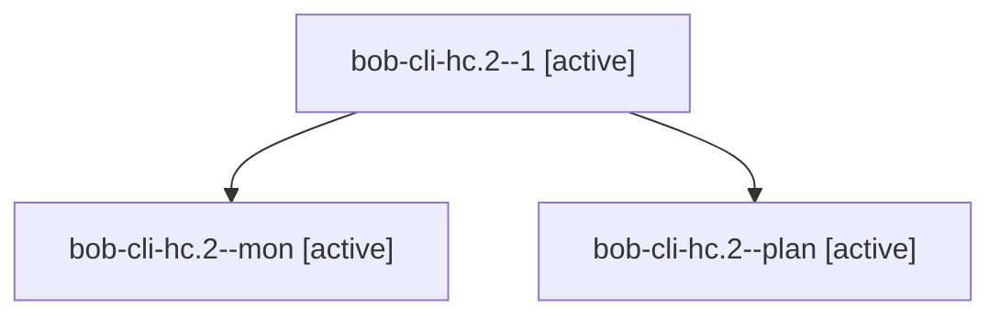

# Session: bob-cli-hc.2

[Agent Hoods](../README.md) / [bbugyi200](../users/bbugyi200/README.md) / [apollo](../users/bbugyi200/machines/apollo/README.md) / [bob-cli-hc](../users/bbugyi200/machines/apollo/hoods/bob-cli-hc/README.md) / bob-cli-hc.2

Owner: `bbugyi200.apollo` · Hood: `bob-cli-hc` · Members: 3 · Bead: [bob-cli-hc.2](https://github.com/bobs-org/bob-cli--beads/blob/main/pages/bob-cli-hc/bob-cli-hc.2.md)

## Lineage

The diagram is an optional enhancement; the ordered table below contains the same lineage in accessible text.

| Role | Agent | State | Model / provider | Timing | Commits | Prompt | Chat |
|---|---|---|---|---|---:|---|---|
| 1 | bob-cli-hc.2--1 | active | gpt-6-luna / codex | 2026-11-05T17:15:57.771216+00:00 | [1](../agents/bbugyi200.apollo.bob-cli-hc.2--1/README.md#commits) | [Prompt](../agents/bbugyi200.apollo.bob-cli-hc.2--1/prompt.md) | [Chat](../agents/bbugyi200.apollo.bob-cli-hc.2--1/chat.md) |
| mon | bob-cli-hc.2--mon | active | gpt-6-luna / codex | 2026-11-05T16:58:40.690278+00:00 | 0 | — | [Chat](../agents/bbugyi200.apollo.bob-cli-hc.2--mon/chat.md) |
| plan | bob-cli-hc.2--plan | active | gpt-6-luna / codex | 2026-11-05T16:23:37.528626+00:00 | 0 | [Prompt](../agents/bbugyi200.apollo.bob-cli-hc.2--plan/prompt.md) | [Chat](../agents/bbugyi200.apollo.bob-cli-hc.2--plan/chat.md) |

## Commits

| Role | Repo | Commit | Subject | Committed |
|---|---|---|---|---|
| 1 | bob-cli | [`e6122f7`](https://github.com/bobs-org/bob-cli/commit/e6122f7a3859d3070469adcf34d1c6235cd77e1b) | fix(capture): restamp relocated pomodoros and align gcal clocks | 2026-11-05 12:18:17 EST |

## Neighbors

| Agent | Relation | State |
|---|---|---|
| [bob-cli-hc.1](../agents/bbugyi200.apollo.bob-cli-hc.1/README.md) | bob-cli-hc hood | active |
| [bob-cli-hc.3](../agents/bbugyi200.apollo.bob-cli-hc.3/README.md) | bob-cli-hc hood | active |
| [bob-cli-hc.4](bbugyi200.apollo.bob-cli-hc.4.md) (session · 9) | bob-cli-hc hood | active 9 |
| [bob-cli-hc.5](../agents/bbugyi200.apollo.bob-cli-hc.5/README.md) | bob-cli-hc hood | active |
| [bob-cli-hc.6](../agents/bbugyi200.apollo.bob-cli-hc.6/README.md) | bob-cli-hc hood | active |
| [bob-cli-hc.land](bbugyi200.apollo.bob-cli-hc.land.md) (session · 5) | bob-cli-hc hood | active 3, completed 2 |
