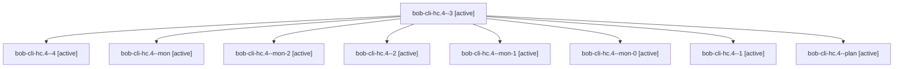

# Session: bob-cli-hc.4

[Agent Hoods](../README.md) / [bbugyi200](../users/bbugyi200/README.md) / [apollo](../users/bbugyi200/machines/apollo/README.md) / [bob-cli-hc](../users/bbugyi200/machines/apollo/hoods/bob-cli-hc/README.md) / bob-cli-hc.4

Owner: `bbugyi200.apollo` · Hood: `bob-cli-hc` · Members: 9 · Bead: [bob-cli-hc.4](https://github.com/bobs-org/bob-cli--beads/blob/main/pages/bob-cli-hc/bob-cli-hc.4.md)

## Lineage

The diagram is an optional enhancement; the ordered table below contains the same lineage in accessible text.

| Role | Agent | State | Model / provider | Timing | Commits | Prompt | Chat |
|---|---|---|---|---|---:|---|---|
| 3 | bob-cli-hc.4--3 | active | gpt-6-luna / codex | 2026-11-05T17:12:37.863353+00:00 | 0 | [Prompt](../agents/bbugyi200.apollo.bob-cli-hc.4--3/prompt.md) | [Chat](../agents/bbugyi200.apollo.bob-cli-hc.4--3/chat.md) |
| 4 | bob-cli-hc.4--4 | active | gpt-6-luna / codex | 2026-11-05T17:19:41.280521+00:00 | 0 | [Prompt](../agents/bbugyi200.apollo.bob-cli-hc.4--4/prompt.md) | [Chat](../agents/bbugyi200.apollo.bob-cli-hc.4--4/chat.md) |
| mon | bob-cli-hc.4--mon | active | gpt-6-luna / codex | 2026-11-05T16:54:45.998643+00:00 | 0 | — | [Chat](../agents/bbugyi200.apollo.bob-cli-hc.4--mon/chat.md) |
| mon-2 | bob-cli-hc.4--mon-2 | active | gpt-6-luna / codex | 2026-11-05T17:15:51.182518+00:00 | 0 | — | [Chat](../agents/bbugyi200.apollo.bob-cli-hc.4--mon-2/chat.md) |
| 2 | bob-cli-hc.4--2 | active | gpt-6-luna / codex | 2026-11-05T17:06:06.791283+00:00 | 0 | [Prompt](../agents/bbugyi200.apollo.bob-cli-hc.4--2/prompt.md) | [Chat](../agents/bbugyi200.apollo.bob-cli-hc.4--2/chat.md) |
| mon-1 | bob-cli-hc.4--mon-1 | active | gpt-6-luna / codex | 2026-11-05T17:08:15.915154+00:00 | 0 | — | [Chat](../agents/bbugyi200.apollo.bob-cli-hc.4--mon-1/chat.md) |
| mon-0 | bob-cli-hc.4--mon-0 | active | gpt-6-luna / codex | 2026-11-05T17:02:32.883817+00:00 | 0 | — | [Chat](../agents/bbugyi200.apollo.bob-cli-hc.4--mon-0/chat.md) |
| 1 | bob-cli-hc.4--1 | active | gpt-6-luna / codex | 2026-11-05T16:59:02.749200+00:00 | 0 | [Prompt](../agents/bbugyi200.apollo.bob-cli-hc.4--1/prompt.md) | [Chat](../agents/bbugyi200.apollo.bob-cli-hc.4--1/chat.md) |
| plan | bob-cli-hc.4--plan | active | gpt-6-luna / codex | 2026-11-05T16:23:47.356899+00:00 | 0 | [Prompt](../agents/bbugyi200.apollo.bob-cli-hc.4--plan/prompt.md) | [Chat](../agents/bbugyi200.apollo.bob-cli-hc.4--plan/chat.md) |

## Neighbors

| Agent | Relation | State |
|---|---|---|
| [bob-cli-hc.1](../agents/bbugyi200.apollo.bob-cli-hc.1/README.md) | bob-cli-hc hood | active |
| [bob-cli-hc.2](bbugyi200.apollo.bob-cli-hc.2.md) (session · 3) | bob-cli-hc hood | active 3 |
| [bob-cli-hc.3](../agents/bbugyi200.apollo.bob-cli-hc.3/README.md) | bob-cli-hc hood | active |
| [bob-cli-hc.5](../agents/bbugyi200.apollo.bob-cli-hc.5/README.md) | bob-cli-hc hood | active |
| [bob-cli-hc.6](../agents/bbugyi200.apollo.bob-cli-hc.6/README.md) | bob-cli-hc hood | active |
| [bob-cli-hc.land](bbugyi200.apollo.bob-cli-hc.land.md) (session · 5) | bob-cli-hc hood | active 3, completed 2 |
