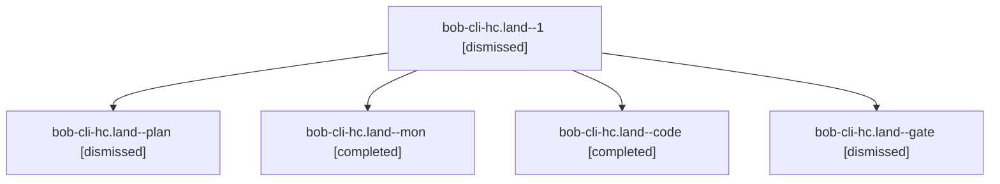

# Session: bob-cli-hc.land

[Agent Hoods](../README.md) / [bbugyi200](../users/bbugyi200/README.md) / [apollo](../users/bbugyi200/machines/apollo/README.md) / [bob-cli-hc](../users/bbugyi200/machines/apollo/hoods/bob-cli-hc/README.md) / bob-cli-hc.land

Owner: `bbugyi200.apollo` · Hood: `bob-cli-hc` · Members: 5 · Bead: [bob-cli-hc](https://github.com/bobs-org/bob-cli--beads/blob/main/pages/bob-cli-hc/README.md)

## Lineage

The diagram is an optional enhancement; the ordered table below contains the same lineage in accessible text.

| Role | Agent | State | Model / provider | Timing | Commits | Prompt | Chat |
|---|---|---|---|---|---:|---|---|
| 1 | bob-cli-hc.land--1 | dismissed | gpt-6-luna / codex | 2026-11-05T18:35:48.501708 → 2026-11-05T18:43:52.241907 | [1](../agents/bbugyi200.apollo.bob-cli-hc.land--1/README.md#commits) | [Prompt](../agents/bbugyi200.apollo.bob-cli-hc.land--1/prompt.md) | [Chat](../agents/bbugyi200.apollo.bob-cli-hc.land--1/chat.md) |
| plan | bob-cli-hc.land--plan | dismissed | opus / claude | 2026-11-05T13:10:58.785265 → 2026-11-05T18:31:32.153235 | [1](../agents/bbugyi200.apollo.bob-cli-hc.land--plan/README.md#commits) | [Prompt](../agents/bbugyi200.apollo.bob-cli-hc.land--plan/prompt.md) | [Chat](../agents/bbugyi200.apollo.bob-cli-hc.land--plan/chat.md) |
| mon | bob-cli-hc.land--mon | completed | gpt-6-luna / codex | 2026-11-05T23:30:08.861023+00:00 → 2026-11-05T23:35:36.653868+00:00 | 0 | — | [Chat](../agents/bbugyi200.apollo.bob-cli-hc.land--mon/chat.md) |
| code | bob-cli-hc.land--code | completed | gpt-6-luna / codex | 2026-11-05T22:33:49.820168+00:00 → 2026-11-05T23:31:31.744919+00:00 | 0 | — | [Chat](../agents/bbugyi200.apollo.bob-cli-hc.land--code/chat.md) |
| gate | bob-cli-hc.land--gate | dismissed | opus / claude | 2026-11-05T17:33:01.550367 → 2026-11-05T17:33:18 | 0 | — | [Chat](../agents/bbugyi200.apollo.bob-cli-hc.land--gate/chat.md) |

## Commits

| Role | Repo | Commit | Subject | Committed |
|---|---|---|---|---|
| plan | — | `82f6cb9` | fix(memory): complete the offclock\_types decision record and isolate its gcal clock test | 2026-11-05 17:32:03 EST |
| 1 | — | `e816bce` | fix(capture): restamp clocks after landing retypes | 2026-11-05 18:42:37 EST |

## Neighbors

| Agent | Relation | State |
|---|---|---|
| [bob-cli-hc.1](../agents/bbugyi200.apollo.bob-cli-hc.1/README.md) | bob-cli-hc hood | dismissed |
| [bob-cli-hc.2](bbugyi200.apollo.bob-cli-hc.2.md) (session · 3) | bob-cli-hc hood | dismissed 3 |
| [bob-cli-hc.3](../agents/bbugyi200.apollo.bob-cli-hc.3/README.md) | bob-cli-hc hood | dismissed |
| [bob-cli-hc.4](bbugyi200.apollo.bob-cli-hc.4.md) (session · 9) | bob-cli-hc hood | dismissed 9 |
| [bob-cli-hc.5](../agents/bbugyi200.apollo.bob-cli-hc.5/README.md) | bob-cli-hc hood | dismissed |
| [bob-cli-hc.6](../agents/bbugyi200.apollo.bob-cli-hc.6/README.md) | bob-cli-hc hood | dismissed |
