# Session: bob-cli-hg.10

[Agent Hoods](../README.md) / [bbugyi200](../users/bbugyi200/README.md) / [apollo](../users/bbugyi200/machines/apollo/README.md) / [bob-cli-hg](../users/bbugyi200/machines/apollo/hoods/bob-cli-hg/README.md) / bob-cli-hg.10

Owner: `bbugyi200.apollo` · Hood: `bob-cli-hg` · Members: 13 · Bead: [bob-cli-hg.10](https://github.com/bobs-org/bob-cli--beads/blob/main/pages/bob-cli-hg/bob-cli-hg.10.md)

## Lineage

```mermaid
flowchart TD
  n0["bob-cli-hg.10--1 [completed]"]
  n1["bob-cli-hg.10--mon-4 [completed]"]
  n0 --> n1
  n2["bob-cli-hg.10--5 [completed]"]
  n0 --> n2
  n3["bob-cli-hg.10--mon-1 [completed]"]
  n0 --> n3
  n4["bob-cli-hg.10--6 [completed]"]
  n0 --> n4
  n5["bob-cli-hg.10--3 [completed]"]
  n0 --> n5
  n6["bob-cli-hg.10--mon [failed]"]
  n0 --> n6
  n7["bob-cli-hg.10--mon-3 [completed]"]
  n0 --> n7
  n8["bob-cli-hg.10--2 [completed]"]
  n0 --> n8
  n9["bob-cli-hg.10--mon-2 [failed]"]
  n0 --> n9
  n10["bob-cli-hg.10--mon-0 [completed]"]
  n0 --> n10
  n11["bob-cli-hg.10--4 [completed]"]
  n0 --> n11
  n12["bob-cli-hg.10--plan [completed]"]
  n0 --> n12
```

The diagram is an optional enhancement; the ordered table below contains the same lineage in accessible text.

| Role | Agent | State | Model / provider | Timing | Commits | Prompt | Chat |
|---|---|---|---|---|---:|---|---|
| 1 | bob-cli-hg.10--1 | completed | gpt-6-luna / codex | 2026-11-06T13:17:32.281259+00:00 → 2026-11-06T13:23:54.848028+00:00 | 0 | [Prompt](../agents/bbugyi200.apollo.bob-cli-hg.10--1/prompt.md) | [Chat](../agents/bbugyi200.apollo.bob-cli-hg.10--1/chat.md) |
| mon-4 | bob-cli-hg.10--mon-4 | completed | gpt-6-luna / codex | 2026-11-06T13:48:43.080246+00:00 → 2026-11-06T13:50:54.617618+00:00 | 0 | — | [Chat](../agents/bbugyi200.apollo.bob-cli-hg.10--mon-4/chat.md) |
| 5 | bob-cli-hg.10--5 | completed | gpt-6-luna / codex | 2026-11-06T13:41:23.781749+00:00 → 2026-11-06T13:49:30.723826+00:00 | 0 | [Prompt](../agents/bbugyi200.apollo.bob-cli-hg.10--5/prompt.md) | [Chat](../agents/bbugyi200.apollo.bob-cli-hg.10--5/chat.md) |
| mon-1 | bob-cli-hg.10--mon-1 | completed | gpt-6-luna / codex | 2026-11-06T13:28:20.719494+00:00 → 2026-11-06T13:31:42.017510+00:00 | 0 | — | [Chat](../agents/bbugyi200.apollo.bob-cli-hg.10--mon-1/chat.md) |
| 6 | bob-cli-hg.10--6 | completed | gpt-6-luna / codex | 2026-11-06T13:51:00.248075+00:00 → 2026-11-06T13:54:44.792483+00:00 | 0 | [Prompt](../agents/bbugyi200.apollo.bob-cli-hg.10--6/prompt.md) | [Chat](../agents/bbugyi200.apollo.bob-cli-hg.10--6/chat.md) |
| 3 | bob-cli-hg.10--3 | completed | gpt-6-luna / codex | 2026-11-06T13:31:51.917892+00:00 → 2026-11-06T13:34:37.786553+00:00 | 0 | [Prompt](../agents/bbugyi200.apollo.bob-cli-hg.10--3/prompt.md) | [Chat](../agents/bbugyi200.apollo.bob-cli-hg.10--3/chat.md) |
| mon | bob-cli-hg.10--mon | failed | gpt-6-luna / codex | 2026-11-06T13:10:40.061620+00:00 → 2026-11-06T13:17:18.234820+00:00 | 0 | — | [Chat](../agents/bbugyi200.apollo.bob-cli-hg.10--mon/chat.md) |
| mon-3 | bob-cli-hg.10--mon-3 | completed | gpt-6-luna / codex | 2026-11-06T13:38:26.972209+00:00 → 2026-11-06T13:41:08.325384+00:00 | 0 | — | [Chat](../agents/bbugyi200.apollo.bob-cli-hg.10--mon-3/chat.md) |
| 2 | bob-cli-hg.10--2 | completed | gpt-6-luna / codex | 2026-11-06T13:25:39.847904+00:00 → 2026-11-06T13:29:04.947364+00:00 | 0 | [Prompt](../agents/bbugyi200.apollo.bob-cli-hg.10--2/prompt.md) | [Chat](../agents/bbugyi200.apollo.bob-cli-hg.10--2/chat.md) |
| mon-2 | bob-cli-hg.10--mon-2 | failed | gpt-6-luna / codex | 2026-11-06T13:33:38.451799+00:00 → 2026-11-06T13:37:05.934296+00:00 | 0 | — | [Chat](../agents/bbugyi200.apollo.bob-cli-hg.10--mon-2/chat.md) |
| mon-0 | bob-cli-hg.10--mon-0 | completed | gpt-6-luna / codex | 2026-11-06T13:22:57.464030+00:00 → 2026-11-06T13:25:21.746958+00:00 | 0 | — | [Chat](../agents/bbugyi200.apollo.bob-cli-hg.10--mon-0/chat.md) |
| 4 | bob-cli-hg.10--4 | completed | gpt-6-luna / codex | 2026-11-06T13:37:07.074811+00:00 → 2026-11-06T13:39:10.190417+00:00 | 0 | [Prompt](../agents/bbugyi200.apollo.bob-cli-hg.10--4/prompt.md) | [Chat](../agents/bbugyi200.apollo.bob-cli-hg.10--4/chat.md) |
| plan | bob-cli-hg.10--plan | completed | gpt-6-luna / codex | 2026-11-06T12:52:28.459719+00:00 → 2026-11-06T13:13:19.675445+00:00 | 0 | [Prompt](../agents/bbugyi200.apollo.bob-cli-hg.10--plan/prompt.md) | [Chat](../agents/bbugyi200.apollo.bob-cli-hg.10--plan/chat.md) |

## Neighbors

| Agent | Relation | State |
|---|---|---|
| [bob-cli-hg.1](bbugyi200.apollo.bob-cli-hg.1.md) (session · 3) | bob-cli-hg hood | completed 3 |
| [bob-cli-hg.11](bbugyi200.apollo.bob-cli-hg.11.md) (session · 3) | bob-cli-hg hood | completed 2, failed 1 |
| [bob-cli-hg.12](bbugyi200.apollo.bob-cli-hg.12.md) (session · 3) | bob-cli-hg hood | completed 2, dismissed 1 |
| [bob-cli-hg.12.1.1](../agents/bbugyi200.apollo.bob-cli-hg.12.1.1/README.md) | bob-cli-hg hood | completed |
| [bob-cli-hg.12.1.2](../agents/bbugyi200.apollo.bob-cli-hg.12.1.2/README.md) | bob-cli-hg hood | completed |
| [bob-cli-hg.12.1.3](bbugyi200.apollo.bob-cli-hg.12.1.3.md) (session · 7) | bob-cli-hg hood | completed 5, failed 2 |
| [bob-cli-hg.12.1.4](../agents/bbugyi200.apollo.bob-cli-hg.12.1.4/README.md) | bob-cli-hg hood | completed |
| [bob-cli-hg.12.1.5](bbugyi200.apollo.bob-cli-hg.12.1.5.md) (session · 5) | bob-cli-hg hood | completed 4, failed 1 |
| [bob-cli-hg.12.1.6](../agents/bbugyi200.apollo.bob-cli-hg.12.1.6/README.md) | bob-cli-hg hood | completed |
| [bob-cli-hg.12.1.land](../agents/bbugyi200.apollo.bob-cli-hg.12.1.land/README.md) | bob-cli-hg hood | completed |
| [bob-cli-hg.13](../agents/bbugyi200.apollo.bob-cli-hg.13/README.md) | bob-cli-hg hood | completed |
| [bob-cli-hg.14](bbugyi200.apollo.bob-cli-hg.14.md) (session · 7) | bob-cli-hg hood | completed 4, failed 3 |
| [bob-cli-hg.2](../agents/bbugyi200.apollo.bob-cli-hg.2/README.md) | bob-cli-hg hood | completed |
| [bob-cli-hg.3](bbugyi200.apollo.bob-cli-hg.3.md) (session · 3) | bob-cli-hg hood | completed 2, dismissed 1 |
| [bob-cli-hg.3.1.1](../agents/bbugyi200.apollo.bob-cli-hg.3.1.1/README.md) | bob-cli-hg hood | dismissed |
| [bob-cli-hg.3.1.2](../agents/bbugyi200.apollo.bob-cli-hg.3.1.2/README.md) | bob-cli-hg hood | dismissed |
| [bob-cli-hg.3.1.3](../agents/bbugyi200.apollo.bob-cli-hg.3.1.3/README.md) | bob-cli-hg hood | dismissed |
| [bob-cli-hg.3.1.4](../agents/bbugyi200.apollo.bob-cli-hg.3.1.4/README.md) | bob-cli-hg hood | dismissed |
| [bob-cli-hg.3.1.land](bbugyi200.apollo.bob-cli-hg.3.1.land.md) (session · 3) | bob-cli-hg hood | completed 1, dismissed 2 |
| [bob-cli-hg.4](../agents/bbugyi200.apollo.bob-cli-hg.4/README.md) | bob-cli-hg hood | completed |
| [bob-cli-hg.5](../agents/bbugyi200.apollo.bob-cli-hg.5/README.md) | bob-cli-hg hood | completed |
| [bob-cli-hg.6](bbugyi200.apollo.bob-cli-hg.6.md) (session · 3) | bob-cli-hg hood | completed 2, dismissed 1 |
| [bob-cli-hg.6.1.1](bbugyi200.apollo.bob-cli-hg.6.1.1.md) (session · 3) | bob-cli-hg hood | completed 2, failed 1 |
| [bob-cli-hg.6.1.2](../agents/bbugyi200.apollo.bob-cli-hg.6.1.2/README.md) | bob-cli-hg hood | completed |
| [bob-cli-hg.6.1.3](../agents/bbugyi200.apollo.bob-cli-hg.6.1.3/README.md) | bob-cli-hg hood | completed |
| [bob-cli-hg.6.1.4](../agents/bbugyi200.apollo.bob-cli-hg.6.1.4/README.md) | bob-cli-hg hood | completed |
| [bob-cli-hg.6.1.land](bbugyi200.apollo.bob-cli-hg.6.1.land.md) (session · 5) | bob-cli-hg hood | completed 4, failed 1 |
| [bob-cli-hg.7](../agents/bbugyi200.apollo.bob-cli-hg.7/README.md) | bob-cli-hg hood | completed |
| [bob-cli-hg.8](bbugyi200.apollo.bob-cli-hg.8.md) (session · 3) | bob-cli-hg hood | completed 2, failed 1 |
| [bob-cli-hg.9](../agents/bbugyi200.apollo.bob-cli-hg.9/README.md) | bob-cli-hg hood | completed |
| [bob-cli-hg.land](../agents/bbugyi200.apollo.bob-cli-hg.land/README.md) | bob-cli-hg hood | completed |
