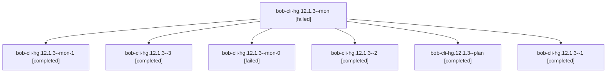

# Session: bob-cli-hg.12.1.3

[Agent Hoods](../README.md) / [bbugyi200](../users/bbugyi200/README.md) / [apollo](../users/bbugyi200/machines/apollo/README.md) / [bob-cli-hg](../users/bbugyi200/machines/apollo/hoods/bob-cli-hg/README.md) / bob-cli-hg.12.1.3

Owner: `bbugyi200.apollo` · Hood: `bob-cli-hg` · Members: 7 · Bead: [bob-cli-hg.12.1.3](https://github.com/bobs-org/bob-cli--beads/blob/main/pages/bob-cli-hg/bob-cli-hg.12.1.3.md)

## Lineage

The diagram is an optional enhancement; the ordered table below contains the same lineage in accessible text.

| Role | Agent | State | Model / provider | Timing | Commits | Prompt | Chat |
|---|---|---|---|---|---:|---|---|
| mon | bob-cli-hg.12.1.3--mon | failed | gpt-6-luna / codex | 2026-11-06T16:28:04.220157+00:00 → 2026-11-06T16:33:40.108211+00:00 | 0 | — | [Chat](../agents/bbugyi200.apollo.bob-cli-hg.12.1.3--mon/chat.md) |
| mon-1 | bob-cli-hg.12.1.3--mon-1 | completed | gpt-6-luna / codex | 2026-11-06T16:57:28.444719+00:00 → 2026-11-06T17:09:37.943082+00:00 | 0 | — | [Chat](../agents/bbugyi200.apollo.bob-cli-hg.12.1.3--mon-1/chat.md) |
| 3 | bob-cli-hg.12.1.3--3 | completed | gpt-6-luna / codex | 2026-11-06T17:09:38.642467+00:00 → 2026-11-06T17:43:20.406128+00:00 | [1](../agents/bbugyi200.apollo.bob-cli-hg.12.1.3--3/README.md#commits) | [Prompt](../agents/bbugyi200.apollo.bob-cli-hg.12.1.3--3/prompt.md) | [Chat](../agents/bbugyi200.apollo.bob-cli-hg.12.1.3--3/chat.md) |
| mon-0 | bob-cli-hg.12.1.3--mon-0 | failed | gpt-6-luna / codex | 2026-11-06T16:36:41.427691+00:00 → 2026-11-06T16:48:26.765180+00:00 | 0 | — | [Chat](../agents/bbugyi200.apollo.bob-cli-hg.12.1.3--mon-0/chat.md) |
| 2 | bob-cli-hg.12.1.3--2 | completed | gpt-6-luna / codex | 2026-11-06T16:48:26.463951+00:00 → 2026-11-06T16:58:15.508040+00:00 | 0 | [Prompt](../agents/bbugyi200.apollo.bob-cli-hg.12.1.3--2/prompt.md) | [Chat](../agents/bbugyi200.apollo.bob-cli-hg.12.1.3--2/chat.md) |
| plan | bob-cli-hg.12.1.3--plan | completed | gpt-6-luna / codex | 2026-11-06T15:35:11.479719+00:00 → 2026-11-06T16:29:07.651578+00:00 | 0 | [Prompt](../agents/bbugyi200.apollo.bob-cli-hg.12.1.3--plan/prompt.md) | [Chat](../agents/bbugyi200.apollo.bob-cli-hg.12.1.3--plan/chat.md) |
| 1 | bob-cli-hg.12.1.3--1 | completed | gpt-6-luna / codex | 2026-11-06T16:33:44.145157+00:00 → 2026-11-06T16:37:29.139812+00:00 | 0 | [Prompt](../agents/bbugyi200.apollo.bob-cli-hg.12.1.3--1/prompt.md) | [Chat](../agents/bbugyi200.apollo.bob-cli-hg.12.1.3--1/chat.md) |

## Commits

| Role | Repo | Commit | Subject | Committed |
|---|---|---|---|---|
| 3 | bob-cli | [`b6a9624`](https://github.com/bobs-org/bob-cli/commit/b6a962435aa73b8a06d1fe654ebcf1f58caa3658) | feat(gmail): add safe draft create and update flow | 2026-11-06 12:41:42 EST |

## Neighbors

| Agent | Relation | State |
|---|---|---|
| [bob-cli-hg.12](bbugyi200.apollo.bob-cli-hg.12.md) (session · 3) | ancestor | active 1, completed 2 |
| [bob-cli-hg.12.1.1](../agents/bbugyi200.apollo.bob-cli-hg.12.1.1/README.md) | bob-cli-hg.12.1 hood | completed |
| [bob-cli-hg.12.1.2](../agents/bbugyi200.apollo.bob-cli-hg.12.1.2/README.md) | bob-cli-hg.12.1 hood | completed |
| [bob-cli-hg.12.1.4](../agents/bbugyi200.apollo.bob-cli-hg.12.1.4/README.md) | bob-cli-hg.12.1 hood | active |
| [bob-cli-hg.12.1.5](../agents/bbugyi200.apollo.bob-cli-hg.12.1.5/README.md) | bob-cli-hg.12.1 hood | waiting |
| [bob-cli-hg.12.1.6](../agents/bbugyi200.apollo.bob-cli-hg.12.1.6/README.md) | bob-cli-hg.12.1 hood | waiting |
| [bob-cli-hg.12.1.land](../agents/bbugyi200.apollo.bob-cli-hg.12.1.land/README.md) | bob-cli-hg.12.1 hood | waiting |
| [bob-cli-hg.1](bbugyi200.apollo.bob-cli-hg.1.md) (session · 3) | bob-cli-hg hood | completed 3 |
| [bob-cli-hg.10](bbugyi200.apollo.bob-cli-hg.10.md) (session · 13) | bob-cli-hg hood | completed 11, failed 2 |
| [bob-cli-hg.11](bbugyi200.apollo.bob-cli-hg.11.md) (session · 2) | bob-cli-hg hood | active 2 |
| [bob-cli-hg.13](../agents/bbugyi200.apollo.bob-cli-hg.13/README.md) | bob-cli-hg hood | waiting |
| [bob-cli-hg.14](bbugyi200.apollo.bob-cli-hg.14.md) (session · 7) | bob-cli-hg hood | completed 4, failed 3 |
| [bob-cli-hg.2](../agents/bbugyi200.apollo.bob-cli-hg.2/README.md) | bob-cli-hg hood | completed |
| [bob-cli-hg.3](bbugyi200.apollo.bob-cli-hg.3.md) (session · 3) | bob-cli-hg hood | active 1, completed 2 |
| [bob-cli-hg.3.1.1](../agents/bbugyi200.apollo.bob-cli-hg.3.1.1/README.md) | bob-cli-hg hood | active |
| [bob-cli-hg.3.1.2](../agents/bbugyi200.apollo.bob-cli-hg.3.1.2/README.md) | bob-cli-hg hood | active |
| [bob-cli-hg.3.1.3](../agents/bbugyi200.apollo.bob-cli-hg.3.1.3/README.md) | bob-cli-hg hood | active |
| [bob-cli-hg.3.1.4](../agents/bbugyi200.apollo.bob-cli-hg.3.1.4/README.md) | bob-cli-hg hood | active |
| [bob-cli-hg.3.1.land](bbugyi200.apollo.bob-cli-hg.3.1.land.md) (session · 3) | bob-cli-hg hood | active 2, completed 1 |
| [bob-cli-hg.4](../agents/bbugyi200.apollo.bob-cli-hg.4/README.md) | bob-cli-hg hood | completed |
| [bob-cli-hg.5](../agents/bbugyi200.apollo.bob-cli-hg.5/README.md) | bob-cli-hg hood | completed |
| [bob-cli-hg.6](bbugyi200.apollo.bob-cli-hg.6.md) (session · 3) | bob-cli-hg hood | active 1, completed 2 |
| [bob-cli-hg.6.1.1](bbugyi200.apollo.bob-cli-hg.6.1.1.md) (session · 3) | bob-cli-hg hood | completed 2, failed 1 |
| [bob-cli-hg.6.1.2](../agents/bbugyi200.apollo.bob-cli-hg.6.1.2/README.md) | bob-cli-hg hood | completed |
| [bob-cli-hg.6.1.3](../agents/bbugyi200.apollo.bob-cli-hg.6.1.3/README.md) | bob-cli-hg hood | completed |
| [bob-cli-hg.6.1.4](../agents/bbugyi200.apollo.bob-cli-hg.6.1.4/README.md) | bob-cli-hg hood | completed |
| [bob-cli-hg.6.1.land](bbugyi200.apollo.bob-cli-hg.6.1.land.md) (session · 5) | bob-cli-hg hood | completed 4, failed 1 |
| [bob-cli-hg.7](../agents/bbugyi200.apollo.bob-cli-hg.7/README.md) | bob-cli-hg hood | completed |
| [bob-cli-hg.8](bbugyi200.apollo.bob-cli-hg.8.md) (session · 3) | bob-cli-hg hood | completed 2, failed 1 |
| [bob-cli-hg.9](../agents/bbugyi200.apollo.bob-cli-hg.9/README.md) | bob-cli-hg hood | completed |
| [bob-cli-hg.land](../agents/bbugyi200.apollo.bob-cli-hg.land/README.md) | bob-cli-hg hood | waiting |
