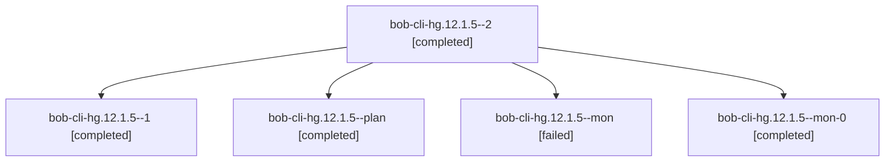

# Session: bob-cli-hg.12.1.5

[Agent Hoods](../README.md) / [bbugyi200](../users/bbugyi200/README.md) / [apollo](../users/bbugyi200/machines/apollo/README.md) / [bob-cli-hg](../users/bbugyi200/machines/apollo/hoods/bob-cli-hg/README.md) / bob-cli-hg.12.1.5

Owner: `bbugyi200.apollo` · Hood: `bob-cli-hg` · Members: 5 · Bead: [bob-cli-hg.12.1.5](https://github.com/bobs-org/bob-cli--beads/blob/main/pages/bob-cli-hg/bob-cli-hg.12.1.5.md)

## Lineage

The diagram is an optional enhancement; the ordered table below contains the same lineage in accessible text.

| Role | Agent | State | Model / provider | Timing | Commits | Prompt | Chat |
|---|---|---|---|---|---:|---|---|
| 2 | bob-cli-hg.12.1.5--2 | completed | gpt-6-luna / codex | 2026-11-06T20:12:29.704479+00:00 → 2026-11-06T20:26:28.566344+00:00 | [1](../agents/bbugyi200.apollo.bob-cli-hg.12.1.5--2/README.md#commits) | [Prompt](../agents/bbugyi200.apollo.bob-cli-hg.12.1.5--2/prompt.md) | [Chat](../agents/bbugyi200.apollo.bob-cli-hg.12.1.5--2/chat.md) |
| 1 | bob-cli-hg.12.1.5--1 | completed | gpt-6-luna / codex | 2026-11-06T19:51:41.306730+00:00 → 2026-11-06T20:02:24.774169+00:00 | 0 | [Prompt](../agents/bbugyi200.apollo.bob-cli-hg.12.1.5--1/prompt.md) | [Chat](../agents/bbugyi200.apollo.bob-cli-hg.12.1.5--1/chat.md) |
| plan | bob-cli-hg.12.1.5--plan | completed | gpt-6-luna / codex | 2026-11-06T18:39:13.604261+00:00 → 2026-11-06T19:42:09.146551+00:00 | 0 | [Prompt](../agents/bbugyi200.apollo.bob-cli-hg.12.1.5--plan/prompt.md) | [Chat](../agents/bbugyi200.apollo.bob-cli-hg.12.1.5--plan/chat.md) |
| mon | bob-cli-hg.12.1.5--mon | failed | gpt-6-luna / codex | 2026-11-06T19:41:14.260329+00:00 → 2026-11-06T19:51:41.820437+00:00 | 0 | — | [Chat](../agents/bbugyi200.apollo.bob-cli-hg.12.1.5--mon/chat.md) |
| mon-0 | bob-cli-hg.12.1.5--mon-0 | completed | gpt-6-luna / codex | 2026-11-06T20:01:12.483174+00:00 → 2026-11-06T20:12:29.994832+00:00 | 0 | — | [Chat](../agents/bbugyi200.apollo.bob-cli-hg.12.1.5--mon-0/chat.md) |

## Commits

| Role | Repo | Commit | Subject | Committed |
|---|---|---|---|---|
| 2 | bob-cli | [`57af3ea`](https://github.com/bobs-org/bob-cli/commit/57af3ead752da458c1dcc8b66c71396e46b2092c) | feat(gmail): add confirmed send and note finalization | 2026-11-06 15:25:30 EST |

## Neighbors

| Agent | Relation | State |
|---|---|---|
| [bob-cli-hg.12](bbugyi200.apollo.bob-cli-hg.12.md) (session · 3) | ancestor | active 1, completed 2 |
| [bob-cli-hg.12.1.1](../agents/bbugyi200.apollo.bob-cli-hg.12.1.1/README.md) | bob-cli-hg.12.1 hood | completed |
| [bob-cli-hg.12.1.2](../agents/bbugyi200.apollo.bob-cli-hg.12.1.2/README.md) | bob-cli-hg.12.1 hood | completed |
| [bob-cli-hg.12.1.3](bbugyi200.apollo.bob-cli-hg.12.1.3.md) (session · 7) | bob-cli-hg.12.1 hood | completed 5, failed 2 |
| [bob-cli-hg.12.1.4](../agents/bbugyi200.apollo.bob-cli-hg.12.1.4/README.md) | bob-cli-hg.12.1 hood | completed |
| [bob-cli-hg.12.1.6](../agents/bbugyi200.apollo.bob-cli-hg.12.1.6/README.md) | bob-cli-hg.12.1 hood | completed |
| [bob-cli-hg.12.1.land](../agents/bbugyi200.apollo.bob-cli-hg.12.1.land/README.md) | bob-cli-hg.12.1 hood | waiting |
| [bob-cli-hg.1](bbugyi200.apollo.bob-cli-hg.1.md) (session · 3) | bob-cli-hg hood | completed 3 |
| [bob-cli-hg.10](bbugyi200.apollo.bob-cli-hg.10.md) (session · 13) | bob-cli-hg hood | completed 11, failed 2 |
| [bob-cli-hg.11](bbugyi200.apollo.bob-cli-hg.11.md) (session · 3) | bob-cli-hg hood | completed 2, failed 1 |
| [bob-cli-hg.13](../agents/bbugyi200.apollo.bob-cli-hg.13/README.md) | bob-cli-hg hood | waiting |
| [bob-cli-hg.14](bbugyi200.apollo.bob-cli-hg.14.md) (session · 7) | bob-cli-hg hood | completed 4, failed 3 |
| [bob-cli-hg.2](../agents/bbugyi200.apollo.bob-cli-hg.2/README.md) | bob-cli-hg hood | completed |
| [bob-cli-hg.3](bbugyi200.apollo.bob-cli-hg.3.md) (session · 3) | bob-cli-hg hood | active 1, completed 2 |
| [bob-cli-hg.3.1.1](../agents/bbugyi200.apollo.bob-cli-hg.3.1.1/README.md) | bob-cli-hg hood | active |
| [bob-cli-hg.3.1.2](../agents/bbugyi200.apollo.bob-cli-hg.3.1.2/README.md) | bob-cli-hg hood | active |
| [bob-cli-hg.3.1.3](../agents/bbugyi200.apollo.bob-cli-hg.3.1.3/README.md) | bob-cli-hg hood | active |
| [bob-cli-hg.3.1.4](../agents/bbugyi200.apollo.bob-cli-hg.3.1.4/README.md) | bob-cli-hg hood | active |
| [bob-cli-hg.3.1.land](bbugyi200.apollo.bob-cli-hg.3.1.land.md) (session · 3) | bob-cli-hg hood | active 2, completed 1 |
| [bob-cli-hg.4](../agents/bbugyi200.apollo.bob-cli-hg.4/README.md) | bob-cli-hg hood | completed |
| [bob-cli-hg.5](../agents/bbugyi200.apollo.bob-cli-hg.5/README.md) | bob-cli-hg hood | completed |
| [bob-cli-hg.6](bbugyi200.apollo.bob-cli-hg.6.md) (session · 3) | bob-cli-hg hood | active 1, completed 2 |
| [bob-cli-hg.6.1.1](bbugyi200.apollo.bob-cli-hg.6.1.1.md) (session · 3) | bob-cli-hg hood | completed 2, failed 1 |
| [bob-cli-hg.6.1.2](../agents/bbugyi200.apollo.bob-cli-hg.6.1.2/README.md) | bob-cli-hg hood | completed |
| [bob-cli-hg.6.1.3](../agents/bbugyi200.apollo.bob-cli-hg.6.1.3/README.md) | bob-cli-hg hood | completed |
| [bob-cli-hg.6.1.4](../agents/bbugyi200.apollo.bob-cli-hg.6.1.4/README.md) | bob-cli-hg hood | completed |
| [bob-cli-hg.6.1.land](bbugyi200.apollo.bob-cli-hg.6.1.land.md) (session · 5) | bob-cli-hg hood | completed 4, failed 1 |
| [bob-cli-hg.7](../agents/bbugyi200.apollo.bob-cli-hg.7/README.md) | bob-cli-hg hood | completed |
| [bob-cli-hg.8](bbugyi200.apollo.bob-cli-hg.8.md) (session · 3) | bob-cli-hg hood | completed 2, failed 1 |
| [bob-cli-hg.9](../agents/bbugyi200.apollo.bob-cli-hg.9/README.md) | bob-cli-hg hood | completed |
| [bob-cli-hg.land](../agents/bbugyi200.apollo.bob-cli-hg.land/README.md) | bob-cli-hg hood | waiting |
