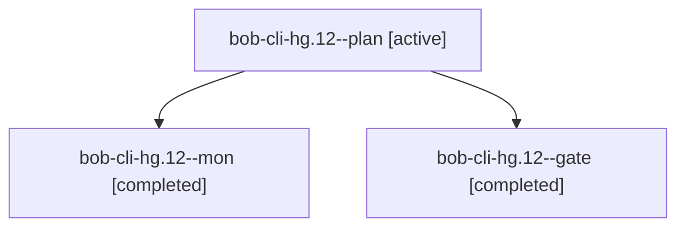

# Session: bob-cli-hg.12

[Agent Hoods](../README.md) / [bbugyi200](../users/bbugyi200/README.md) / [apollo](../users/bbugyi200/machines/apollo/README.md) / [bob-cli-hg](../users/bbugyi200/machines/apollo/hoods/bob-cli-hg/README.md) / bob-cli-hg.12

Owner: `bbugyi200.apollo` · Hood: `bob-cli-hg` · Members: 3 · Bead: [bob-cli-hg.12](https://github.com/bobs-org/bob-cli--beads/blob/main/pages/bob-cli-hg/bob-cli-hg.12.md)

## Lineage

The diagram is an optional enhancement; the ordered table below contains the same lineage in accessible text.

| Role | Agent | State | Model / provider | Timing | Commits | Prompt | Chat |
|---|---|---|---|---|---:|---|---|
| plan | bob-cli-hg.12--plan | active | gpt-6-astra / codex | 2026-11-06T12:00:03.800868+00:00 → 2026-11-06T12:12:32.957712+00:00 | 0 | [Prompt](../agents/bbugyi200.apollo.bob-cli-hg.12--plan/prompt.md) | [Chat](../agents/bbugyi200.apollo.bob-cli-hg.12--plan/chat.md) |
| mon | bob-cli-hg.12--mon | completed | gpt-6-astra / codex | 2026-11-06T12:12:18.868241+00:00 → 2026-11-06T12:14:22.018361+00:00 | 0 | — | [Chat](../agents/bbugyi200.apollo.bob-cli-hg.12--mon/chat.md) |
| gate | bob-cli-hg.12--gate | completed | gpt-6-astra / codex | 2026-11-06T12:12:01.866533+00:00 → 2026-11-06T12:12:24.435404+00:00 | 0 | — | [Chat](../agents/bbugyi200.apollo.bob-cli-hg.12--gate/chat.md) |

## Neighbors

| Agent | Relation | State |
|---|---|---|
| [bob-cli-hg.12.1.1](../agents/bbugyi200.apollo.bob-cli-hg.12.1.1/README.md) | descendant | completed |
| [bob-cli-hg.12.1.2](../agents/bbugyi200.apollo.bob-cli-hg.12.1.2/README.md) | descendant | completed |
| [bob-cli-hg.12.1.3](bbugyi200.apollo.bob-cli-hg.12.1.3.md) (session · 7) | descendant | completed 5, failed 2 |
| [bob-cli-hg.12.1.4](../agents/bbugyi200.apollo.bob-cli-hg.12.1.4/README.md) | descendant | completed |
| [bob-cli-hg.12.1.5](bbugyi200.apollo.bob-cli-hg.12.1.5.md) (session · 5) | descendant | completed 4, failed 1 |
| [bob-cli-hg.12.1.6](../agents/bbugyi200.apollo.bob-cli-hg.12.1.6/README.md) | descendant | waiting |
| [bob-cli-hg.12.1.land](../agents/bbugyi200.apollo.bob-cli-hg.12.1.land/README.md) | descendant | waiting |
| [bob-cli-hg.1](bbugyi200.apollo.bob-cli-hg.1.md) (session · 3) | bob-cli-hg hood | completed 3 |
| [bob-cli-hg.10](bbugyi200.apollo.bob-cli-hg.10.md) (session · 13) | bob-cli-hg hood | completed 11, failed 2 |
| [bob-cli-hg.11](bbugyi200.apollo.bob-cli-hg.11.md) (session · 3) | bob-cli-hg hood | completed 2, failed 1 |
| [bob-cli-hg.13](../agents/bbugyi200.apollo.bob-cli-hg.13/README.md) | bob-cli-hg hood | waiting |
| [bob-cli-hg.14](bbugyi200.apollo.bob-cli-hg.14.md) (session · 7) | bob-cli-hg hood | completed 4, failed 3 |
| [bob-cli-hg.2](../agents/bbugyi200.apollo.bob-cli-hg.2/README.md) | bob-cli-hg hood | completed |
| [bob-cli-hg.3](bbugyi200.apollo.bob-cli-hg.3.md) (session · 3) | bob-cli-hg hood | active 1, completed 2 |
| [bob-cli-hg.3.1.1](../agents/bbugyi200.apollo.bob-cli-hg.3.1.1/README.md) | bob-cli-hg hood | active |
| [bob-cli-hg.3.1.2](../agents/bbugyi200.apollo.bob-cli-hg.3.1.2/README.md) | bob-cli-hg hood | active |
| [bob-cli-hg.3.1.3](../agents/bbugyi200.apollo.bob-cli-hg.3.1.3/README.md) | bob-cli-hg hood | active |
| [bob-cli-hg.3.1.4](../agents/bbugyi200.apollo.bob-cli-hg.3.1.4/README.md) | bob-cli-hg hood | active |
| [bob-cli-hg.3.1.land](bbugyi200.apollo.bob-cli-hg.3.1.land.md) (session · 3) | bob-cli-hg hood | active 2, completed 1 |
| [bob-cli-hg.4](../agents/bbugyi200.apollo.bob-cli-hg.4/README.md) | bob-cli-hg hood | completed |
| [bob-cli-hg.5](../agents/bbugyi200.apollo.bob-cli-hg.5/README.md) | bob-cli-hg hood | completed |
| [bob-cli-hg.6](bbugyi200.apollo.bob-cli-hg.6.md) (session · 3) | bob-cli-hg hood | active 1, completed 2 |
| [bob-cli-hg.6.1.1](bbugyi200.apollo.bob-cli-hg.6.1.1.md) (session · 3) | bob-cli-hg hood | completed 2, failed 1 |
| [bob-cli-hg.6.1.2](../agents/bbugyi200.apollo.bob-cli-hg.6.1.2/README.md) | bob-cli-hg hood | completed |
| [bob-cli-hg.6.1.3](../agents/bbugyi200.apollo.bob-cli-hg.6.1.3/README.md) | bob-cli-hg hood | completed |
| [bob-cli-hg.6.1.4](../agents/bbugyi200.apollo.bob-cli-hg.6.1.4/README.md) | bob-cli-hg hood | completed |
| [bob-cli-hg.6.1.land](bbugyi200.apollo.bob-cli-hg.6.1.land.md) (session · 5) | bob-cli-hg hood | completed 4, failed 1 |
| [bob-cli-hg.7](../agents/bbugyi200.apollo.bob-cli-hg.7/README.md) | bob-cli-hg hood | completed |
| [bob-cli-hg.8](bbugyi200.apollo.bob-cli-hg.8.md) (session · 3) | bob-cli-hg hood | completed 2, failed 1 |
| [bob-cli-hg.9](../agents/bbugyi200.apollo.bob-cli-hg.9/README.md) | bob-cli-hg hood | completed |
| [bob-cli-hg.land](../agents/bbugyi200.apollo.bob-cli-hg.land/README.md) | bob-cli-hg hood | waiting |
