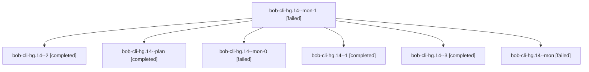

# Session: bob-cli-hg.14

[Agent Hoods](../README.md) / [bbugyi200](../users/bbugyi200/README.md) / [apollo](../users/bbugyi200/machines/apollo/README.md) / [bob-cli-hg](../users/bbugyi200/machines/apollo/hoods/bob-cli-hg/README.md) / bob-cli-hg.14

Owner: `bbugyi200.apollo` · Hood: `bob-cli-hg` · Members: 7 · Bead: [bob-cli-hg.14](https://github.com/bobs-org/bob-cli--beads/blob/main/pages/bob-cli-hg/bob-cli-hg.14.md)

## Lineage



The diagram is an optional enhancement; the ordered table below contains the same lineage in accessible text.

| Role | Agent | State | Model / provider | Timing | Commits | Prompt | Chat |
|---|---|---|---|---|---:|---|---|
| <a id="member-mon-1"></a>mon-1 | bob-cli-hg.14--mon-1 | failed | gpt-6-luna / codex | 2026-11-06T13:22:00.379543+00:00 → 2026-11-06T13:37:17.088558+00:00 | 0 | — | [Chat](../agents/bbugyi200.apollo.bob-cli-hg.14--mon-1/chat.md) |
| <a id="member-2"></a>2 | bob-cli-hg.14--2 | completed | gpt-6-luna / codex | 2026-11-06T13:17:28.165425+00:00 → 2026-11-06T13:22:59.021385+00:00 | 0 | [Prompt](../agents/bbugyi200.apollo.bob-cli-hg.14--2/prompt.md) | [Chat](../agents/bbugyi200.apollo.bob-cli-hg.14--2/chat.md) |
| <a id="member-plan"></a>plan | bob-cli-hg.14--plan | completed | gpt-6-luna / codex | 2026-11-06T11:59:55.797398+00:00 → 2026-11-06T12:48:04.055688+00:00 | 0 | [Prompt](../agents/bbugyi200.apollo.bob-cli-hg.14--plan/prompt.md) | [Chat](../agents/bbugyi200.apollo.bob-cli-hg.14--plan/chat.md) |
| <a id="member-mon-0"></a>mon-0 | bob-cli-hg.14--mon-0 | failed | gpt-6-luna / codex | 2026-11-06T13:10:15.900692+00:00 → 2026-11-06T13:17:28.670306+00:00 | 0 | — | [Chat](../agents/bbugyi200.apollo.bob-cli-hg.14--mon-0/chat.md) |
| <a id="member-1"></a>1 | bob-cli-hg.14--1 | completed | gpt-6-luna / codex | 2026-11-06T12:52:59.532844+00:00 → 2026-11-06T13:11:16.739638+00:00 | 0 | [Prompt](../agents/bbugyi200.apollo.bob-cli-hg.14--1/prompt.md) | [Chat](../agents/bbugyi200.apollo.bob-cli-hg.14--1/chat.md) |
| <a id="member-3"></a>3 | bob-cli-hg.14--3 | completed | gpt-6-luna / codex | 2026-11-06T13:37:16.989567+00:00 → 2026-11-06T16:25:45.540945+00:00 | [3](../agents/bbugyi200.apollo.bob-cli-hg.14--3/README.md#commits) | [Prompt](../agents/bbugyi200.apollo.bob-cli-hg.14--3/prompt.md) | [Chat](../agents/bbugyi200.apollo.bob-cli-hg.14--3/chat.md) |
| <a id="member-mon"></a>mon | bob-cli-hg.14--mon | failed | gpt-6-luna / codex | 2026-11-06T12:46:52.473983+00:00 → 2026-11-06T12:52:59.972375+00:00 | 0 | — | [Chat](../agents/bbugyi200.apollo.bob-cli-hg.14--mon/chat.md) |

## Commits

| Role | Repo | Commit | Subject | Committed |
|---|---|---|---|---|
| 3 | bob-cli | [`2a37f8c`](https://github.com/bobs-org/bob-cli/commit/2a37f8ce073d8e166590daec83412ad6e49671d8) | feat(gmail): add offline compose and reply notes | 2026-11-06 09:24:02 EST |
| 3 | bob-cli | [`f075147`](https://github.com/bobs-org/bob-cli/commit/f075147f4bb928427a7b21501e863b3c99051b5e) | feat(gmail): swap Gmail URLs for labelled links, and backfill | 2026-11-06 09:57:47 EST |
| 3 | bob-cli | [`e096004`](https://github.com/bobs-org/bob-cli/commit/e0960045bf86d88f7f2443b746a7ef48c4643245) | feat(gmail): link captured Gmail URLs without blocking capture | 2026-11-06 10:48:25 EST |
| — | bob-cli | [`ec39e1a`](https://github.com/bobs-org/bob-cli/commit/ec39e1a00e0ac9339d832d22db956ade66731c47) | feat(gmail): pull label mail and import attachments | 2026-11-06 11:17:57 EST |

## Variables

| Role | Variable | Value |
|---|---|---|
| 3 | `artifacts` | \[{bead: bob-cli-hf, kind: file, label: Highlights ingest timestamp equality test source, path: /home/bryan/.sase/artifacts/agents/gh\_bobs-org\_\_bob-cli/20261106083626/ingest-456c2b77b474.rs, ref: file… |

#### artifacts

**Role:** `3`

```yaml
- bead: bob-cli-hf
  kind: file
  label: Highlights ingest timestamp equality test source
  path: /home/bryan/.sase/artifacts/agents/gh_bobs-org__bob-cli/20261106083626/ingest-456c2b77b474.rs
  ref: file:explicit:8631991b3f782cb93e3bff02
  source_path: /home/bryan/.local/state/sase/workspaces/bobs-org/bob-cli/bob-cli_34/tests/cli/highlights/ingest.rs
```

Values are truncated for display; see each member's agent meta.json for the full values.

## Neighbors

| Agent | Relation | State |
|---|---|---|
| [bob-cli-hg.1](bbugyi200.apollo.bob-cli-hg.1.md) (session · 3) | bob-cli-hg hood | completed 3 |
| [bob-cli-hg.10](bbugyi200.apollo.bob-cli-hg.10.md) (session · 13) | bob-cli-hg hood | completed 11, failed 2 |
| [bob-cli-hg.11](bbugyi200.apollo.bob-cli-hg.11.md) (session · 3) | bob-cli-hg hood | completed 2, failed 1 |
| [bob-cli-hg.12](bbugyi200.apollo.bob-cli-hg.12.md) (session · 3) | bob-cli-hg hood | active 1, completed 2 |
| [bob-cli-hg.12.1.1](../agents/bbugyi200.apollo.bob-cli-hg.12.1.1/README.md) | bob-cli-hg hood | completed |
| [bob-cli-hg.12.1.2](../agents/bbugyi200.apollo.bob-cli-hg.12.1.2/README.md) | bob-cli-hg hood | completed |
| [bob-cli-hg.12.1.3](bbugyi200.apollo.bob-cli-hg.12.1.3.md) (session · 7) | bob-cli-hg hood | completed 5, failed 2 |
| [bob-cli-hg.12.1.4](../agents/bbugyi200.apollo.bob-cli-hg.12.1.4/README.md) | bob-cli-hg hood | completed |
| [bob-cli-hg.12.1.5](bbugyi200.apollo.bob-cli-hg.12.1.5.md) (session · 5) | bob-cli-hg hood | completed 4, failed 1 |
| [bob-cli-hg.12.1.6](../agents/bbugyi200.apollo.bob-cli-hg.12.1.6/README.md) | bob-cli-hg hood | waiting |
| [bob-cli-hg.12.1.land](../agents/bbugyi200.apollo.bob-cli-hg.12.1.land/README.md) | bob-cli-hg hood | waiting |
| [bob-cli-hg.13](../agents/bbugyi200.apollo.bob-cli-hg.13/README.md) | bob-cli-hg hood | waiting |
| [bob-cli-hg.2](../agents/bbugyi200.apollo.bob-cli-hg.2/README.md) | bob-cli-hg hood | completed |
| [bob-cli-hg.3](bbugyi200.apollo.bob-cli-hg.3.md) (session · 3) | bob-cli-hg hood | active 1, completed 2 |
| [bob-cli-hg.3.1.1](../agents/bbugyi200.apollo.bob-cli-hg.3.1.1/README.md) | bob-cli-hg hood | active |
| [bob-cli-hg.3.1.2](../agents/bbugyi200.apollo.bob-cli-hg.3.1.2/README.md) | bob-cli-hg hood | active |
| [bob-cli-hg.3.1.3](../agents/bbugyi200.apollo.bob-cli-hg.3.1.3/README.md) | bob-cli-hg hood | active |
| [bob-cli-hg.3.1.4](../agents/bbugyi200.apollo.bob-cli-hg.3.1.4/README.md) | bob-cli-hg hood | active |
| [bob-cli-hg.3.1.land](bbugyi200.apollo.bob-cli-hg.3.1.land.md) (session · 3) | bob-cli-hg hood | active 2, completed 1 |
| [bob-cli-hg.4](../agents/bbugyi200.apollo.bob-cli-hg.4/README.md) | bob-cli-hg hood | completed |
| [bob-cli-hg.5](../agents/bbugyi200.apollo.bob-cli-hg.5/README.md) | bob-cli-hg hood | completed |
| [bob-cli-hg.6](bbugyi200.apollo.bob-cli-hg.6.md) (session · 3) | bob-cli-hg hood | active 1, completed 2 |
| [bob-cli-hg.6.1.1](bbugyi200.apollo.bob-cli-hg.6.1.1.md) (session · 3) | bob-cli-hg hood | completed 2, failed 1 |
| [bob-cli-hg.6.1.2](../agents/bbugyi200.apollo.bob-cli-hg.6.1.2/README.md) | bob-cli-hg hood | completed |
| [bob-cli-hg.6.1.3](../agents/bbugyi200.apollo.bob-cli-hg.6.1.3/README.md) | bob-cli-hg hood | completed |
| [bob-cli-hg.6.1.4](../agents/bbugyi200.apollo.bob-cli-hg.6.1.4/README.md) | bob-cli-hg hood | completed |
| [bob-cli-hg.6.1.land](bbugyi200.apollo.bob-cli-hg.6.1.land.md) (session · 5) | bob-cli-hg hood | completed 4, failed 1 |
| [bob-cli-hg.7](../agents/bbugyi200.apollo.bob-cli-hg.7/README.md) | bob-cli-hg hood | completed |
| [bob-cli-hg.8](bbugyi200.apollo.bob-cli-hg.8.md) (session · 3) | bob-cli-hg hood | completed 2, failed 1 |
| [bob-cli-hg.9](../agents/bbugyi200.apollo.bob-cli-hg.9/README.md) | bob-cli-hg hood | completed |
| [bob-cli-hg.land](../agents/bbugyi200.apollo.bob-cli-hg.land/README.md) | bob-cli-hg hood | waiting |
