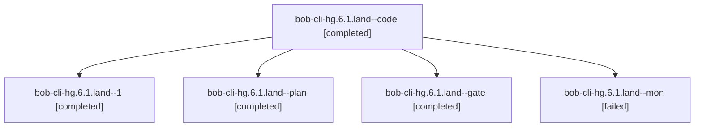

# Session: bob-cli-hg.6.1.land

[Agent Hoods](../README.md) / [bbugyi200](../users/bbugyi200/README.md) / [apollo](../users/bbugyi200/machines/apollo/README.md) / [bob-cli-hg](../users/bbugyi200/machines/apollo/hoods/bob-cli-hg/README.md) / bob-cli-hg.6.1.land

Owner: `bbugyi200.apollo` · Hood: `bob-cli-hg` · Members: 5 · Bead: [bob-cli-hg.6.1](https://github.com/bobs-org/bob-cli--beads/blob/main/pages/bob-cli-hg/bob-cli-hg.6.1.md)

## Lineage



The diagram is an optional enhancement; the ordered table below contains the same lineage in accessible text.

| Role | Agent | State | Model / provider | Timing | Commits | Prompt | Chat |
|---|---|---|---|---|---:|---|---|
| <a id="member-code"></a>code | bob-cli-hg.6.1.land--code | completed | gpt-6-luna / codex | 2026-11-06T10:29:14.454710+00:00 → 2026-11-06T11:40:25.823692+00:00 | 0 | — | [Chat](../agents/bbugyi200.apollo.bob-cli-hg.6.1.land--code/chat.md) |
| <a id="member-1"></a>1 | bob-cli-hg.6.1.land--1 | completed | gpt-6-luna / codex | 2026-11-06T11:50:57.033571+00:00 → 2026-11-06T12:04:08.328894+00:00 | [1](../agents/bbugyi200.apollo.bob-cli-hg.6.1.land--1/README.md#commits) | [Prompt](../agents/bbugyi200.apollo.bob-cli-hg.6.1.land--1/prompt.md) | [Chat](../agents/bbugyi200.apollo.bob-cli-hg.6.1.land--1/chat.md) |
| <a id="member-plan"></a>plan | bob-cli-hg.6.1.land--plan | completed | gpt-6-astra / codex | 2026-11-06T10:08:37.713889+00:00 → 2026-11-06T11:40:25.823692+00:00 | 0 | [Prompt](../agents/bbugyi200.apollo.bob-cli-hg.6.1.land--plan/prompt.md) | [Chat](../agents/bbugyi200.apollo.bob-cli-hg.6.1.land--plan/chat.md) |
| <a id="member-gate"></a>gate | bob-cli-hg.6.1.land--gate | completed | gpt-6-astra / codex | 2026-11-06T10:28:36.728307+00:00 → 2026-11-06T10:28:48.247967+00:00 | 0 | — | [Chat](../agents/bbugyi200.apollo.bob-cli-hg.6.1.land--gate/chat.md) |
| <a id="member-mon"></a>mon | bob-cli-hg.6.1.land--mon | failed | gpt-6-luna / codex | 2026-11-06T11:39:33.883947+00:00 → 2026-11-06T11:50:57.324620+00:00 | 0 | — | [Chat](../agents/bbugyi200.apollo.bob-cli-hg.6.1.land--mon/chat.md) |

## Commits

| Role | Repo | Commit | Subject | Committed |
|---|---|---|---|---|
| 1 | — | `7825a98` | fix(gmail): close transactional save gaps | 2026-11-06 07:02:37 EST |

## Variables

| Role | Variable | Value |
|---|---|---|
| plan | `artifacts` | \[{bead: bob-cli-hg.6.1, kind: file, label: Gmail landing synthetic reproducer, path: /home/bryan/.sase/artifacts/agents/gh\_bobs-org\_\_bob-cli/20261105234839/gmail-land-repro-27da8d1ec6d1.py, ref: file… |

#### artifacts

**Role:** `plan`

```yaml
- bead: bob-cli-hg.6.1
  kind: file
  label: Gmail landing synthetic reproducer
  path: /home/bryan/.sase/artifacts/agents/gh_bobs-org__bob-cli/20261105234839/gmail-land-repro-27da8d1ec6d1.py
  ref: file:explicit:e7aea0b4b642b917e1e2d9f7
  source_path: /home/bryan/.local/state/sase/workspaces/bobs-org/bob-cli/bob-cli_23/.git/gmail-land-repro.py
- bead: bob-cli-hg.6.1
  kind: file
  label: Gmail landing reproduced defects on fcc4efa5
  path: /home/bryan/.sase/artifacts/agents/gh_bobs-org__bob-cli/20261105234839/gmail-land-repro-6a3ed50ec51a.jsonl
  ref: file:explicit:18705a7c72a5c9d067cf6be1
  source_path: /home/bryan/.local/state/sase/workspaces/bobs-org/bob-cli/bob-cli_23/.git/gmail-land-repro.jsonl
```

Values are truncated for display; see each member's agent meta.json for the full values.

## Neighbors

| Agent | Relation | State |
|---|---|---|
| [bob-cli-hg.6](bbugyi200.apollo.bob-cli-hg.6.md) (session · 3) | ancestor | completed 2, dismissed 1 |
| [bob-cli-hg.6.1.1](bbugyi200.apollo.bob-cli-hg.6.1.1.md) (session · 3) | bob-cli-hg.6.1 hood | completed 2, failed 1 |
| [bob-cli-hg.6.1.2](../agents/bbugyi200.apollo.bob-cli-hg.6.1.2/README.md) | bob-cli-hg.6.1 hood | completed |
| [bob-cli-hg.6.1.3](../agents/bbugyi200.apollo.bob-cli-hg.6.1.3/README.md) | bob-cli-hg.6.1 hood | completed |
| [bob-cli-hg.6.1.4](../agents/bbugyi200.apollo.bob-cli-hg.6.1.4/README.md) | bob-cli-hg.6.1 hood | completed |
| [bob-cli-hg.1](bbugyi200.apollo.bob-cli-hg.1.md) (session · 3) | bob-cli-hg hood | completed 3 |
| [bob-cli-hg.10](bbugyi200.apollo.bob-cli-hg.10.md) (session · 13) | bob-cli-hg hood | completed 11, failed 2 |
| [bob-cli-hg.11](bbugyi200.apollo.bob-cli-hg.11.md) (session · 3) | bob-cli-hg hood | completed 2, failed 1 |
| [bob-cli-hg.12](bbugyi200.apollo.bob-cli-hg.12.md) (session · 3) | bob-cli-hg hood | completed 2, dismissed 1 |
| [bob-cli-hg.12.1.1](../agents/bbugyi200.apollo.bob-cli-hg.12.1.1/README.md) | bob-cli-hg hood | completed |
| [bob-cli-hg.12.1.2](../agents/bbugyi200.apollo.bob-cli-hg.12.1.2/README.md) | bob-cli-hg hood | completed |
| [bob-cli-hg.12.1.3](bbugyi200.apollo.bob-cli-hg.12.1.3.md) (session · 7) | bob-cli-hg hood | completed 5, failed 2 |
| [bob-cli-hg.12.1.4](../agents/bbugyi200.apollo.bob-cli-hg.12.1.4/README.md) | bob-cli-hg hood | completed |
| [bob-cli-hg.12.1.5](bbugyi200.apollo.bob-cli-hg.12.1.5.md) (session · 5) | bob-cli-hg hood | completed 4, failed 1 |
| [bob-cli-hg.12.1.6](../agents/bbugyi200.apollo.bob-cli-hg.12.1.6/README.md) | bob-cli-hg hood | completed |
| [bob-cli-hg.12.1.land](../agents/bbugyi200.apollo.bob-cli-hg.12.1.land/README.md) | bob-cli-hg hood | completed |
| [bob-cli-hg.13](../agents/bbugyi200.apollo.bob-cli-hg.13/README.md) | bob-cli-hg hood | completed |
| [bob-cli-hg.14](bbugyi200.apollo.bob-cli-hg.14.md) (session · 7) | bob-cli-hg hood | completed 4, failed 3 |
| [bob-cli-hg.2](../agents/bbugyi200.apollo.bob-cli-hg.2/README.md) | bob-cli-hg hood | completed |
| [bob-cli-hg.3](bbugyi200.apollo.bob-cli-hg.3.md) (session · 3) | bob-cli-hg hood | completed 2, dismissed 1 |
| [bob-cli-hg.3.1.1](../agents/bbugyi200.apollo.bob-cli-hg.3.1.1/README.md) | bob-cli-hg hood | dismissed |
| [bob-cli-hg.3.1.2](../agents/bbugyi200.apollo.bob-cli-hg.3.1.2/README.md) | bob-cli-hg hood | dismissed |
| [bob-cli-hg.3.1.3](../agents/bbugyi200.apollo.bob-cli-hg.3.1.3/README.md) | bob-cli-hg hood | dismissed |
| [bob-cli-hg.3.1.4](../agents/bbugyi200.apollo.bob-cli-hg.3.1.4/README.md) | bob-cli-hg hood | dismissed |
| [bob-cli-hg.3.1.land](bbugyi200.apollo.bob-cli-hg.3.1.land.md) (session · 3) | bob-cli-hg hood | completed 1, dismissed 2 |
| [bob-cli-hg.4](../agents/bbugyi200.apollo.bob-cli-hg.4/README.md) | bob-cli-hg hood | completed |
| [bob-cli-hg.5](../agents/bbugyi200.apollo.bob-cli-hg.5/README.md) | bob-cli-hg hood | completed |
| [bob-cli-hg.7](../agents/bbugyi200.apollo.bob-cli-hg.7/README.md) | bob-cli-hg hood | completed |
| [bob-cli-hg.8](bbugyi200.apollo.bob-cli-hg.8.md) (session · 3) | bob-cli-hg hood | completed 2, failed 1 |
| [bob-cli-hg.9](../agents/bbugyi200.apollo.bob-cli-hg.9/README.md) | bob-cli-hg hood | completed |
| [bob-cli-hg.land](../agents/bbugyi200.apollo.bob-cli-hg.land/README.md) | bob-cli-hg hood | completed |
