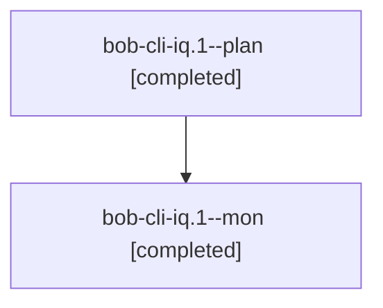

# Session: bob-cli-iq.1

[Agent Hoods](../README.md) / [bbugyi200](../users/bbugyi200/README.md) / [apollo](../users/bbugyi200/machines/apollo/README.md) / [bob-cli-iq](../users/bbugyi200/machines/apollo/hoods/bob-cli-iq/README.md) / bob-cli-iq.1

Owner: `bbugyi200.apollo` · Hood: `bob-cli-iq` · Members: 2 · Bead: [bob-cli-iq.1](https://github.com/bobs-org/bob-cli--beads/blob/main/pages/bob-cli-iq/bob-cli-iq.1.md)

## Lineage

The diagram is an optional enhancement; the ordered table below contains the same lineage in accessible text.

| Role | Agent | State | Model / provider | Timing | Commits | Prompt | Chat |
|---|---|---|---|---|---:|---|---|
| plan | bob-cli-iq.1--plan | completed | gpt-6-luna / codex | 2026-11-08T15:41:55.738756+00:00 → 2026-11-08T16:02:01.904152+00:00 | 0 | [Prompt](../agents/bbugyi200.apollo.bob-cli-iq.1--plan/prompt.md) | [Chat](../agents/bbugyi200.apollo.bob-cli-iq.1--plan/chat.md) |
| mon | bob-cli-iq.1--mon | completed | gpt-6-luna / codex | 2026-11-08T15:59:56.042145+00:00 → 2026-11-08T16:02:11.658009+00:00 | 0 | — | [Chat](../agents/bbugyi200.apollo.bob-cli-iq.1--mon/chat.md) |

## Neighbors

| Agent | Relation | State |
|---|---|---|
| [bob-cli-iq.2](../agents/bbugyi200.apollo.bob-cli-iq.2/README.md) | bob-cli-iq hood | completed |
| [bob-cli-iq.3](../agents/bbugyi200.apollo.bob-cli-iq.3/README.md) | bob-cli-iq hood | completed |
| [bob-cli-iq.4](../agents/bbugyi200.apollo.bob-cli-iq.4/README.md) | bob-cli-iq hood | waiting |
| [bob-cli-iq.5](../agents/bbugyi200.apollo.bob-cli-iq.5/README.md) | bob-cli-iq hood | waiting |
| [bob-cli-iq.6](../agents/bbugyi200.apollo.bob-cli-iq.6/README.md) | bob-cli-iq hood | waiting |
| [bob-cli-iq.land](../agents/bbugyi200.apollo.bob-cli-iq.land/README.md) | bob-cli-iq hood | waiting |
