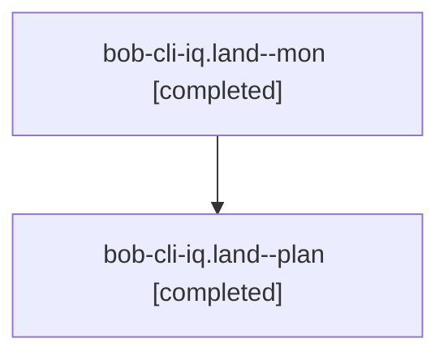

# Session: bob-cli-iq.land

[Agent Hoods](../README.md) / [bbugyi200](../users/bbugyi200/README.md) / [apollo](../users/bbugyi200/machines/apollo/README.md) / [bob-cli-iq](../users/bbugyi200/machines/apollo/hoods/bob-cli-iq/README.md) / bob-cli-iq.land

Owner: `bbugyi200.apollo` · Hood: `bob-cli-iq` · Members: 2 · Bead: [bob-cli-iq](https://github.com/bobs-org/bob-cli--beads/blob/main/pages/bob-cli-iq/README.md)

## Lineage

The diagram is an optional enhancement; the ordered table below contains the same lineage in accessible text.

| Role | Agent | State | Model / provider | Timing | Commits | Prompt | Chat |
|---|---|---|---|---|---:|---|---|
| mon | bob-cli-iq.land--mon | completed | opus / claude | 2026-11-08T17:47:23.930869+00:00 → 2026-11-08T17:49:37.776037+00:00 | 0 | — | [Chat](../agents/bbugyi200.apollo.bob-cli-iq.land--mon/chat.md) |
| plan | bob-cli-iq.land--plan | completed | opus / claude | 2026-11-08T17:23:50.831535+00:00 → 2026-11-08T17:49:34.504726+00:00 | 0 | [Prompt](../agents/bbugyi200.apollo.bob-cli-iq.land--plan/prompt.md) | [Chat](../agents/bbugyi200.apollo.bob-cli-iq.land--plan/chat.md) |

## Neighbors

| Agent | Relation | State |
|---|---|---|
| [bob-cli-iq.1](bbugyi200.apollo.bob-cli-iq.1.md) (session · 2) | bob-cli-iq hood | completed 2 |
| [bob-cli-iq.2](../agents/bbugyi200.apollo.bob-cli-iq.2/README.md) | bob-cli-iq hood | completed |
| [bob-cli-iq.3](../agents/bbugyi200.apollo.bob-cli-iq.3/README.md) | bob-cli-iq hood | completed |
| [bob-cli-iq.4](../agents/bbugyi200.apollo.bob-cli-iq.4/README.md) | bob-cli-iq hood | completed |
| [bob-cli-iq.5](../agents/bbugyi200.apollo.bob-cli-iq.5/README.md) | bob-cli-iq hood | completed |
| [bob-cli-iq.6](../agents/bbugyi200.apollo.bob-cli-iq.6/README.md) | bob-cli-iq hood | completed |
