# Session: bob-cli-is.2

[Agent Hoods](../README.md) / [bbugyi200](../users/bbugyi200/README.md) / [apollo](../users/bbugyi200/machines/apollo/README.md) / [bob-cli-is](../users/bbugyi200/machines/apollo/hoods/bob-cli-is/README.md) / bob-cli-is.2

Owner: `bbugyi200.apollo` · Hood: `bob-cli-is` · Members: 13 · Bead: [bob-cli-is.2](https://github.com/bobs-org/bob-cli--beads/blob/main/pages/bob-cli-is/bob-cli-is.2.md)

## Lineage

```mermaid
flowchart TD
  n0["bob-cli-is.2--plan [completed]"]
  n1["bob-cli-is.2--mon-1 [failed]"]
  n0 --> n1
  n2["bob-cli-is.2--4 [completed]"]
  n0 --> n2
  n3["bob-cli-is.2--mon-4 [completed]"]
  n0 --> n3
  n4["bob-cli-is.2--5 [completed]"]
  n0 --> n4
  n5["bob-cli-is.2--mon-2 [failed]"]
  n0 --> n5
  n6["bob-cli-is.2--3 [completed]"]
  n0 --> n6
  n7["bob-cli-is.2--1 [completed]"]
  n0 --> n7
  n8["bob-cli-is.2--2 [completed]"]
  n0 --> n8
  n9["bob-cli-is.2--mon-3 [failed]"]
  n0 --> n9
  n10["bob-cli-is.2--mon-0 [failed]"]
  n0 --> n10
  n11["bob-cli-is.2--6 [completed]"]
  n0 --> n11
  n12["bob-cli-is.2--mon [failed]"]
  n0 --> n12
```

The diagram is an optional enhancement; the ordered table below contains the same lineage in accessible text.

| Role | Agent | State | Model / provider | Timing | Commits | Prompt | Chat |
|---|---|---|---|---|---:|---|---|
| plan | bob-cli-is.2--plan | completed | gpt-6-luna / codex | 2026-11-08T16:44:08.567240+00:00 → 2026-11-08T17:40:21.998752+00:00 | 0 | [Prompt](../agents/bbugyi200.apollo.bob-cli-is.2--plan/prompt.md) | [Chat](../agents/bbugyi200.apollo.bob-cli-is.2--plan/chat.md) |
| mon-1 | bob-cli-is.2--mon-1 | failed | gpt-6-luna / codex | 2026-11-08T18:30:38.892472+00:00 → 2026-11-08T18:45:41.757010+00:00 | 0 | — | [Chat](../agents/bbugyi200.apollo.bob-cli-is.2--mon-1/chat.md) |
| 4 | bob-cli-is.2--4 | completed | gpt-6-luna / codex | 2026-11-08T19:14:34.736693+00:00 → 2026-11-08T19:23:34.156775+00:00 | 0 | [Prompt](../agents/bbugyi200.apollo.bob-cli-is.2--4/prompt.md) | [Chat](../agents/bbugyi200.apollo.bob-cli-is.2--4/chat.md) |
| mon-4 | bob-cli-is.2--mon-4 | completed | grok-4.6 / grok | 2026-11-08T19:48:56.178583+00:00 → 2026-11-08T20:12:16.104292+00:00 | 0 | — | [Chat](../agents/bbugyi200.apollo.bob-cli-is.2--mon-4/chat.md) |
| 5 | bob-cli-is.2--5 | completed | grok-4.6 / grok | 2026-11-08T19:38:52.235965+00:00 → 2026-11-08T19:49:44.268838+00:00 | 0 | [Prompt](../agents/bbugyi200.apollo.bob-cli-is.2--5/prompt.md) | [Chat](../agents/bbugyi200.apollo.bob-cli-is.2--5/chat.md) |
| mon-2 | bob-cli-is.2--mon-2 | failed | gpt-6-luna / codex | 2026-11-08T18:56:56.310336+00:00 → 2026-11-08T19:14:34.963771+00:00 | 0 | — | [Chat](../agents/bbugyi200.apollo.bob-cli-is.2--mon-2/chat.md) |
| 3 | bob-cli-is.2--3 | completed | gpt-6-luna / codex | 2026-11-08T18:45:41.629717+00:00 → 2026-11-08T18:58:05.369543+00:00 | 0 | [Prompt](../agents/bbugyi200.apollo.bob-cli-is.2--3/prompt.md) | [Chat](../agents/bbugyi200.apollo.bob-cli-is.2--3/chat.md) |
| 1 | bob-cli-is.2--1 | completed | gpt-6-luna / codex | 2026-11-08T17:58:14.856336+00:00 → 2026-11-08T18:06:46.442223+00:00 | 0 | [Prompt](../agents/bbugyi200.apollo.bob-cli-is.2--1/prompt.md) | [Chat](../agents/bbugyi200.apollo.bob-cli-is.2--1/chat.md) |
| 2 | bob-cli-is.2--2 | completed | gpt-6-luna / codex | 2026-11-08T18:23:36.459884+00:00 → 2026-11-08T18:31:25.577601+00:00 | 0 | [Prompt](../agents/bbugyi200.apollo.bob-cli-is.2--2/prompt.md) | [Chat](../agents/bbugyi200.apollo.bob-cli-is.2--2/chat.md) |
| mon-3 | bob-cli-is.2--mon-3 | failed | gpt-6-luna / codex | 2026-11-08T19:22:35.336745+00:00 → 2026-11-08T19:38:52.394083+00:00 | 0 | — | [Chat](../agents/bbugyi200.apollo.bob-cli-is.2--mon-3/chat.md) |
| mon-0 | bob-cli-is.2--mon-0 | failed | gpt-6-luna / codex | 2026-11-08T18:05:53.299695+00:00 → 2026-11-08T18:23:36.799698+00:00 | 0 | — | [Chat](../agents/bbugyi200.apollo.bob-cli-is.2--mon-0/chat.md) |
| 6 | bob-cli-is.2--6 | completed | grok-4.6 / grok | 2026-11-08T20:12:16.069947+00:00 → 2026-11-08T20:17:10.466547+00:00 | 0 | [Prompt](../agents/bbugyi200.apollo.bob-cli-is.2--6/prompt.md) | [Chat](../agents/bbugyi200.apollo.bob-cli-is.2--6/chat.md) |
| mon | bob-cli-is.2--mon | failed | gpt-6-luna / codex | 2026-11-08T17:38:48.980185+00:00 → 2026-11-08T17:58:15.108278+00:00 | 0 | — | [Chat](../agents/bbugyi200.apollo.bob-cli-is.2--mon/chat.md) |

## Neighbors

| Agent | Relation | State |
|---|---|---|
| [bob-cli-is.1](../agents/bbugyi200.apollo.bob-cli-is.1/README.md) | bob-cli-is hood | completed |
| [bob-cli-is.3](bbugyi200.apollo.bob-cli-is.3.md) (session · 11) | bob-cli-is hood | completed 8, failed 3 |
| [bob-cli-is.3](../agents/bbugyi200.apollo.bob-cli-is.3/README.md) | bob-cli-is hood | completed |
| [bob-cli-is.land](bbugyi200.apollo.bob-cli-is.land.md) (session · 3) | bob-cli-is hood | completed 3 |
